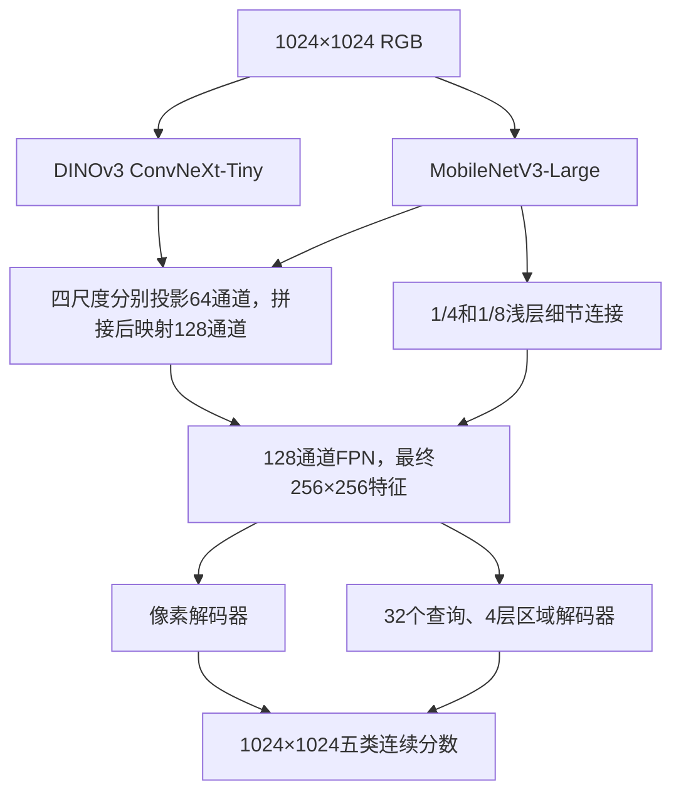

# LuSNAR：DINOv3 ConvNeXt-Tiny + MobileNetV3-Large

两条 CNN 同时接收同一张 **1024×1024 RGB 图像**。提供像素解码和区域解码两套可训练模型，原始训练集、验证集与评估口径保持一致。编码器没有 ViT；区域解码器含注意力。

## 当前最佳完整测试（2026-11-12）

当前已完成测试中，最高加权 S 来自 **`dual_region_random80_1024` 第 29 轮最佳检查点 + 1024／768 双尺度等权水平翻转 TTA（4 视图）**。该检查点由 1601 张自定义验证图选出，随后在完整 Moon_2/4/9 的 **5004 张**图像上评估。下列方式使用同一模型检查点，均未调整任何类别分数。

| 指标 | 1024 单视图 | 1024 翻转（2 视图） | 1024＋768 等权翻转（4 视图） | 1024＋768＋512 等权翻转（6 视图） | 1024／768 加权 0.75／0.25（4 视图） |
|---|---:|---:|---:|---:|---:|
| Moon_2 mIoU | 93.6594% | 93.6525% | 93.5843% | 93.1457% | 93.7796% |
| Moon_4 mIoU | 93.4588% | 93.5798% | 93.3560% | 92.5597% | 93.6968% |
| Moon_9 mIoU | 84.9600% | 85.2437% | 86.0030% | 85.6944% | 85.5754% |
| **加权 S** | **89.2595%** | **89.4299%** | **89.7366%** | **89.2735%** | **89.6568%** |

`S=(Moon_2 mIoU + Moon_4 mIoU + 2×Moon_9 mIoU)/4`。等权双尺度比原 1024 翻转提高 **0.3066 个百分点**；继续加入 512 尺度反而下降。等权双尺度的 Moon_9 撞击坑 IoU 为 **57.6963%**，召回率为 **63.1540%**，漏检仍需改善。前一轮按用户要求直接在测试集比较新增等权 TTA，最高测试分不代表该模式已经由独立验证集选定；最佳训练轮次仍由自定义验证集决定。

后续在完整自定义验证集比较 1024 权重 `1、0.75、0.5`，验证 mIoU 分别为 **97.5166%、97.7806%、97.6754%**，因此统一选择 **0.75／0.25** 后才运行其完整测试。相对等权双尺度，该方案的 Moon_2／Moon_4 分别提高 **0.1954／0.3408 个百分点**，Moon_9 下降 **0.4275 个百分点**，但仍比纯 1024 翻转高 **0.3317 个百分点**。加权 S 为 **89.6568%**，比等权双尺度低 **0.0797 个百分点**：本次部分保留 Moon_9 收益并改善其他场景，尚未超过已观察到的最高 S。验证所选方案与已测最高 S 分开记录，未按测试结果回改验证推荐。

[加权 TTA 验证及测试分析](result/weighted_tta_analysis/report_zh.md) · [0.75／0.25 完整测试指标](result/dual_region_random80_1024/test_multiscale_hflip_1024_768_weights_0p75_0p25_metrics.json)

[多尺度完整分析](result/multiscale_tta_analysis/report_zh.md) · [4 视图指标](result/dual_region_random80_1024/test_multiscale_hflip_1024_768_metrics.json) · [6 视图指标](result/dual_region_random80_1024/test_multiscale_hflip_1024_768_512_metrics.json) · [原单尺度与旧模型对照](result/random80_analysis/report_zh.md)

本地检查点：`result/dual_region_random80_1024/best.pt`。复现 TTA 测试：

```bash
python code/evaluate.py --checkpoint result/dual_region_random80_1024/best.pt \
  --split test --tta multiscale_hflip --tta-sizes 1024 768 --device cuda:3
```

## 当前最高测试 S 方案的逐类别结果

下表固定使用 **第 29 轮最佳检查点＋1024／768 等权翻转 TTA（4 视图）**，山体与撞击坑类别系数均为 1。验证集为完整自定义 **1601 张**，该方案验证 mIoU 为 **97.6754%**；**97.5166%** 属于 1024 翻转方案，验证最佳 **97.7806%** 属于 0.75／0.25 加权方案，均不用于下表。

完整测试共 **5004 张**：Moon_2 **1597 张**、Moon_4 **1320 张**、Moon_9 **2087 张**。各指标由对应集合全部像素的混淆矩阵计算，单位为百分比；未定义值显示“—”。

| 集合 | 类别 | IoU | 精确率（Precision） | 召回率（Recall） |
|---|---|---:|---:|---:|
| 自定义验证 | 月壤 | 99.7335% | 99.9054% | 99.8278% |
| 自定义验证 | 岩石 | 93.6351% | 95.6400% | 97.8103% |
| 自定义验证 | 撞击坑 | 97.1039% | 98.4197% | 98.6419% |
| 自定义验证 | 山体 | 98.0765% | 98.9021% | 99.1560% |
| 自定义验证 | 天空 | 99.8280% | 99.9280% | 99.8998% |
| Moon_2 | 月壤 | 99.3448% | 99.6305% | 99.7122% |
| Moon_2 | 岩石 | 88.5927% | 93.6012% | 94.3042% |
| Moon_2 | 撞击坑 | 84.4451% | 98.7426% | 85.3630% |
| Moon_2 | 山体 | 95.7331% | 96.6129% | 99.0577% |
| Moon_2 | 天空 | 99.8057% | 99.9199% | 99.8856% |
| Moon_4 | 月壤 | 99.1773% | 99.4084% | 99.7662% |
| Moon_4 | 岩石 | 88.9764% | 94.6789% | 93.6600% |
| Moon_4 | 撞击坑 | 81.0743% | 97.6799% | 82.6662% |
| Moon_4 | 山体 | 97.7858% | 98.6177% | 99.1447% |
| Moon_4 | 天空 | 99.7663% | 99.9167% | 99.8494% |
| Moon_9 | 月壤 | 98.1101% | 98.8883% | 99.2042% |
| Moon_9 | 岩石 | 84.3132% | 92.6065% | 90.3983% |
| Moon_9 | 撞击坑 | 57.6963% | 86.9729% | 63.1540% |
| Moon_9 | 山体 | 90.2741% | 91.9292% | 98.0447% |
| Moon_9 | 天空 | 99.6212% | 99.7722% | 99.8482% |

来源：[完整测试逐场景指标](result/dual_region_random80_1024/test_multiscale_hflip_1024_768_metrics.json)；[完整验证权重扫描](result/dual_region_random80_1024/val_multiscale_hflip_1024_768_weight_sweep_metrics.json)中 `weight_1024=0.5` 候选的 `metrics`。

## 文件结构

```text
fenge/
├── model/       # 两个预训练骨干、来源和 SHA256
├── code/        # 网络、损失、数据读取、训练、评估、推理和运行检查
├── result/      # 训练检查点、逐轮指标、评估和预测输出
├── config/      # 可直接传给训练入口的 JSON 配置
└── README.md
```

## 环境

使用现有环境，不需要重新创建环境：

```bash
conda activate lzc_fenge
cd /home/lzc/workspace/fenge
```

该环境的 Python 为 `/home/vrlab/miniconda3/envs/lzc_fenge/bin/python`。代码兼容其中的 PyTorch 2.1.1+cu121、torchvision 0.16.1、timm 1.0.30，不依赖 transformers。依赖清单在 `code/requirements.txt`，已有依赖无需重复安装。

## 网络



ConvNeXt 四尺度通道为 96/192/384/768。MobileNet 对应特征通道为 24/40/112/960，步长均为 4/8/16/32。两条分支都完整处理 1024 图像，不使用分类预处理中的 224 中心裁剪。输入只做 RGB 转换、同步几何增强和 ImageNet 均值标准差归一化。

区域头联合预测每个查询的五类加 `no-object` 分类，以及 256×256 掩码；类别概率和掩码概率组合为五类语义分数，再将连续分数插值到标签尺寸，最后 argmax。区域注意力读取多尺度特征，保留 1/4 掩码细节。

本任务使用语义标注：每个实际出现的类别提供一张目标掩码，通过 Hungarian 匹配监督查询。一个语义掩码允许多个不连通部分，也允许岩石遮挡形成孔洞；不额外填孔，不将语义标签虚构为实例标注。区域损失包含分类、掩码 BCE/Dice、各解码层辅助监督和最终语义监督；像素头使用语义 CE/Dice。小类别的匹配采样直接来自原尺寸标签，避免先缩小 GT 后丢失细小岩石。

## 预训练权重

运行权重下载入口：

```bash
python code/download_weights.py
```

ConvNeXt 使用 [timm 维护者发布的 DINOv3 LVD1689M 权重](https://huggingface.co/timm/convnext_tiny.dinov3_lvd1689m)，MobileNet 使用 [torchvision ImageNet1K V2](https://docs.pytorch.org/vision/stable/models/generated/torchvision.models.mobilenet_v3_large.html)。下载来源与文件哈希记录在 `model/manifest.json`。模型构建只读取本地文件；缺失或不匹配的权重会报错，不会自动改成随机初始化或下载 ViT。

预训练权重和训练检查点（如 `best.pt`、`last.pt`）保留在本地，Git 忽略这些大文件。版本库保存下载代码、配置、权重来源清单及 SHA256，以及可复核的训练和评估指标；在其他机器上运行下载入口并核对哈希即可恢复相同预训练文件。训练检查点的实际 SHA256 会记录在完整评估及分析结果中，用于确认每份成绩对应的模型。

实现依据：[DINOv3 ConvNeXt 官方实现](https://github.com/facebookresearch/dinov3/blob/main/dinov3/models/convnext.py)、[MobileNetV3 官方实现](https://github.com/pytorch/vision/blob/v0.16.1/torchvision/models/mobilenetv3.py)。

## 数据划分与标签

原数据清单：`/media/nas/lzc/fenge/baseline_segformer_20261026/manifest.json`。

| 用途 | 场景 | 图像数 |
|---|---|---:|
| 训练 | Moon_1、Moon_3、Moon_6、Moon_7、Moon_8 | 6403 |
| 验证、选轮 | Moon_5 | 1599 |
| 最终测试 | Moon_2、Moon_4、Moon_9 | 5004 |

输入读取清单的 `image` 并转 RGB，训练标签读取 `mask` 的单通道 ID。类别固定为 `0 月壤、1 岩石、2 撞击坑、3 山体、4 天空`。原始 `label` 的 P 模式调色板索引不等于这些类别 ID，不能直接作为训练标签。

增强清单：`/media/nas/lzc/lusnar_augmentation/lusnar_gt_context_6000_20261110/manifest.json`。`crater`、`mountain_rock`、`mixed` 各 2000 张，均来自训练场景，额外读取相对路径 `image/mask` 和 `primary_group`。6000 个裁剪来自 2872 个原图，不是 6000 个独立场景，不能随机拆入验证集。

### 自定义随机 4:1 划分

新增保存清单为 `result/selections/random80_seed42_20261112.json`。按用户选择，仅合并旧训练场景和 Moon_5 的 **8002 张原始图**，不纳入 Moon_2/4/9。先按来源 ID 排序，以 seed 42 完整打乱，前 `floor(8002×4/5)=6401` 张作为原图训练集，余下 1601 张作为验证集；字面顺序、源文件哈希及抽选算法均已保存，读取和续训不重新划分。

| 用途 | 原始图 | 大坑增强 | 山体增强 | 总数 |
|---|---:|---:|---:|---:|
| 自定义训练 | 6401 | 1500 | 1500 | **9401** |
| 自定义验证 | 1601 | 0 | 0 | **1601** |
| Moon_2/4/9 测试 | 5004 | 0 | 0 | **5004** |

4:1 比例作用于原始图，增强随后追加到训练集。原图和其所有增强版本作为同一来源管理，增强只允许来自新的 6401 个训练来源。新验证来源对应的大坑增强 372 张、山体增强 375 张全部排除；剩余候选分别为 1628、1625 张，再以同一 RNG 各无放回抽取 1500 张，组合训练列表最后再次打乱。验证集不包含增强图，训练／验证来源交集为空；没有用增强图凑验证数量。

构建与独立核验均使用现有入口：

```bash
python code/select_training_data.py --mode random-split --seed 42 \
  --output result/selections/random80_seed42_20261112.json
python code/verify.py --split-only \
  --split-manifest result/selections/random80_seed42_20261112.json \
  --output result/random_split_verification.json
```

清单 SHA256 为 `29da57bc3a846e5ae38ba8bd55919e8813f3da954695ffa53552d2e4094e7187`。构建时已只读核验全部 **11002 张训练／验证 ID 标签**的 L 模式与 0–4 范围。独立核验还重演 seed 抽选、逐条核对来源和顺序、检查泄漏／重复／篡改拒绝，并按 split×scene×group 实读 21 对图像与标签；报告见 [random_split_verification.json](result/random_split_verification.json)。图片仍引用 NAS 原文件，不另复制数据。

新训练配置为 `config/dual_region_random80_1024.json`，其 manifest 已完整包含原图和增强图，因此不再叠加旧的 `selection_manifest` 或其他 `augmented_manifest`。训练选轮使用全部 1601 张自定义验证图的汇总混淆矩阵 mIoU，标记 `custom_validation`。`evaluate.py --split val` 默认读取检查点保存的验证清单；`--split test` 仍读取完整 Moon_2/4/9。

已按要求停止原两组训练并完成各最佳权重的两种完整测试。当前原损失组最佳为第 10 轮、困难像素组最佳为第 7 轮；四个历史检查点的全部 8 份成绩使用相同的 5004 张标签与评分公式，逐份核对了检查点 SHA256。

| 最佳检查点 | 单视图 S | 水平翻转 TTA S |
|---|---:|---:|
| 最初单视图组，第 5 轮 | 87.0732% | 87.2468% |
| 上一轮 TTA 组，第 12 轮 | 88.2424% | 88.3044% |
| 本轮原损失对照，第 10 轮 | 88.1130% | **88.3678%** |
| 本轮困难像素辅助，第 7 轮 | 87.5780% | 87.8410% |

因此新随机划分采用原损失方案（`hard_pixel_weight=0`）和 hflip 验证，保留 1024、batch 8、seed 42、原学习率／冻结计划，从原始预训练重新训练。方案选择清单为 `result/selections/random80_selected_recipe_20261112.json`，包含所有候选结果、选中权重与测试结果 SHA256，以及新划分哈希和实际训练参数。旧最佳分割权重见过新验证集中的部分原图，原始预训练初始化可避免这部分监督历史重叠。

```bash
python code/train.py --config config/dual_region_random80_1024.json --device cuda:3
python code/monitor_experiments.py --config config/early_stopping_random80.json
python code/publish_results.py --config config/early_stopping_random80.json
```

新结果目录为 `result/dual_region_random80_1024/`；独立监控保存在 `result/random80_monitor/`。仍按完整验证集连续 5 轮没有增加 0.05 个百分点早停，结束后自动测试新最佳检查点的 none／hflip 两种完整 Moon_2/4/9，分析写入 `result/random80_analysis/` 并自动提交推送。新旧测试按相同 TTA 分别比较，图像、权重和验证划分的来源都保留在记录中。

新训练于 **2026-11-12 01:38（北京时间）**在 GPU 3 启动，已完成 **30 轮**，使用完整 9401／1601 清单。初始化哈希与选中参考实验的原始预训练起点完全一致；核对记录为 `result/random80_monitor/startup_check.json`。最佳检查点为 **第 29 轮**，自定义验证集 mIoU 为 **97.5166%**。监控曾因混淆“历史测试参与方案选择”与“测试参与选轮”的元数据校验退出，现已修复并恢复测试；失败及恢复记录保留在 `result/random80_monitor/state.json`。历史回放显示早停规则会在第 29 轮触发，但实际训练完成了 30 轮，不能将其记为已经执行早停。

第 29 轮权重在 GPU 3 完成全部 **5004 张** Moon_2/4/9 的水平翻转 TTA 测试，相同 TTA 下与旧参考对比如下：

| 指标 | 旧参考，第 10 轮 | 新随机划分，第 29 轮 | 变化（百分点） |
|---|---:|---:|---:|
| Moon_2 mIoU | 92.6765% | 93.6525% | +0.9760 |
| Moon_4 mIoU | 91.6236% | 93.5798% | +1.9561 |
| Moon_9 mIoU | 84.5855% | 85.2437% | +0.6582 |
| 加权 S | 88.3678% | **89.4299%** | **+1.0621** |

三个场景总体都有提升，但 Moon_9 撞击坑 IoU 从 **63.5995% 降至 57.1909%**，召回率从 75.6512% 降至 64.8485%；该场景山体和岩石 IoU 分别提高 6.2071、3.2715 个百分点。总分提升不能解释为所有类别都改善。完整数值见 [TTA 测试结果](result/dual_region_random80_1024/test_hflip_metrics.json)，相同权重的单视图结果及逐类对照见 [分析报告](result/random80_analysis/report_zh.md)。

新划分允许同一场景出现在训练和验证中，与原先整场景留出 Moon_5 的口径不同，新旧验证 mIoU 不能直接作为提升对比。本轮按用户要求使用 Moon_2/4/9 的结果选择训练方案，后续在这三个场景上的结果属于同一已查看测试集上的对照；相关选择依据会保存在运行记录中。

## 训练与断点续训

以下保留上一轮固定 **8000 张训练图**的复现说明：5000 张原始图、1500 张 `mountain_rock` 山岩交界增强、1500 张 `crater` 大坑增强。其 Moon_5 完整 1599 张用于每轮评估与选轮。实际 **batch size 8、累积 1**，有效 batch 也是 8。当前随机 4:1 实验使用上节的 9401／1601 清单与独立配置。

先生成并保存抽样清单：

```bash
python code/select_training_data.py --config config/train_selection_8000.json
```

清单位于 `result/selections/train8000_seed42_20261111.json`，保存全部有序样本、seed 42、分组数量、来源清单 SHA256、抽样算法和代码 SHA。每组无放回抽样；8000 个条目来自 5492 个原始来源。重新运行相同选择会保留已有清单及哈希；更换种子或配比必须指定新的输出文件，不覆盖旧选择。训练和续训直接重放保存清单，不重新随机选择。每轮只打乱训练顺序，训练样本集合固定。

两个并行实验共享同一份选择、初始化和训练设置，区别是验证是否使用水平翻转 TTA：

| 配置 | 每轮 Moon_5 评估 | 结果目录 | 本次显卡 |
|---|---|---|---|
| `config/dual_region_augmented_1024.json` | 原图单视图 | `result/dual_region_balanced8000_bs8` | GPU 3 |
| `config/dual_region_augmented_tta_1024.json` | 原图＋水平翻转，2 视图 | `result/dual_region_balanced8000_bs8_tta` | GPU 4 |

无 TTA 组已按要求在完成第 9 轮后停止，第 10 轮未完成部分不计入完成轮数；最佳检查点为第 5 轮，完整 Moon_5 mIoU 为 87.7176%。已在 GPU 3 完成其完整 Moon_2/4/9 的 `none`、`hflip` 测试，各 5004 张，两次均未保存图片。单视图加权 S 为 **87.0732%**，同一权重加水平翻转 TTA 后为 **87.2468%**；逐场景、逐类结果及混淆分析见 [测试分析](result/dual_region_balanced8000_bs8/test_comparison_zh.md)。

TTA 训练组也已按要求在完成第 14 轮后停止，最佳第 12 轮 Moon_5 mIoU 为 **88.4815%**。已在 GPU 4 完成其两种完整测试：单视图 S 为 **88.2424%**，翻转 TTA S 为 **88.3044%**。同一检查点的 TTA 增益为 0.0620 个百分点；两组不同检查点之间的增益不能全部归因于 TTA。四次完整测试、逐类混淆矩阵和曲线见 [两组完整分析](result/analysis/report_zh.md)，流程与发布记录位于 `result/experiment_monitor/`。

重新开展同配置实验时，在两个终端分别运行，并为新实验指定新的结果目录：

```bash
python code/train.py --config config/dual_region_augmented_1024.json --output result/dual_region_balanced8000_bs8_new --device cuda:3
python code/train.py --config config/dual_region_augmented_tta_1024.json --output result/dual_region_balanced8000_bs8_tta_new --device cuda:4
```

两组均为 1024 输入、最多 30 轮；外部监控满足早停条件时提前结束。前 3 轮冻结两个 CNN、只训练融合和解码，从第 4 轮开始两个骨干一起微调。头部学习率 `1e-4`，骨干学习率 `1e-5`。冻结阶段同时冻结 MobileNet 的 BN 运行统计。训练使用一次前向和原有水平翻转增强；TTA 作用于评估和推理，不加进训练损失。

需选择显卡时使用 `--device cuda:2` 等参数。每个实验用独立的 `result` 子目录，保存 `run_config.json`、`history.jsonl`、逐轮验证指标、`last.pt` 和验证选出的 `best.pt`。续训保持原配置和训练轮数计划：

```bash
python code/train.py --config config/dual_region_augmented_1024.json --resume result/dual_region_balanced8000_bs8/last.pt --device cuda:3
python code/train.py --config config/dual_region_augmented_tta_1024.json --resume result/dual_region_balanced8000_bs8_tta/last.pt --device cuda:4
```

若需迁移已有最佳模型的 ConvNeXt，可传 `--convnext-checkpoint /media/nas/lzc/lusnar_visualizations/best_xiuzheng_finetune_gt_1_epoch8/source_model/model.safetensors`；只加载其中 `base.backbone.*`，不加载 ViT 或旧解码器。默认配置使用刚下载的原始 DINOv3 预训练。对照实验应使用相同骨干初始化来源。

`train_source` 可取 `original`、`augmented`、`combined`，`augmentation_groups` 限定候选组，`selection_manifest` 再指定实际使用的固定样本。保留的 `dual_pixel_1024.json`、`dual_region_1024.json` 是原始 6403 张数据基线配置；此前 `result/dual_region_1024/` 实验已按要求停止，已有检查点保留。

单 ConvNeXt 对照可用 `--backbone convnext` 并指定新的输出目录；其余配置保持一致。

### 困难像素完整训练对照

本轮从**原始 DINOv3 ConvNeXt-Tiny 和 ImageNet MobileNetV3-Large 预训练**重新训练两组，融合层和区域头以相同 seed 42 初始化；不从已有第 12 轮权重微调。两组固定使用上述同一份 8000 张训练清单、1024 整图、batch 8、累积 1、前 3 轮冻结骨干、最多 30 轮、相同学习率和 Moon_5 水平翻转 TTA 验证。只改变训练损失中的困难像素辅助权重，推理保留山体系数 α=1。

两组于 **2026-11-12 00:04（北京时间）**在 GPU 3/4 启动，现已按要求停止：原损失组完成 10 轮、最佳第 10 轮；困难像素组完成 9 轮、最佳第 7 轮。两份实际 `run_config.json` 仅输出目录及 λ 不同，初始全模型 SHA256 都是 `48afac5eac0038e6e4a0aa55b6c472a68cde716b0492943b9181c182687a2740`；核对记录在 `result/hard_pixel_monitor/initialization_check.json`。完整测试及分析已完成，见 `result/hard_pixel_analysis/`；新随机划分的方案选择结果见上节。

```bash
python code/train.py --config config/dual_region_augmented_tta_1024.json \
  --output result/dual_region_hardpixel_control_8000_bs8 --hard-pixel-weight 0 --device cuda:3
python code/train.py --config config/dual_region_augmented_tta_1024.json \
  --output result/dual_region_hardpixel_8000_bs8 --hard-pixel-weight 0.2 --hard-pixel-quota 256 --device cuda:4
```

实现直接扩展现有 `losses.py` 和 `train.py`，保留全部原有 CE、Dice、区域匹配和辅助层监督。当前 argmax 相对 GT 的六个混淆方向分别为：月壤→山体、山体→月壤、撞击坑→月壤、月壤→撞击坑、山体→岩石、岩石→山体。每张图、每个方向最多选 **256 个实际误分且 CE 最高的像素**，不额外裁图，也不把各方向候选合在一起竞争名额。

每个非空“图像×方向”计算所选 CE 均值，空方向贡献 0，再除以固定的 `batch×6`，得到 `L_hard`；最终 `L_total=L_existing+0.2×L_hard`。固定分母使已纠正的方向逐渐减少辅助损失，不会因剩余一个困难点而把整项重新放大。λ 是损失权重，不是增强数据比例；日志同时保存原损失、困难项原值、加权值和二者比值，以确认实际量纲。λ=0 时不执行困难选点，模型和原损失路径不变。

区域头的五类合成证据先归一化为 `p` 再取 `log(p)`；语义 CE 等价于 `-log(p_GT)`，Dice 的 softmax 恢复 `p`，辅助项直接使用同一语义输出。仅 argmax、方向筛选及 top-k 排序脱离梯度，所选原 CE 保留梯度并回传到区域类别、掩码及编码器；训练不使用 TTA 或山体分数压低。这借鉴 [HRNet 的 OHEM 语义分割损失](https://github.com/HRNet/HRNet-Semantic-Segmentation/blob/pytorch-v1.1/lib/core/criterion.py) 的在线困难点思想，六方向分别限额与固定归一化是本任务的适配。

每组 `run_config.json` 保存完整初始模型、两骨干和解码头的张量 SHA256，以及预训练文件来源哈希，用于确认两组从完全相同的状态开始。续训要求困难项权重和每方向限额与检查点一致，不能在同一历史中悄悄更换目标函数。

训练每 25 批更新 `hard_pixel_diagnostics_current.json`，逐轮保存 `hard_pixel_diagnostics_epoch_NNN.json`：各方向候选数、选中数、平均 CE、边界占比，以及每方向最多 8 个高损失训练样本的坐标。边界指 7×7 GT 邻域存在其他类别，默认只检查、不剔除。坐标同时保留训练图位置和撤销随机翻转、尺寸变换后的数据文件位置；增强样本的位置对应其增强文件，并记录来源原图 ID。高损失或处于边界本身不证明错标，需结合原图和 GT 审查，避免用验证或测试样本生成训练困难点。

已抽查第 1 轮第 275 批的启动快照（2200 张，`partial_epoch=true`）：选中点边界率 **73.53%**，候选点为 **21.60%**，表明最高 CE 选点明显偏向边界。六方向共 6 例、12 个点的原标签、翻转坐标和边界标记全部核对一致；实际图像未确认明显错标，但山体与岩石、月壤交界应继续按类别定义复核，不能将高损失直接当成标签错误。加权辅助损失约为原损失的 16.22%（该启动快照的累计值）。[启动检查 JSON](result/dual_region_hardpixel_8000_bs8/hard_pixel_startup_review.json) 保存统计与逐例观察，图库位于 `/home/lzc/workspace/fenge_result/dual_region_hardpixel_8000_bs8/training_diagnostics/`；这些诊断不代表完整验证精度。

CPU 损失与梯度验证使用现有入口 `python code/verify.py --hard-pixel-only`。GPU 的真实 1024、batch 8、全骨干解冻检查可使用 `python code/verify.py --device cuda:3 --size 1024 --batch-size 8 --decoder region --hard-pixel-weight 0.2 --output result/verification_hard_pixel_batch8.json`。

上述 CPU 检查已通过，包括 λ=0 与旧实现的损失、梯度、RNG 精确一致；真实 GPU 检查也已通过，两骨干梯度有限非零，峰值分配显存约 **19.67 GiB**，并完成优化器更新与检查点严格重载。对应报告为 `result/hard_pixel_verification.json` 和 `result/verification_hard_pixel_batch8.json`。

`config/early_stopping_monitor.json` 保留这两组已完成对照的监控配置，按完整 Moon_5 连续 5 轮没有增加 0.05 个百分点早停；结果与分析位于 `result/hard_pixel_monitor/`、`result/hard_pixel_analysis/`。当前随机实验使用单独的 `config/early_stopping_random80.json`，按自定义验证集的汇总 mIoU 判断。

## 外部 JSON 监控、早停与最终分析

监控不修改训练循环，通过已完成轮次的 JSON 指标决定早停。使用当前两个实验的配置启动：

```bash
python code/monitor_experiments.py --config config/early_stopping_monitor.json
```

只读查看当前早停计数和决定：

```bash
python code/monitor_experiments.py --config config/early_stopping_monitor.json --inspect
```

`--inspect` 只重放已完成验证，不写状态、不停止进程，也不启动测试。正常监控每 **5 秒**读取各实验 `summary.json` 的 `completed_epochs`，再读取这一边界内的 `validation_epoch_NNN.json`。训练入口在保存 `last.pt`、必要时保存 `best.pt` 之后才更新 summary，因此正在训练或尚未提交的轮次不计入早停。

当前策略在 [early_stopping_monitor.json](config/early_stopping_monitor.json) 中固定为：

| 参数 | 当前值 | 含义 |
|---|---:|---|
| `start_epoch` | 4 | 从骨干解冻后的第 4 轮完整验证开始判断 |
| `patience` | 5 | 连续 5 个有效轮次没有达到改善门槛时停止 |
| `min_delta` | 0.0005 | mIoU 至少增长 0.0005，即 **0.05 个百分点** |

第 4 轮分数建立参考值 anchor。后续分数达到 `anchor + min_delta` 时更新 anchor 并清零计数；小幅增长继续相对原 anchor 累计判断，不会因为某一轮略有增长就清零。监控启动或重启时会重放已经完成的轮次，避免丢掉已有等待计数。早停计数与最佳模型保存分别处理：`best.pt` 仍由完整 Moon_5 的任何严格 mIoU 新高决定，即使提升小于早停门槛也会保留。

两组独立判断并停止各自的训练进程，保留已完成验证记录和最佳检查点，`summary.json` 标记 `early_stopped`。当前监控总状态记录在 `result/hard_pixel_monitor/state.json`（上一轮为 `result/experiment_monitor/state.json`），每组的判断和评估进展记录在对应结果目录的 `early_stopping_monitor.json`。

每组停止或完成最多 30 轮之后，监控在该实验原 GPU 上用固定 `best.pt` 评估完整 **Moon_2/4/9，共 5004 张**。每个检查点分别运行 `none` 和 `hflip` 两种测试，共 **4 次完整评估**；同一实验的两个模式依次运行，不同实验可以各用自己的显卡推进。结果分别写为：

- `test_metrics.json`：原图单视角。
- `test_hflip_metrics.json`：原图加水平翻转，逆翻转连续类别概率后平均。

四份完整结果就绪后，监控调用分析入口，将中文报告、逐类指标、完整混淆矩阵、逐轮数据和训练验证曲线写入 `result/analysis/`。也可以手动重建分析：

```bash
python code/analyze_experiments.py \
  --run-off result/dual_region_balanced8000_bs8 \
  --run-on result/dual_region_balanced8000_bs8_tta \
  --output result/analysis
```

分析会核验完整测试数量、数据清单与检查点 SHA256、Moon_5 选轮以及混淆矩阵评分。运行尚未停止或完整结果缺失时会报错，不生成最终分析。不同实验选出的检查点可能不同，组间成绩变化不能全部归因于 TTA；每个固定检查点内部的 `none/hflip` 对照才隔离了本次推理视角的变化。最终测试完成之前，不将流程验证或中途 Moon_5 成绩当成新的完整测试结论。

后台发布入口会等待监控状态成为 `ready_to_publish`，再只提交本次两组实验记录、最终分析及对应监控记录，推送至 `origin main`：

```bash
python code/publish_results.py
```

上述不带参数入口保留上一轮发布目录。当前困难像素对照使用显式配置：`python code/publish_results.py --config config/early_stopping_monitor.json`，仅提交配置指定的两组结果、对应分析和监控文件，发布状态保存在 `result/hard_pixel_monitor/publication.json`。相同配置追加 `--once` 可在分析就绪后重试。

仅检查一次，结果未就绪时立即返回：

```bash
python code/publish_results.py --once
```

发布状态保存在 `result/experiment_monitor/publication.json`。如果推送失败，已创建的本地 commit 及错误记录会保留；完成 GitHub 登录后可再次运行 `--once` 重试推送。只有该状态记录为 `published` 才表示发布入口已成功推送，启动发布进程本身不代表远端发布成功。

## 评估和推理

验证集和最终测试评估分别运行：

```bash
python code/evaluate.py --checkpoint result/dual_region_balanced8000_bs8/best.pt --split val --tta none
python code/evaluate.py --checkpoint result/dual_region_balanced8000_bs8_tta/best.pt --split val --tta hflip
python code/evaluate.py --checkpoint result/dual_region_balanced8000_bs8_tta/best.pt --split test --tta hflip
```

TTA 开关：训练期评估使用 `--val-tta none|hflip`（配置键 `val_tta`）；独立评估和推理使用 `--tta none|hflip|multiscale_hflip`。`hflip` 是 **左右镜像**，保持上下方向及 1024×1024 尺寸，每张图使用原图和镜像图共两个视图。

1. 原图通过同一个完整模型，得到每个像素的五类概率 `P_original`。
2. 输入沿宽度翻转：`images.flip(-1)`。坐标 `(x, y)` 对应 `(1023-x, y)`，镜像图再次通过该模型。
3. 将镜像图的五类概率图也沿宽度翻转回来，使其与原图位置一一对应。
4. 两份概率各占 50%，计算 `P_final = (P_original + P_flip_back) / 2`，需要时将连续分数插值到目标尺寸，最后 `argmax` 得到类别。

实现见 [predict_semantic_scores](code/lunarseg/metrics.py)。概率在 float32 下平均，两次前向共享同一套模型权重。TTA 用于验证和推理；训练中的随机水平翻转由数据增强开关单独控制。当前第 29 轮检查点的同权重对照见 README 顶部。

多尺度模式通过 `--tta multiscale_hflip --tta-sizes 1024 768` 指定尺寸；再追加 `512` 即为三尺度。每个尺度均运行原图和水平翻转，因此两尺度为 4 个视图、三尺度为 6 个视图。各尺度都从同一 1024 输入以双线性、抗锯齿方式缩放，翻转预测先恢复方向，五类概率再以双线性插值恢复到 1024，最后对全部视图等权平均并 argmax。GT 保持原始 1024 尺寸，所有视图共享现有权重，山体系数保持 α=1。

本次尺寸为 **1024、768、512**，均直接进入两个 CNN，无需补边。可变尺寸入口仅用于 eval，训练入口仍检查配置尺寸。使用相同第 29 轮权重、在两张卡上分别复现完整 Moon_2/4/9：

```bash
CUDA_VISIBLE_DEVICES=3 python code/evaluate.py --config config/evaluate_random80_multiscale_1024_768.json
CUDA_VISIBLE_DEVICES=4 python code/evaluate.py --config config/evaluate_random80_multiscale_1024_768_512.json
```

两份配置均为 batch 2、BF16、完整 5004 张；结果在 `result/dual_region_random80_1024/` 下分别保存为 `test_multiscale_hflip_1024_768_metrics.json` 和 `test_multiscale_hflip_1024_768_512_metrics.json`，保留各视图尺寸、权重、检查点 SHA256 和逐场景混淆矩阵。不同尺度组合有独立文件名，不覆盖原有单尺度成绩。

两尺度还可显式设置 `--tta-weights 0.75 0.25`，对应 `P=0.75×P_1024+0.25×P_768`，每个尺度内部仍等权平均原图和水平翻转。权重必须非负、总和为 1，零权重尺度在固定方案推理时跳过；未传此参数时继续使用原有等权路径。

验证权重使用 `--tta-1024-weights 1 0.75 0.5`，固定 `--tta-sizes 1024 768`。三个候选共用每批四个视图，1.0 和 0.5 分别精确复现原 hflip 和等权双尺度；只按完整自定义验证集的总 mIoU 选一个全局权重，并列时优先更大 1024 权重。扫描不允许用测试集，也不与类别分数校准同时启用。

```bash
CUDA_VISIBLE_DEVICES=2 python code/evaluate.py --config config/evaluate_random80_tta_weight_sweep.json
```

权重扫描结果保存为 `result/dual_region_random80_1024/val_multiscale_hflip_1024_768_weight_sweep_metrics.json`。固定权重后可在独立评估或 `infer.py` 中传 `--tta multiscale_hflip --tta-sizes 1024 768 --tta-weights 0.75 0.25`；不同显式权重的评估和可选图片导出使用不同文件名。

本次第 29 轮检查点在完整 1601 张自定义验证图上的结果如下；各类别分数保持不变（山体 α=1、坑 γ=1）：

| 1024 权重 | 768 权重 | 验证 mIoU | 较纯 1024 / 百分点 |
|---:|---:|---:|---:|
| 1.00 | 0.00 | 97.5166% | 0.0000 |
| **0.75** | **0.25** | **97.7806%** | **+0.2639** |
| 0.50 | 0.50 | 97.6754% | +0.1587 |

验证集选出的统一权重是 **0.75／0.25**，六个验证场景也均以该候选的 mIoU 最高。0.75 相比 0.5 的总体验证 mIoU 提高 0.1052 个百分点。w=1 的整体及逐场景混淆矩阵与保存的第 29 轮验证完全一致；扫描共执行 3204 次前向，由三个候选共享。固定所选权重后，每张图四个视图的权重依次为 `0.375、0.375、0.125、0.125`（1024 原图、1024 翻转、768 原图、768 翻转）。

```bash
CUDA_VISIBLE_DEVICES=3 python code/evaluate.py --config config/evaluate_random80_weighted_1024_768.json
```

验证选择及所选权重的测试对照见 [加权 TTA 分析](result/weighted_tta_analysis/report_zh.md)。

评估先累计每个场景的像素混淆矩阵，再对 GT 实际出现的类别计算 mIoU。完整测试的加权分数为 `S=(Moon_2+Moon_4+2×Moon_9)/4`，不是单图 mIoU 的平均值，也不是官方平台提交分数。各实验的检查点均由验证集选轮；本次随机划分采用的训练方案参考了历史测试结果，选择依据和解释范围见前文。

### 坑分数校准：固定权重的验证集扫描

`--crater-gammas 1 1.03 1.06 1.10` 在一次验证集遍历中复用各批预测，仅将最终撞击坑（类别 2）分数乘以 γ，再重新 argmax。四个其他类别不变，山体系数固定 α=1。单视图 logits／log 概率采用 `+log(γ)`，TTA 平均概率采用 `×γ`；γ=1 原样返回原分数。固定系数推理和评估可用 `--crater-gamma`，与山体校准互斥。

本次扫描固定第 29 轮权重、**1024 水平翻转 TTA**、完整自定义验证集 **1601 张**，用于单独比较 γ；两尺度 TTA 的成绩另行报告，系数不直接跨推理设置套用：

```bash
CUDA_VISIBLE_DEVICES=2 python code/evaluate.py --config config/evaluate_random80_crater_sweep.json
```

输出 `result/dual_region_random80_1024/val_hflip_crater_sweep_metrics.json`。顶层保留 γ=1 基线，`crater_score_sweep.candidates` 保存每个 γ 的逐场景混淆矩阵、总 mIoU、坑 IoU／精确率／召回率、找回的漏坑和新增误检。共享诊断统计漏坑（及其中被判成月壤的部分）的坑分数排名、胜出分数与坑分数之差、两者比值，并保存最多 32 个带来源与坐标的示例像素。

只有完整验证集的总 mIoU 和坑 IoU 都提高时才推荐 γ，再按总 mIoU 最高选择，平分取较小 γ；否则保留 1。部分样本不能推荐系数，测试集不能执行系数扫描。每个候选 γ 对全部验证图统一应用，不按 Moon 场景单独选择。CPU 校准检查可运行 `python code/verify.py --crater-calibration-only`。

本次完整验证已完成，γ=1 的混淆矩阵与第 29 轮保存记录逐位一致。**三个放大系数均使总 mIoU 和坑 IoU 下降，保留 γ=1**：

| γ | 验证 mIoU | 坑 IoU | 找回坑像素 | 新增坑误检 |
|---|---:|---:|---:|---:|
| 1.00 | **97.5166%** | **97.0620%** | 0 | 0 |
| 1.03 | 97.5149% | 97.0538% | 5209 | 7294 |
| 1.06 | 97.5134% | 97.0462% | 10431 | 14462 |
| 1.10 | 97.5115% | 97.0371% | 17085 | 23461 |

被错分成月壤的 177116 个坑像素中，99.3106% 的坑分数排第二，但只有 9.3278% 的赢家／坑分数比不超过 1.10。γ=1.10 实际找回其中 16514 个像素，同时增加 22100 个真月壤上的坑误检。排名第二不意味着只需很小的分数增益；本次放大收益不足以抵消误检代价。[完整验证分析与诊断](result/crater_calibration_analysis/report_zh.md) 保存分数分布、候选结果和来源校验。

### 山体分数系数验证

现有 `evaluate.py` 支持 `--mountain-alphas 1 0.95 0.90 0.85 0.80`，只在 Moon_5 比较系数。每批只生成一次原有推理结果，再分别累计五组混淆矩阵；单视图每批一次前向，水平翻转 TTA 每批两次前向，不因系数数量增加模型前向次数。

```bash
python code/evaluate.py --checkpoint result/dual_region_balanced8000_bs8/best.pt \
  --split val --tta none --device cuda:3 --mountain-alphas 1 0.95 0.90 0.85 0.80
python code/evaluate.py --checkpoint result/dual_region_balanced8000_bs8_tta/best.pt \
  --split val --tta hflip --device cuda:4 --mountain-alphas 1 0.95 0.90 0.85 0.80
```

最终尺寸的五类连续概率仅修改 `S_mountain *= alpha`，其他四类不变，然后 argmax；不是“山体概率大于 alpha”的阈值。单视图内部保存 logits（区域头为 log 概率），实现用山体通道 `+ log(alpha)`，与乘概率再 argmax 等价；不能直接乘负 logit。TTA 已经输出平均概率，直接乘系数。所有图片共用同一个系数，α=1 保持原始分数。

结果默认保存为原实验目录的 `val_mountain_sweep_metrics.json` 或 `val_hflip_mountain_sweep_metrics.json`，顶层指标是 α=1 的参考值，`mountain_score_sweep.candidates` 包含每个系数的完整逐类指标、精确率/召回率、混淆矩阵，以及减少的山体误检和损失的正确山体像素数。额外统计 GT 山体面积占比在 0–1% 的图片中山体像素召回率；这是小面积图片的代理指标，不等同于真实小山实例统计。

只有完整 1599 张 Moon_5 才输出推荐：在山体 IoU 和总 mIoU 都提高的系数中选总 mIoU 最高者，相同分数优先较大的系数；没有同时改善则保留 1。推荐不会自动写入模型或配置，默认一直为 1。验证确定后，可在现有 `evaluate.py`、`infer.py` 命令添加 `--mountain-alpha 0.95` 等单个系数，并保存在结果元数据中。非 1 系数的评估指标和图片目录会附加系数，例如 `test_hflip_mountain_0p95`，避免覆盖原始结果；多系数扫描不导出图片，先选定一个系数再开启 `--save-images`。

仅检查分数缩放及单次前向复用逻辑，无需读取权重或数据：

```bash
python code/verify.py --calibration-only
```

检查覆盖负 logits、区域 log 概率、TTA 平均概率、插值后缩放、α=1 精确不变，以及两种解码输出下五系数扫描与独立评估一致性。报告位于 `result/calibration_verification.json`。

本次两组完整 Moon_5 已完成，α=1 均逐项复现历史最佳混淆矩阵。最终 TTA 组降低系数后总 mIoU 全部略降，应保留 **α=1（88.4815%）**；α=0.80 时山体 IoU 提高 0.4066 个百分点，但总 mIoU 降为 88.4336%。第一组单视图在 α=0.80 时由 87.7176% 小幅提高到 87.7906%。完整五系数表、逐类代价和小面积山体召回统计见 [山体分数验证分析](result/analysis/report_zh.md#moon_5-山体分数系数验证)。

### 可选保存评估图片

`evaluate.py` 默认不保存图片，需要逐图查看时开启 `--save-images`。常规两视角测试使用默认关闭选项；按后续要求，已额外完成一次无 TTA 组第 5 轮最佳权重的完整单视图图片导出。

当前最高测试 S 的等权四视图方案使用下面的配置，**每张仅保存三联图与 IoU JSON**：

```bash
CUDA_VISIBLE_DEVICES=3 python code/evaluate.py --config config/evaluate_random80_multiscale_save_images.json
```

该配置启用 `--save-images --image-output-mode comparison`，输出位于 `/home/lzc/workspace/fenge_result/dual_region_random80_1024/test_multiscale_hflip_1024_768/`。每个 `Moon_*/<sample_id>/` 目录仅有 `comparison.jpg` 和 `metrics.json`；三联图从左到右为原图、真值、预测，底部显示单图 mIoU 和五类 IoU。JSON 额外保留精确率、召回率及整数混淆矩阵，根目录的 `per_image_metrics.csv` 汇总全部单图 IoU，数值范围为 0–1。单图 mIoU 只平均该图 GT 出现的类别，未出现类别的 IoU 为 null、图中为 N/A；全测试和场景 mIoU 由累计像素混淆矩阵另行计算，不平均单图 mIoU。

保存图片的独立指标为 `result/dual_region_random80_1024/test_multiscale_hflip_1024_768_with_images_metrics.json`，保留原始不保存图片的结果。`comparison` 模式的复核依据是保存的逐图整数混淆矩阵，不声称能从有损 JPEG 重算像素标签。未指定 `--image-output-mode` 时仍为 `all`，保存下文的四个文件。

本次已完成 **5004 张** comparison 导出，所有样本目录均只有三联 JPG 和 IoU JSON。逐图矩阵加总后与原最高分测试的整体、Moon_2、Moon_4、Moon_9 整数矩阵逐项相同，S 保持 **89.7366%**；[全量复核摘要](result/dual_region_random80_1024/visual_analysis_multiscale_1024_768/summary.json)、[逐图指标 CSV](result/dual_region_random80_1024/visual_analysis_multiscale_1024_768/per_image_metrics.csv)、[精选案例清单](result/dual_region_random80_1024/visual_analysis_multiscale_1024_768/selected_cases.json) 已保存。三个场景共选出 16 个用于查看的案例，预览 JPG 位于 `/home/lzc/workspace/fenge_result/dual_region_random80_1024/visual_review_multiscale_1024_768/`；选例用于诊断，不代表随机抽样的错误发生率。

```bash
python code/evaluate.py \
  --checkpoint result/dual_region_balanced8000_bs8/best.pt \
  --split test --tta none --device cuda:3 \
  --output result/dual_region_balanced8000_bs8/test_with_images_metrics.json \
  --save-images
```

默认图片根目录为 **`/home/lzc/workspace/fenge_result`**，独立于代码仓库。第一层实验文件夹与检查点所在 `fenge/result` 实验目录同名，再按 split、TTA 模式、场景和样本分开，避免跨场景同名覆盖：

```text
/home/lzc/workspace/fenge_result/
└── dual_region_balanced8000_bs8/
    └── test_none/
        ├── index.json
        └── Moon_2/
            └── <sample_id>/
                ├── prediction_ids.png
                ├── prediction_color.png
                ├── ground_truth_ids.png
                └── comparison.jpg
```

`prediction_ids.png`、`ground_truth_ids.png` 都是单通道类别 ID（0–4）；彩图使用固定五类调色板。对照 JPG 并排显示原图 RGB、真值和预测，使用实际评估输入反归一化还原的 RGB，以及评分时已经解码的 GT ID，三者空间位置和尺寸一致。原始 LuSNAR 的每一幅图和掩码均为 1024×1024。图片导出发生在预测和混淆矩阵累积之后，不改变 TTA、连续分数插值、argmax 或评分口径。

开启后保存本次评估的全部图片，`index.json` 记录保存数量、相对路径及检查点来源，指标 JSON 的 `saved_images` 记录目录与索引。可用 `--image-output-root /your/image/root` 更换根目录；不传 `--save-images` 时不会创建图片目录。图片保留在独立目录，不作为本次 Git 结果发布内容。

本次已保存完整 5004 张的三联对照图及 ID/彩色掩码，位于 `/home/lzc/workspace/fenge_result/dual_region_balanced8000_bs8/test_none/`，约 2.7 GiB。重新读取保存的 ID 图得到的混淆矩阵，与评估及先前不保存图片时的结果逐项相同，S 仍为 87.0732%。逐图指标、17 个精选案例和实际图像审查建议见 [图片分析报告](result/dual_region_balanced8000_bs8/visual_analysis/report_zh.md)。三个场景的精选图库与重点六图位于同一实验图片目录下的 `visual_review/`。

导出与全量图片核验可复现：

```bash
CUDA_VISIBLE_DEVICES=3 python code/evaluate.py --config config/evaluate_baseline_save_images.json
python code/analyze_saved_images.py \
  --image-index ../fenge_result/dual_region_balanced8000_bs8/test_none/index.json \
  --metrics result/dual_region_balanced8000_bs8/test_with_images_metrics.json \
  --output result/dual_region_balanced8000_bs8/visual_analysis
```

统计入口校验完整数量、来源权重及像素矩阵，输出逐图 CSV、自动选例 JSON 和本地图库；人工图像观察与建议记录在报告及 `manual_review_cases.json` 中。选例是诊断用途，不代表随机抽样的错误发生率。

单图或目录推理：

```bash
python code/infer.py --checkpoint result/dual_region_balanced8000_bs8_tta/best.pt --input /path/to/images --output result/predictions --device cuda --tta hflip --overlay
```

输出类别 ID PNG、类别彩色 PNG、可选叠加图和 `predictions.json`。其他尺寸图像会先变为配置输入尺寸，预测连续分数再恢复到原图尺寸；原始 LuSNAR 图像本身为 1024×1024。

## 运行验证

```bash
python code/verify.py --device cuda:2 --size 1024
```

该入口实际加载两个预训练骨干，分别检查像素版和区域版的 1024 前向、反向、两支梯度、冻结行为、优化器更新和检查点严格重载，也检查数据场景隔离及查询排列不变性。报告写入 `result/verification.json`。这些检查验证代码执行，不代表模型已完成训练或取得新的分割成绩。

已在 `lzc_fenge`、RTX 4090 上通过两个完整 1024 模型检查；新的真实 batch 8 还通过了全部骨干解冻的前向、反向、优化器及检查点检查，峰值分配显存约 19.5 GiB，记录在 `result/verification_batch8.json`。双视图 TTA 数值对齐检查及真实样本评估通过，后者记录在 `result/verification_tta.json`。

加权 TTA 可运行 `python code/verify.py --weighted-tta-only`，报告为 `result/weighted_tta_verification.json`。该检查覆盖独立概率融合参考、零权重跳过、前向复用、完整验证集选权重和非法参数拒绝。真实最佳权重在 RTX 4090/BF16 上的检查见 `result/weighted_tta_verification_gpu.json`：w=1 和 w=0.5 均与原路径逐位相同；完整 1601 张扫描另已核对 w=1 的全部混淆矩阵。

先前少量样本的流程检查产物位于 `result/runtime_check_region/` 与 `result/runtime_check_prediction/`，明确标记 `partial`，选轮文件名为 `best_smoke.pt`，仅用于代码运行验证。当前 8000 张两个实验的进展分别查看各自的 `train.log`、`history.jsonl` 和 `summary.json`。
