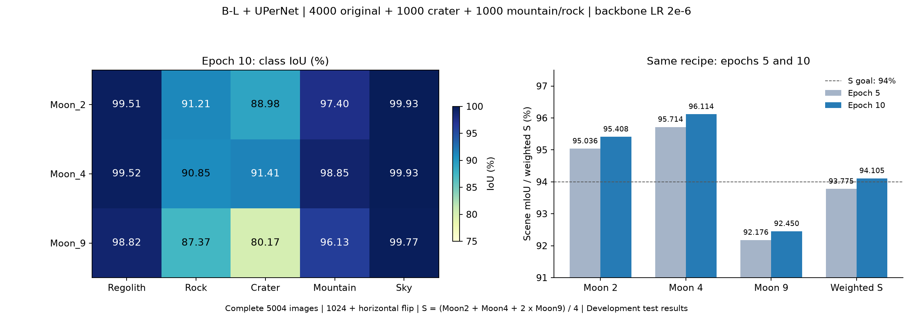

# LuSNAR：双CNN、ViT＋CNN与纯ViT语义分割

## 当前最高完整测试：94.1055%（2026-11-19更新）

**已达到S≥94.00%的项目目标。** 当前最高为 **B-L＋原UPerNet，第10轮，94.1055%**；DINOv3 ViT-L/16＋ConvNeXt-Tiny＋四阶段双向Adapter，单模型、**1024原图＋水平翻转（2视图）**。

|场景|张数|mIoU|月壤 IoU|岩石 IoU|撞击坑 IoU|山体 IoU|天空 IoU|
|---|---:|---:|---:|---:|---:|---:|---:|
|Moon_2|1597|95.4077%|99.5148%|91.2103%|88.9833%|97.3995%|99.9308%|
|Moon_4|1320|96.1141%|99.5182%|90.8527%|91.4146%|98.8527%|99.9322%|
|Moon_9|2087|92.4500%|98.8164%|87.3705%|80.1718%|96.1262%|99.7653%|

完整5004张，`S=(mIoU_2+mIoU_4+2×mIoU_9)/4=0.9410546957082757`；顶层合并像素`miou`为94.0453%，与S定义不同。逐类别指标、精确率、召回率和S已由整数混淆矩阵独立复算，固定权重实际SHA256再次核对通过。

训练为**4000原图＋1000坑增强＋1000山岩增强，共6000张**；来自Moon_1／3／5／6／7／8的合法6401训练来源，验证仍为固定1601原图，来源家族零交叉。从原始DINOv3预训练初始化，骨干基础学习率2e-6、Adapter／解码头1e-4，前三轮冻结骨干；本地GPU4单卡batch4×累积2，有效batch8。没有OCR校正、细节修正或C组遮挡。每轮按1601验证mIoU选BEST，每5轮完整测试该BEST；验证使用1024／768四视图，测试使用1024两视图。训练仍在继续，计划在20轮保存后结束，沿用原30轮poly学习率计划。

同组第5→10轮S由93.7752%升至94.1055%；此前6401原图、5e-6 UPerNet第14轮为93.8405%；103两阶段5e-6第10轮为93.9348%。这些是同测试视角的记录，数据组成和训练轨迹不同，不能据差值单独归因增强或学习率。Moon_9坑IoU仍为80.1718%、岩石为87.3705%，仍有漏检和误检；94分不表示每类都达到94%。

**测试集已反复用于开发和方案选择，以上是本地已查看测试集的成绩，不等同于官方平台或独立留出成绩。** 本次没有多种子重复或显著性检验。固定第10轮权重独立保留，GitHub不上传二进制权重和图像。

[完整模型／数据／逐类结果／权重位置／复核命令](fenge_vit/result/progress_analysis/github_update_20261119_goal94/report_zh.md) · [原始测试JSON](fenge_vit/result/progress_analysis/github_update_20261119_goal94/test_epoch010_metrics.json) · [逐类CSV](fenge_vit/result/progress_analysis/github_update_20261119_goal94/metrics.csv) · [配置及机器可读汇总](fenge_vit/result/progress_analysis/github_update_20261119_goal94/summary.json)



[2026-11-17历史快照](fenge_vit/result/progress_analysis/github_update_20261117_evening/report_zh.md)。以下历史章节只代表记录当时的状态和协议。

## 历史 ViT-L 三组实际结果（2026-11-15）

**该历史快照完整测试最高为 B-L 第10轮 93.3075%，C-L 第5轮为93.2656%。** 本次结果快照覆盖A的第5／10／15轮、B的第5／10轮、C的第5／10／15轮；A第20轮评测仍在进行，不使用未完成分数。

完整Moon_2／4／9各1597／1320／2087张，共5004张；每组使用一个固定检查点评测三个场景。均采用1024＋768等权水平翻转TTA（4视图），按各场景整数混淆矩阵重算类别IoU，再计算 `S=(Moon_2 mIoU+Moon_4 mIoU+2×Moon_9 mIoU)/4`。`miou`是合并像素后的指标，排名使用`weighted_score`。

|模型|最佳轮次|Moon_2 mIoU|Moon_4 mIoU|Moon_9 mIoU|加权S|
|---|---:|---:|---:|---:|---:|
|[B-L](fenge_vit/result/b_adapter_vit_large_pool8002_train6000_hardval1500_103_2gpu/periodic_test/epoch_010/test_metrics.json)|10|94.2910%|94.5132%|92.2129%|**93.3075%**|
|[C-L](fenge_vit/result/c_adapter_masking_vit_large_pool8002_train6000_hardval1500_2gpu/periodic_test/epoch_005/test_metrics.json)|5|94.1251%|94.2988%|92.3193%|**93.2656%**|
|[A-L](fenge_vit/result/a_fusion_vit_large_pool8002_train6000_hardval1500_103_2gpu/periodic_test/epoch_005/test_metrics.json)|5|93.7111%|93.6431%|90.8608%|**92.2690%**|

三组都从原始DINOv3 ViT-L/16＋ConvNeXt-Tiny初始化，使用同一Mask2Former解码端。A-L用最终ViT特征与CNN拼接；B-L加入四阶段双向Adapter；C-L在B-L同一网络上追加RGB遮挡视图监督。训练均为4000原图＋1000坑增强＋1000山岩增强，1024整图、有效batch 8。

这些历史实验当时关闭早停，最多训练30轮，每5轮评测当轮权重；每组保留完整测试S最高的`best_full_test.pt`及最终`final.pt`，训练中`last.pt`用于断点恢复。初期困难1500验证已停用。完整2／4／9成绩直接参与选模，因此这些是本地开发集成绩，不作为未参与模型选择的独立留出结果。

[三组结构、五类IoU、精确率／召回率及逐轮趋势](fenge_vit/result/vitl_analysis_20261115/report_zh.md) · [混合网络README与运行配置](fenge_vit/README.md)

C-L完整S在第5／10／15轮依次为93.2656%／93.2179%／93.0041%；Moon_9坑IoU从81.4345%下降至78.0437%，主要表现为召回下降。后续候选为B/C概率融合、较低解冻学习率与EMA独立对照，均尚未产生新成绩。B-L与C-L最高分仅差0.0419个百分点，不能据单次运行判定遮挡训练必然有益或有害。

以下历史快照保留旧实验的原始记录，其中“训练中”仅表示当时状态；旧数据划分与选轮协议不同，不用于单独归因当前提升。

## 历史三大框架对照（2026-11-13快照）

下表只比较完整 Moon_2／4／9 共 **5004张**的测试，统一使用 **1024＋768等权水平翻转TTA（4视图）**。最高分是历史已测结果；最终权重仍由各自验证规则选出。

|框架|编码与解码结构|目前已测最高方案|权重轮次|完整测试S|
|---|---|---|---:|---:|
|双CNN|ConvNeXt-Tiny＋MobileNetV3-Large＋128通道FPN／区域头|[细节注入](result/dual_region_priors_detail_8000_1024/test_epoch_030_multiscale_hflip_1024_768_metrics.json)|30|**90.0523%**|
|混合|DINOv3 ViT-S/16＋ConvNeXt-Tiny＋Mask2Former|[A：直接融合](fenge_vit/result/a_fusion/periodic_test/epoch_015/test_metrics.json)|14|**90.6628%**|
|纯ViT|DINOv3 ViT-S/16＋四层特征重组＋Mask2Former|[ViT-S/16＋特征重组](fenge_vit_only/result/vit_only_m2f_8000_1024/periodic_test/epoch_005/test_metrics.json)|5|**86.4615%**|

**历史快照时纯ViT仍在训练**，当前只有第5轮的完整5004张测试，86.4615%不代表其最终上限。混合A的90.6628%属于第14轮历史检查点；A最终验证best是第21轮，其完整测试为89.7335%。

GitHub布局：根目录为双CNN；[fenge_vit/](fenge_vit/README.md)为混合框架A／B／C；[fenge_vit_only/](fenge_vit_only/README.md)为纯ViT。A是双骨干直接融合；B加入四阶段双向Adapter；C在B基础上增加随机RGB遮挡训练。

## 各框架保留的较高结果

训练列是实际训练图像数；轮次来自指标中的 `checkpoint_epoch`，不是周期评测文件夹名称。各行均可点击核对原始JSON、五类IoU及整数混淆矩阵。

### 双CNN

|方案|训练张数|权重轮次|Moon_2 mIoU|Moon_4 mIoU|Moon_9 mIoU|加权S|
|---|---:|---:|---:|---:|---:|---:|
|[细节注入](result/dual_region_priors_detail_8000_1024/test_epoch_030_multiscale_hflip_1024_768_metrics.json)|8000|30|94.2704%|94.2583%|85.8402%|**90.0523%**|
|[对照](result/dual_region_priors_control_8000_1024/test_epoch_028_multiscale_hflip_1024_768_metrics.json)|8000|28|93.6695%|93.5634%|86.3247%|**89.9706%**|
|[4000＋2000＋2000基线](result/dual_region_random80_4000_2000_2000_1024/test_multiscale_hflip_1024_768_metrics.json)|8000|24|93.7277%|93.4045%|86.0804%|**89.8232%**|

### 混合

|方案|训练张数|权重轮次|Moon_2 mIoU|Moon_4 mIoU|Moon_9 mIoU|加权S|
|---|---:|---:|---:|---:|---:|---:|
|[A：直接融合](fenge_vit/result/a_fusion/periodic_test/epoch_015/test_metrics.json)|8000|14|93.3239%|92.7107%|88.3082%|**90.6628%**|
|[C：Adapter＋遮挡，四卡](fenge_vit/result/c_adapter_masking_4000_1000_1000_103_4gpu/periodic_test/epoch_015/test_metrics.json)|6000|15|93.4439%|93.2922%|87.8778%|**90.6230%**|
|[C四卡6000最终验证best](fenge_vit/result/c_adapter_masking_4000_1000_1000_103_4gpu/periodic_test/final_epoch_024/test_metrics.json)|6000|23|93.3967%|93.1300%|87.6578%|**90.4606%**|
|[C：Adapter＋遮挡，单卡](fenge_vit/result/c_adapter_masking/periodic_test/epoch_015/test_metrics.json)|8000|15|92.8829%|93.0022%|87.5667%|**90.2547%**|
|[B：双向Adapter](fenge_vit/result/b_adapter/periodic_test/epoch_015/test_metrics.json)|8000|14|93.0752%|91.7683%|87.6883%|**90.0550%**|

### 纯ViT

|方案|训练张数|权重轮次|Moon_2 mIoU|Moon_4 mIoU|Moon_9 mIoU|加权S|
|---|---:|---:|---:|---:|---:|---:|
|[ViT-S/16＋特征重组](fenge_vit_only/result/vit_only_m2f_8000_1024/periodic_test/epoch_005/test_metrics.json)|8000|5|89.8902%|90.0389%|82.9585%|**86.4615%**|

双CNN细节注入比对照高 **0.0817个百分点**，但Moon_9低0.4845个百分点，不能称为所有场景均有改善。训练主机、微批次、数据量和训练进度存在差异，上述排名不单独证明模块的因果收益。

### 历史最高与最终验证best

|实验|训练状态|验证best|该best的完整5004测试|
|---|---|---|---|
|CNN细节注入|已完成，完成30轮|第30轮，98.7520%|[90.0523%](result/dual_region_priors_detail_8000_1024/test_epoch_030_multiscale_hflip_1024_768_metrics.json)|
|A融合|早停，完成21轮|第21轮，96.5867%|[89.7335%](fenge_vit/result/a_fusion/periodic_test/final_epoch_021/test_metrics.json)|
|C四卡6000|早停，完成24轮|第23轮，96.5054%|[90.4606%](fenge_vit/result/c_adapter_masking_4000_1000_1000_103_4gpu/periodic_test/final_epoch_024/test_metrics.json)|
|B Adapter|训练中，完成25轮|第23轮，96.5901%|尚未完整测试；上表为较早权重|
|C单卡8000|训练中，完成21轮|第21轮，96.5534%|尚未完整测试；上表为较早权重|
|纯ViT8000|训练中，完成13轮|第13轮，95.6181%|尚未完整测试；上表为较早权重|

**权重保留情况：** CNN细节30轮和对照28轮的已测固定权重仍在训练服务器；当前各组验证best也保留。A14、C6000-15、C单卡15、B14和纯ViT5的临时评测权重已被既有“仅保留S>92%快照”策略清理，指标、配置、实际轮次和SHA仍在；这些历史高分不能直接用当前best复测。模型权重不上传Git。

## 每个框架最高结果的五类IoU

|框架／权重|场景|月壤|岩石|撞击坑|山体|天空|
|---|---|---:|---:|---:|---:|---:|
|双CNN／细节注入第30轮|Moon_2|99.4284%|90.9328%|84.5635%|96.5036%|99.9237%|
|双CNN／细节注入第30轮|Moon_4|99.3458%|91.4781%|81.7919%|98.7391%|99.9365%|
|双CNN／细节注入第30轮|Moon_9|98.0992%|84.8780%|58.1406%|88.3438%|99.7392%|
|混合／A：直接融合第14轮|Moon_2|99.3001%|88.1611%|83.9832%|95.4575%|99.7176%|
|混合／A：直接融合第14轮|Moon_4|99.0899%|87.5921%|79.7675%|97.3941%|99.7100%|
|混合／A：直接融合第14轮|Moon_9|98.2597%|83.6053%|67.4661%|92.8465%|99.3636%|
|纯ViT／ViT-S/16＋特征重组第5轮|Moon_2|99.0242%|80.2194%|77.7633%|92.7941%|99.6500%|
|纯ViT／ViT-S/16＋特征重组第5轮|Moon_4|98.7366%|80.8064%|74.4902%|96.4728%|99.6885%|
|纯ViT／ViT-S/16＋特征重组第5轮|Moon_9|97.6809%|78.0717%|52.1565%|87.7206%|99.1628%|

完整的较高结果、来源SHA与权重可用性见 [框架汇总JSON](result/framework_summary/summary.json) 和 [逐类别CSV](result/framework_summary/metrics.csv)。

## 数据协议与困难验证

|协议|训练组成|选轮验证|完整测试|
|---|---|---|---|
|旧8000|4000原图＋2000坑增强＋2000山岩增强|原1601张，来自Moon_1/3/5/6/7/8|Moon_2/4/9，5004张|
|旧6000|相同4000原图＋1000坑增强＋1000山岩增强|同一1601张|同上|
|新6000|从全部8002原图池重新抽4000张＋1000坑增强＋1000山岩增强|2/4/9固定困难1500张|期末报告5004及排除验证后的3504张|

旧1601验证按汇总像素混淆矩阵mIoU选轮：ViT三类旧协议及CNN先验对照使用单1024；CNN的4000＋2000＋2000历史基线按其run_config使用1024／768四视图。困难1500使用1024／768四视图，按场景1∶1∶2加权。二者不能与完整5004分数混排。新协议的1500张来自原测试，完整5004包含选轮数据；其余3504也参与过困难集筛选，不能称为未经查看的独立留出集。

困难1500固定为Moon_2 **188张**、Moon_4 **187张**、Moon_9 **1125张**。固定来源baseline为C四卡6000第18轮：**80.7379%**。下表旧模型仅用这批图做诊断，新A和新纯ViT用它选轮。

|模型|数据／用途|已测权重轮次|困难1500加权分数|
|---|---|---:|---:|
|[C单卡8000](fenge_vit/result/c_adapter_masking/hard_periodic_test/epoch_020/hard_test_metrics.json)|旧划分／诊断|20|82.2268%|
|[C四卡6000](fenge_vit/result/c_adapter_masking_4000_1000_1000_103_4gpu/hard_periodic_test/epoch_022/hard_test_metrics.json)|旧划分／诊断|21|81.9583%|
|[B Adapter](fenge_vit/result/b_adapter/hard_periodic_test/epoch_024/hard_test_metrics.json)|旧划分／诊断|23|81.1272%|
|[纯ViT8000](fenge_vit_only/result/vit_only_m2f_8000_1024/hard_periodic_test/epoch_012/hard_test_metrics.json)|旧划分／诊断|12|77.7768%|
|[新A](fenge_vit/result/a_fusion_pool8002_train6000_hardval1500_103_2gpu/validation_epoch_004.json)|新6000／选轮验证|4|80.4746%|
|[新纯ViT](fenge_vit_only/result/vit_only_pool8002_train6000_hardval1500_103_2gpu/validation_epoch_004.json)|新6000／选轮验证|4|75.7125%|

[旧8000固定清单](result/selections/random80_4000_2000_2000_seed42_20261112.json) · [旧6000固定清单](result/selections/random80_4000_1000_1000_seed42_20261112.json) · [新6000／困难1500完整清单](result/selections/pool8002_train6000_hardval1500_seed42_20261113.json)。原图与增强记录保留source_id、种子及顺序，来源不跨训练／验证。

## 评分与TTA

每个场景先累计全部像素的混淆矩阵，类别IoU为TP/(TP+FP+FN)，仅平均该场景GT实际出现的类别。最终 **`S=(Moon_2 mIoU + Moon_4 mIoU + 2×Moon_9 mIoU)/4`**。JSON中的`miou`是合并混淆矩阵的指标，不能代替`weighted_score`，也不平均单图IoU。

四视图TTA：1024原图、1024左右翻转、768原图、768左右翻转。翻转预测恢复方向，连续五类概率对齐到原尺寸；每尺度内部平均后，两尺度等权平均，最后只做一次argmax。TTA不改变训练权重。

## 运行与复现

服务器实际工作目录为 `/home/lzc/workspace/fenge`、`fenge_vit`、`fenge_vit_only`。本机使用 `lzc_fenge`，103使用 `/home/lzc/miniconda3/envs/lusnar`。源码与数据清单在服务器，图片保存在NAS，文字结果在各项目result目录；权重和图片不入Git。克隆仓库后需按实际路径配置本地数据及预训练权重，不能仅凭Git文本恢复历史训练检查点。

```text
fenge/                    # GitHub仓库根：双CNN
├── code/                 # 网络、训练、评估、数据及验证入口
├── config/               # 保留的可运行配置
├── model/                # 预训练来源与SHA256，不含大权重
├── result/               # 指标、固定清单、汇总及精简退役证据
├── fenge_vit/            # ViT＋CNN混合：code/config/model/result/README
└── fenge_vit_only/       # 纯ViT：code/config/model/result/README
```

双CNN保留细节注入、对照与原始区域解码实现，两主骨干都完整处理1024图像。细节分支在解码后段加入RGB浅层与语义引导残差，原始监督保持。先下载预训练，再按配置训练：

```bash
conda activate lzc_fenge
cd /home/lzc/workspace/fenge
python code/download_weights.py
python code/train.py --config config/dual_region_priors_detail_1024.json --device cuda:0
python code/train.py --config config/dual_region_priors_control_1024.json --device cuda:0
```

以上两个训练命令为独立实验入口，应分别指定空闲GPU及新的输出目录。细节30轮已测权重复测：

```bash
python code/evaluate.py --config config/evaluate_detail_epoch030_multiscale.json \
  --device cuda:0 --output result/dual_region_priors_detail_8000_1024/retest_metrics.json
```

混合框架的A/B/C、分布式训练与评测命令见 [混合README](fenge_vit/README.md)；纯ViT特征重组与两套数据协议见 [纯ViT README](fenge_vit_only/README.md)。当前两类新困难验证实验每两轮验证，完整2/4/9仅训练结束后评测。旧实验的历史五轮周期结果继续保留。

可视化按需加 `--save-images --image-output-mode comparison`（CNN）或 `--save-images`（ViT），每张保存三联图`comparison.jpg`及`metrics.json`，图片默认根目录为NAS `/media/nas/lzc/fenge_result`。

## 已退役尝试

已从可运行配置及冗余实验目录移除：当前CNN亲和监督、周围关系、困难像素增强损失；此前几何一致性两组已清理。坑分数校准与加入512的三尺度TTA不再保留专用启动配置。清理只针对本次已测实现及参数，不表示这些方法在所有条件下无效。

|退役尝试|本次证据|
|---|---|
|CNN亲和监督|完整S=89.7348%，比对照低0.2357个百分点|
|CNN周围关系|完整S=89.8741%，比对照低0.0964个百分点|
|困难像素λ=0.2|同协议hflip完整S=87.8410%，对照88.3678%|
|坑分数γ>1|验证扫描未优于γ=1|
|1024＋768＋512 TTA|旧固定权重S=89.2735%，低于双尺度89.7366%且增加计算|

必要的负结果、原始指标、配置及来源SHA保存在[退役证据](result/retired_experiments/summary.json)。较高结果、对照、正在训练的实验、共用数据清单和模型加载兼容代码继续保留。0.75／0.25尺度加权曾提高验证表现，仍保留其验证及测试记录，不列为确定无效。

[最新运行进度](fenge_vit/result/progress_analysis/latest_report_zh.md) · [CNN运行检查](result/verification.json) · [混合运行检查](fenge_vit/result/verification_model.json) · [纯ViT运行检查](fenge_vit_only/result/protocol_verification.json)

## 本地工作区清理（2026-11-14）

旧低分运行、调试权重、重复快照及其专用启动配置已清理；较好结果、必要对照、运行中的任务、数据和预训练权重保留。旧指标与配置的清理归档保留在实验服务器。
