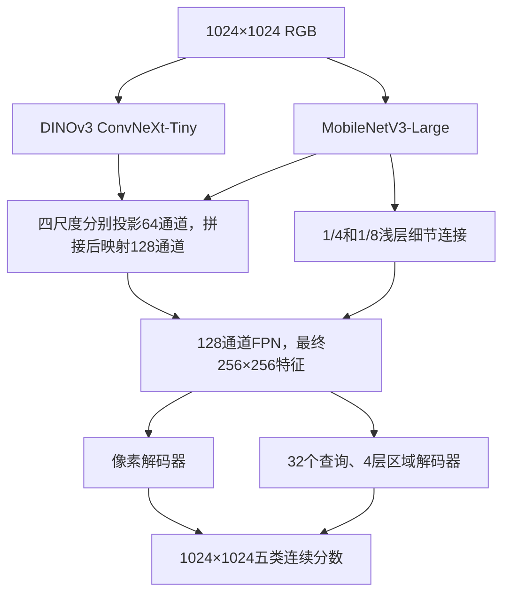

# LuSNAR：DINOv3 ConvNeXt-Tiny + MobileNetV3-Large

两条 CNN 同时接收同一张 **1024×1024 RGB 图像**。提供像素解码和区域解码两套可训练模型，原始训练集、验证集与评估口径保持一致。编码器没有 ViT；区域解码器含注意力。

## 文件结构

```text
fenge/
├── model/       # 两个预训练骨干、来源和 SHA256
├── code/        # 网络、损失、数据读取、训练、评估、推理和运行检查
├── result/      # 训练检查点、逐轮指标、评估和预测输出
├── config/      # 可直接传给训练入口的 JSON 配置
└── README.md
```

## 环境

使用现有环境，不需要重新创建环境：

```bash
conda activate lzc_fenge
cd /home/lzc/workspace/fenge
```

该环境的 Python 为 `/home/vrlab/miniconda3/envs/lzc_fenge/bin/python`。代码兼容其中的 PyTorch 2.1.1+cu121、torchvision 0.16.1、timm 1.0.30，不依赖 transformers。依赖清单在 `code/requirements.txt`，已有依赖无需重复安装。

## 网络



ConvNeXt 四尺度通道为 96/192/384/768。MobileNet 对应特征通道为 24/40/112/960，步长均为 4/8/16/32。两条分支都完整处理 1024 图像，不使用分类预处理中的 224 中心裁剪。输入只做 RGB 转换、同步几何增强和 ImageNet 均值标准差归一化。

区域头联合预测每个查询的五类加 `no-object` 分类，以及 256×256 掩码；类别概率和掩码概率组合为五类语义分数，再将连续分数插值到标签尺寸，最后 argmax。区域注意力读取多尺度特征，保留 1/4 掩码细节。

本任务使用语义标注：每个实际出现的类别提供一张目标掩码，通过 Hungarian 匹配监督查询。一个语义掩码允许多个不连通部分，也允许岩石遮挡形成孔洞；不额外填孔，不将语义标签虚构为实例标注。区域损失包含分类、掩码 BCE/Dice、各解码层辅助监督和最终语义监督；像素头使用语义 CE/Dice。小类别的匹配采样直接来自原尺寸标签，避免先缩小 GT 后丢失细小岩石。

## 预训练权重

运行权重下载入口：

```bash
python code/download_weights.py
```

ConvNeXt 使用 [timm 维护者发布的 DINOv3 LVD1689M 权重](https://huggingface.co/timm/convnext_tiny.dinov3_lvd1689m)，MobileNet 使用 [torchvision ImageNet1K V2](https://docs.pytorch.org/vision/stable/models/generated/torchvision.models.mobilenet_v3_large.html)。下载来源与文件哈希记录在 `model/manifest.json`。模型构建只读取本地文件；缺失或不匹配的权重会报错，不会自动改成随机初始化或下载 ViT。

预训练权重和训练检查点（如 `best.pt`、`last.pt`）保留在本地，Git 忽略这些大文件。版本库保存下载代码、配置、权重来源清单及 SHA256，以及可复核的训练和评估指标；在其他机器上运行下载入口并核对哈希即可恢复相同预训练文件。训练检查点的实际 SHA256 会记录在完整评估及分析结果中，用于确认每份成绩对应的模型。

实现依据：[DINOv3 ConvNeXt 官方实现](https://github.com/facebookresearch/dinov3/blob/main/dinov3/models/convnext.py)、[MobileNetV3 官方实现](https://github.com/pytorch/vision/blob/v0.16.1/torchvision/models/mobilenetv3.py)。

## 数据划分与标签

原数据清单：`/media/nas/lzc/fenge/baseline_segformer_20261026/manifest.json`。

| 用途 | 场景 | 图像数 |
|---|---|---:|
| 训练 | Moon_1、Moon_3、Moon_6、Moon_7、Moon_8 | 6403 |
| 验证、选轮 | Moon_5 | 1599 |
| 最终测试 | Moon_2、Moon_4、Moon_9 | 5004 |

输入读取清单的 `image` 并转 RGB，训练标签读取 `mask` 的单通道 ID。类别固定为 `0 月壤、1 岩石、2 撞击坑、3 山体、4 天空`。原始 `label` 的 P 模式调色板索引不等于这些类别 ID，不能直接作为训练标签。

增强清单：`/media/nas/lzc/lusnar_augmentation/lusnar_gt_context_6000_20261110/manifest.json`。`crater`、`mountain_rock`、`mixed` 各 2000 张，均来自训练场景，额外读取相对路径 `image/mask` 和 `primary_group`。6000 个裁剪来自 2872 个原图，不是 6000 个独立场景，不能随机拆入验证集。

## 训练与断点续训

当前实验使用固定随机选择的 **8000 张训练图**：5000 张原始图、1500 张 `mountain_rock` 山岩交界增强、1500 张 `crater` 大坑增强。Moon_5 的完整 1599 张继续用于每轮评估与选轮。实际 **batch size 8、累积 1**，有效 batch 也是 8。

先生成并保存抽样清单：

```bash
python code/select_training_data.py --config config/train_selection_8000.json
```

清单位于 `result/selections/train8000_seed42_20261111.json`，保存全部有序样本、seed 42、分组数量、来源清单 SHA256、抽样算法和代码 SHA。每组无放回抽样；8000 个条目来自 5492 个原始来源。重新运行相同选择会保留已有清单及哈希；更换种子或配比必须指定新的输出文件，不覆盖旧选择。训练和续训直接重放保存清单，不重新随机选择。每轮只打乱训练顺序，训练样本集合固定。

两个并行实验共享同一份选择、初始化和训练设置，区别是验证是否使用水平翻转 TTA：

| 配置 | 每轮 Moon_5 评估 | 结果目录 | 本次显卡 |
|---|---|---|---|
| `config/dual_region_augmented_1024.json` | 原图单视图 | `result/dual_region_balanced8000_bs8` | GPU 3 |
| `config/dual_region_augmented_tta_1024.json` | 原图＋水平翻转，2 视图 | `result/dual_region_balanced8000_bs8_tta` | GPU 4 |

无 TTA 组已按要求在完成第 9 轮后停止，第 10 轮未完成部分不计入完成轮数；最佳检查点为第 5 轮，完整 Moon_5 mIoU 为 87.7176%。已在 GPU 3 完成其完整 Moon_2/4/9 的 `none`、`hflip` 测试，各 5004 张，两次均未保存图片。单视图加权 S 为 **87.0732%**，同一权重加水平翻转 TTA 后为 **87.2468%**；逐场景、逐类结果及混淆分析见 [测试分析](result/dual_region_balanced8000_bs8/test_comparison_zh.md)。TTA 训练组继续运行，并采用下述 0.05 个百分点、patience 5 的监控策略；两组联合报告将在剩余测试完成后生成。

重新开展同配置实验时，在两个终端分别运行，并为新实验指定新的结果目录：

```bash
python code/train.py --config config/dual_region_augmented_1024.json --output result/dual_region_balanced8000_bs8_new --device cuda:3
python code/train.py --config config/dual_region_augmented_tta_1024.json --output result/dual_region_balanced8000_bs8_tta_new --device cuda:4
```

两组均为 1024 输入、最多 30 轮；外部监控满足早停条件时提前结束。前 3 轮冻结两个 CNN、只训练融合和解码，从第 4 轮开始两个骨干一起微调。头部学习率 `1e-4`，骨干学习率 `1e-5`。冻结阶段同时冻结 MobileNet 的 BN 运行统计。训练使用一次前向和原有水平翻转增强；TTA 作用于评估和推理，不加进训练损失。

需选择显卡时使用 `--device cuda:2` 等参数。每个实验用独立的 `result` 子目录，保存 `run_config.json`、`history.jsonl`、逐轮验证指标、`last.pt` 和验证选出的 `best.pt`。续训保持原配置和训练轮数计划：

```bash
python code/train.py --config config/dual_region_augmented_1024.json --resume result/dual_region_balanced8000_bs8/last.pt --device cuda:3
python code/train.py --config config/dual_region_augmented_tta_1024.json --resume result/dual_region_balanced8000_bs8_tta/last.pt --device cuda:4
```

若需迁移已有最佳模型的 ConvNeXt，可传 `--convnext-checkpoint /media/nas/lzc/lusnar_visualizations/best_xiuzheng_finetune_gt_1_epoch8/source_model/model.safetensors`；只加载其中 `base.backbone.*`，不加载 ViT 或旧解码器。默认配置使用刚下载的原始 DINOv3 预训练。对照实验应使用相同骨干初始化来源。

`train_source` 可取 `original`、`augmented`、`combined`，`augmentation_groups` 限定候选组，`selection_manifest` 再指定实际使用的固定样本。保留的 `dual_pixel_1024.json`、`dual_region_1024.json` 是原始 6403 张数据基线配置；此前 `result/dual_region_1024/` 实验已按要求停止，已有检查点保留。

单 ConvNeXt 对照可用 `--backbone convnext` 并指定新的输出目录；其余配置保持一致。

## 外部 JSON 监控、早停与最终分析

监控不修改训练循环，通过已完成轮次的 JSON 指标决定早停。使用现有两个实验的配置启动：

```bash
python code/monitor_experiments.py --config config/early_stopping_monitor.json
```

只读查看当前早停计数和决定：

```bash
python code/monitor_experiments.py --config config/early_stopping_monitor.json --inspect
```

`--inspect` 只重放已完成验证，不写状态、不停止进程，也不启动测试。正常监控每 **5 秒**读取各实验 `summary.json` 的 `completed_epochs`，再读取这一边界内的 `validation_epoch_NNN.json`。训练入口在保存 `last.pt`、必要时保存 `best.pt` 之后才更新 summary，因此正在训练或尚未提交的轮次不计入早停。

当前策略在 [early_stopping_monitor.json](config/early_stopping_monitor.json) 中固定为：

| 参数 | 当前值 | 含义 |
|---|---:|---|
| `start_epoch` | 4 | 从骨干解冻后的第 4 轮完整验证开始判断 |
| `patience` | 5 | 连续 5 个有效轮次没有达到改善门槛时停止 |
| `min_delta` | 0.0005 | mIoU 至少增长 0.0005，即 **0.05 个百分点** |

第 4 轮分数建立参考值 anchor。后续分数达到 `anchor + min_delta` 时更新 anchor 并清零计数；小幅增长继续相对原 anchor 累计判断，不会因为某一轮略有增长就清零。监控启动或重启时会重放已经完成的轮次，避免丢掉已有等待计数。早停计数与最佳模型保存分别处理：`best.pt` 仍由完整 Moon_5 的任何严格 mIoU 新高决定，即使提升小于早停门槛也会保留。

两组独立判断并停止各自的训练进程，保留已完成验证记录和最佳检查点，`summary.json` 标记 `early_stopped`。监控总状态记录在 `result/experiment_monitor/state.json`，每组的判断和评估进展记录在对应结果目录的 `early_stopping_monitor.json`。

每组停止或完成最多 30 轮之后，监控在该实验原 GPU 上用固定 `best.pt` 评估完整 **Moon_2/4/9，共 5004 张**。每个检查点分别运行 `none` 和 `hflip` 两种测试，共 **4 次完整评估**；同一实验的两个模式依次运行，不同实验可以各用自己的显卡推进。结果分别写为：

- `test_metrics.json`：原图单视角。
- `test_hflip_metrics.json`：原图加水平翻转，逆翻转连续类别概率后平均。

四份完整结果就绪后，监控调用分析入口，将中文报告、逐类指标、完整混淆矩阵、逐轮数据和训练验证曲线写入 `result/analysis/`。也可以手动重建分析：

```bash
python code/analyze_experiments.py \
  --run-off result/dual_region_balanced8000_bs8 \
  --run-on result/dual_region_balanced8000_bs8_tta \
  --output result/analysis
```

分析会核验完整测试数量、数据清单与检查点 SHA256、Moon_5 选轮以及混淆矩阵评分。运行尚未停止或完整结果缺失时会报错，不生成最终分析。不同实验选出的检查点可能不同，组间成绩变化不能全部归因于 TTA；每个固定检查点内部的 `none/hflip` 对照才隔离了本次推理视角的变化。最终测试完成之前，不将流程验证或中途 Moon_5 成绩当成新的完整测试结论。

后台发布入口会等待监控状态成为 `ready_to_publish`，再只提交本次两组实验记录、最终分析及对应监控记录，推送至 `origin main`：

```bash
python code/publish_results.py
```

仅检查一次，结果未就绪时立即返回：

```bash
python code/publish_results.py --once
```

发布状态保存在 `result/experiment_monitor/publication.json`。如果推送失败，已创建的本地 commit 及错误记录会保留；完成 GitHub 登录后可再次运行 `--once` 重试推送。只有该状态记录为 `published` 才表示发布入口已成功推送，启动发布进程本身不代表远端发布成功。

## 评估和推理

验证集和最终测试评估分别运行：

```bash
python code/evaluate.py --checkpoint result/dual_region_balanced8000_bs8/best.pt --split val --tta none
python code/evaluate.py --checkpoint result/dual_region_balanced8000_bs8_tta/best.pt --split val --tta hflip
python code/evaluate.py --checkpoint result/dual_region_balanced8000_bs8_tta/best.pt --split test --tta hflip
```

TTA 开关：训练期评估使用 `--val-tta none|hflip`（配置键 `val_tta`）；独立评估和推理使用 `--tta none|hflip`。开启后，两次前向都使用 1024×1024 输入，将翻转图的五类预测概率翻回原坐标，再与原图概率平均，最后统一插值和 argmax。关闭时保持原有单次推理路径。TTA 不保证精度一定提升，比较时可对同一固定检查点分别评估两种模式。

评估先累计每个场景的像素混淆矩阵，再对 GT 实际出现的类别计算 mIoU。完整测试的加权分数为 `S=(Moon_2+Moon_4+2×Moon_9)/4`，不是单图 mIoU 的平均值，也不是官方平台提交分数。测试结果只用于最终评估，不用于选轮或调参。

### 可选保存评估图片

`evaluate.py` 默认不保存图片。未来需要逐图查看时，可单独开启 `--save-images`；本次完整 Moon_2/4/9 测试均保持关闭。

```bash
python code/evaluate.py \
  --checkpoint result/dual_region_balanced8000_bs8/best.pt \
  --split test --tta none --device cuda:3 \
  --output result/dual_region_balanced8000_bs8/test_with_images_metrics.json \
  --save-images
```

默认图片根目录为 **`/home/lzc/workspace/fenge_result`**，独立于代码仓库。第一层实验文件夹与检查点所在 `fenge/result` 实验目录同名，再按 split、TTA 模式、场景和样本分开，避免跨场景同名覆盖：

```text
/home/lzc/workspace/fenge_result/
└── dual_region_balanced8000_bs8/
    └── test_none/
        ├── index.json
        └── Moon_2/
            └── <sample_id>/
                ├── prediction_ids.png
                ├── prediction_color.png
                ├── ground_truth_ids.png
                └── comparison.jpg
```

`prediction_ids.png`、`ground_truth_ids.png` 都是单通道类别 ID（0–4）；彩图使用固定五类调色板。对照 JPG 并排显示原图 RGB、真值和预测，使用实际评估输入反归一化还原的 RGB，以及评分时已经解码的 GT ID，三者空间位置和尺寸一致。原始 LuSNAR 的每一幅图和掩码均为 1024×1024。图片导出发生在预测和混淆矩阵累积之后，不改变 TTA、连续分数插值、argmax 或评分口径。

开启后保存本次评估的全部图片，`index.json` 记录保存数量、相对路径及检查点来源，指标 JSON 的 `saved_images` 记录目录与索引。可用 `--image-output-root /your/image/root` 更换根目录；不传 `--save-images` 时不会创建图片目录。图片保留在独立目录，不作为本次 Git 结果发布内容。

单图或目录推理：

```bash
python code/infer.py --checkpoint result/dual_region_balanced8000_bs8_tta/best.pt --input /path/to/images --output result/predictions --device cuda --tta hflip --overlay
```

输出类别 ID PNG、类别彩色 PNG、可选叠加图和 `predictions.json`。其他尺寸图像会先变为配置输入尺寸，预测连续分数再恢复到原图尺寸；原始 LuSNAR 图像本身为 1024×1024。

## 运行验证

```bash
python code/verify.py --device cuda:2 --size 1024
```

该入口实际加载两个预训练骨干，分别检查像素版和区域版的 1024 前向、反向、两支梯度、冻结行为、优化器更新和检查点严格重载，也检查数据场景隔离及查询排列不变性。报告写入 `result/verification.json`。这些检查验证代码执行，不代表模型已完成训练或取得新的分割成绩。

已在 `lzc_fenge`、RTX 4090 上通过两个完整 1024 模型检查；新的真实 batch 8 还通过了全部骨干解冻的前向、反向、优化器及检查点检查，峰值分配显存约 19.5 GiB，记录在 `result/verification_batch8.json`。双视图 TTA 数值对齐检查及真实样本评估通过，后者记录在 `result/verification_tta.json`。

先前少量样本的流程检查产物位于 `result/runtime_check_region/` 与 `result/runtime_check_prediction/`，明确标记 `partial`，选轮文件名为 `best_smoke.pt`，仅用于代码运行验证。当前 8000 张两个实验的进展分别查看各自的 `train.log`、`history.jsonl` 和 `summary.json`。
