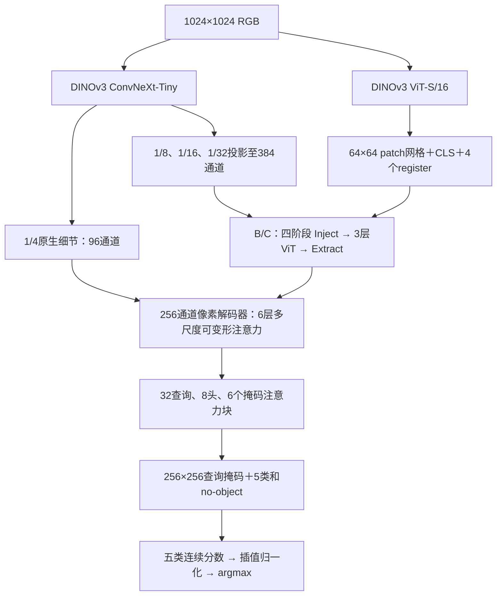

# LuSNAR：ViT＋CNN 混合骨干与 Mask2Former

DINOv3 ViT-S/16 与 ConvNeXt-Tiny 都接收完整 **1024×1024 RGB**。本目录保留 A 融合、B 双向 Adapter、C 遮挡训练三组实现，与双 CNN 和纯 ViT 源码分开。

[三大框架结果总览](https://github.com/buqinch/fenge/blob/main/README.md) · [完整指标汇总](result/progress_analysis/latest_report_zh.md)

## 保留的较高结果

结果整理日期：**2026-11-13**。下表均完整评估 Moon_2／4／9 的1597／1320／2087张，共5004张，使用1024／768等权水平翻转TTA（4视图）。轮次指实际检查点，可能与测试目录名不同。

|模型／训练配比|权重轮次|Moon_2 mIoU|Moon_4 mIoU|Moon_9 mIoU|加权S|记录|
|---|---:|---:|---:|---:|---:|---|
|**A 融合／4000＋2000＋2000**|**14**|93.3239%|92.7107%|88.3082%|**90.6628%**|[历史已测最高](result/a_fusion/periodic_test/epoch_015/test_metrics.json)|
|C 四卡／4000＋1000＋1000|15|93.4439%|93.2922%|87.8778%|90.6230%|[阶段高分](result/c_adapter_masking_4000_1000_1000_103_4gpu/periodic_test/epoch_015/test_metrics.json)|
|C 单卡／4000＋2000＋2000|15|92.8829%|93.0022%|87.5667%|90.2547%|[阶段高分](result/c_adapter_masking/periodic_test/epoch_015/test_metrics.json)|
|B Adapter／4000＋2000＋2000|14|93.0752%|91.7683%|87.6883%|90.0550%|[阶段高分](result/b_adapter/periodic_test/epoch_015/test_metrics.json)|
|C 四卡6000／最终验证best|23|93.3967%|93.1300%|87.6578%|90.4606%|[期末测试](result/c_adapter_masking_4000_1000_1000_103_4gpu/periodic_test/final_epoch_024/test_metrics.json)|
|A 融合／最终验证best|21|93.0862%|92.3730%|86.7375%|89.7335%|[期末测试](result/a_fusion/periodic_test/final_epoch_021/test_metrics.json)|

A 第14轮的完整精度为 **90.66277112%**。这是已观察到的测试最高分；A最终按原1601张验证集选出第21轮，不能把历史测试最高轮写成最终验证best。C6000已在第24轮早停，验证best为第23轮，原验证mIoU为96.5054%；该第23轮权重已完成完整5004张期末测试，**S＝90.4606%**，是当前可用最终验证best的结果。

历史阶段测试的临时权重可能已按原“完整S超过92%才额外保留”规则清理。指标、checkpoint SHA和训练记录仍用于核验；重测前需确认对应精确权重仍存在，不能用当前best冒充历史权重。

## 新6000／困难1500实验

新A使用全部8002张候选原图池重新抽取的4000原图，加1000坑增强、1000山岩增强。相同清单的纯ViT对照位于[独立目录](../fenge_vit_only/README.md)。两组都从原始预训练开始、关闭RGB随机遮挡。

|实验|已完成验证权重|困难验证加权分数|对应记录|
|---|---:|---:|---|
|A 融合|4|**80.4746%**|[验证](result/a_fusion_pool8002_train6000_hardval1500_103_2gpu/validation_epoch_004.json)|
|纯ViT|4|75.7125%|[验证](../fenge_vit_only/result/vit_only_pool8002_train6000_hardval1500_103_2gpu/validation_epoch_004.json)|
|固定困难集来源baseline：C6000|18|80.7379%|[固定基准](result/hard_test_1500_20261113/source_hard_subset_metrics.json)|

这些是困难1500张的分数，不能与上表完整5004张S或原1601张验证mIoU混比。新实验的完整5004张评测安排在训练结束后。

## 文件与环境

```text
fenge_vit/
├── model/   # 原始预训练来源、配置、许可证、SHA256；权重不进Git
├── code/    # 网络、损失、训练、评估、推理、同步与验证入口
├── config/  # A/B/C及数据协议配置
├── result/  # 检查点、训练记录和评测指标
└── README.md
```

GitHub中本项目位于`fenge_vit/`；服务器部署目录为`/home/lzc/workspace/fenge_vit`。数据清单引用`/home/lzc/workspace/fenge/result/selections/`。

```bash
conda activate lzc_fenge
cd /home/lzc/workspace/fenge_vit
python code/download_weights.py
```

本机Python为`/home/vrlab/miniconda3/envs/lzc_fenge/bin/python`；103使用`/home/lzc/miniconda3/envs/lusnar/bin/python`。依赖见[requirements.txt](code/requirements.txt)。已有环境分别使用PyTorch2.1.1／timm1.0.30和PyTorch2.2.2／timm1.0.22。

ViT来自[timm DINOv3 ViT-S/16](https://huggingface.co/timm/vit_small_patch16_dinov3.lvd1689m)，revision为`3bf4720a82ec2066db88137180ff1f83a675cef0`，SHA256为`2a1ec16ae28ffa07bc0ead0241ee7df9fc26451fe6f9f839b7b3afa0a906b040`。ConvNeXt原始DINOv3权重SHA256为`a7637753a2e85d709d1a5474e13382d39e7bc581a35868b477585c970f36847f`。来源和许可证见[权重清单](model/manifest.json)；加载时核对SHA和参数，缺失或不匹配即报错。

## 网络与三组对照

|组|编码与交互|RGB输入遮挡|配置|
|---|---|---|---|
|A|ViT＋ConvNeXt最终特征多尺度融合|关闭|[a_fusion.json](config/a_fusion.json)|
|B|四阶段双向Adapter|关闭|[b_adapter.json](config/b_adapter.json)|
|C|与B同一网络|解冻后启用|[c_adapter_masking.json](config/c_adapter_masking.json)|



ViT为非plus的ViT-S/16：12层、384通道，保留RoPE、CLS和4个register，只有patch tokens参与空间重排和Adapter。ConvNeXt只执行一次，产生96／192／384／768通道、步长4／8／16／32的特征；后三层参与交互，1/4细节独立送入解码器。

B/C每阶段先用多尺度可变形交叉注意力向ViT注入空间特征，经过3个原始ViT block，再反向更新空间特征。残差系数gamma／eta初值为1e-4。A使用简单融合，没有这些交互Adapter。

像素编码器为6层、256通道、8头、4采样点；查询解码器6块按1/32→1/16→1/8循环两次。初始预测和6块输出共7组，最后一组及6组辅助输出均监督。前一次掩码产生detach的注意力屏蔽，全屏蔽行恢复可访问位置，避免NaN。

骨干调用timm；Adapter和Mask2Former使用独立PyTorch实现，可变形采样用FP32 `grid_sample`并分块。无需Detectron2/MMCV编译。实现依据：[DINOv3](https://github.com/facebookresearch/dinov3/blob/main/dinov3/models/vision_transformer.py)、[ViT-Adapter](https://github.com/czczup/ViT-Adapter/blob/main/segmentation/mmseg_custom/models/backbones/adapter_modules.py)、[Mask2Former](https://github.com/facebookresearch/Mask2Former/blob/main/mask2former/modeling/transformer_decoder/mask2former_transformer_decoder.py)。本项目的通道、查询及层数不是官方默认配置。

GT中每个出现的类别构成一张union mask，保留孔洞及不连通部分。每组输出独立Hungarian匹配，分类／mask BCE／Dice权重2／5／5，no-object权重0.1；4096匹配与损失点直接采自原分辨率标签，覆盖出现类别的正点。no-object不是天空。

输出沿用A：查询类别softmax与mask sigmoid先合成五类分数，再双线性插值、按类归一化；不能把合成分数当原始logits再套softmax。B/C网络初始化相同；跨A或纯ViT的特征投影与随机数消耗不同，不宣称所有公共张量逐元素相同。

## C组遮挡监督

完整图始终保留全部Mask2Former监督。解冻后约25%的优化器更新追加遮挡分支；同一更新的累积微批都执行遮挡，每图独立采样，两骨干接收同一份遮挡RGB。

块大小32×32，遮挡约10%，填归一化后的0；lambda在解冻后的1000次更新从0升至0.5，隐藏有效像素权重rho为0.2。随机流由seed、更新号、样本ID决定。被完全遮住的GT岩石／坑／山体连通区域仅在遮挡辅助监督中忽略，完整图照常监督。

```text
p = (S + 1e-8) / (sum_class(S) + 5e-8)
L_masked = (sum_visible NLL + 0.2 × sum_eligible_hidden NLL)
           / (visible_valid_pixels + eligible_hidden_pixels)
L = L_Mask2Former(full_image) + lambda × L_masked(masked_image)
```

分母不按rho加权，按整个累积窗口有效像素归约；完整图与遮挡图先后反向，控制显存峰值。本实现使用GT监督，无教师网络。

## 数据与选轮协议

类别ID固定为0月壤、1岩石、2撞击坑、3山体、4天空；图像与ID标签均为1024×1024。

|协议|训练来源与配比|验证|选轮与早停|
|---|---|---|---|
|旧8000|原6401训练来源中4000原图＋2000坑＋2000山岩|固定1601原图|每轮单1024；汇总mIoU|
|旧6000|与旧8000同4000原图，增强各抽1000|同一1601原图|同上；每轮750更新|
|新6000|全8002候选中重新抽4000原图，增强各1000|固定困难1500|每2轮及末轮四视图；场景加权分数|

旧协议的原图及其增强来源不跨训练／验证，Moon_2/4/9不进入训练或选轮。旧6000与旧8000的更新数不同，不能把同epoch解释为相同更新预算。

新清单为`pool8002_train6000_hardval1500_seed42_20261113.json`，SHA256为`68bb4ab8410fb36009d4f6a5818d3943a7f675769a4cd73c9e281a5a82ac7e09`。候选原图来自Moon_1/3/5/6/7/8，增强父图也只来自该池。验证为Moon_2/4/9的188／187／1125张，固定后不随新预测重选；采样1∶1∶6，评分仍1∶1∶2。

新验证字段`validation_weighted_score`用于best，`miou`仍是汇总混淆矩阵mIoU。困难Moon_4无山体GT，该类IoU为null，只平均其余4类。原测试1500被用于新验证，期末分别报告完整5004、验证1500、剩余3504；完整5004包含选轮数据，3504也参与过难度筛选，均不称为未经查看的留出集。

## 训练与断点续训

全部从原始预训练开始，最长30轮，前3轮冻结骨干，之后联合微调。新层LR为1e-4，骨干5e-6，poly调度、BF16及激活重计算；有效batch为8。冻结ViT参数时，B/C仍需让梯度穿过冻结block进入Adapter，不能整体no_grad。

```bash
python code/train.py --config config/a_fusion.json --device cuda:0 --output result/a_reproduction
python code/train.py --config config/b_adapter.json --device cuda:1 --output result/b_reproduction
python code/train.py --config config/c_adapter_masking.json --device cuda:2 --output result/c_reproduction
python code/train.py --config config/c_adapter_masking.json \
  --resume result/c_adapter_masking/last.pt --device cuda:2
```

严格新高保存best；显著提升阈值为0.05个百分点。旧协议从第4轮起连续5轮无显著增长早停，新协议按5次实际验证检查计数，跳过验证的轮次不计耐心。

检查点保存优化器、调度器、AMP、随机流、样本身份、代码SHA、早停状态；按完整epoch边界恢复。数据、批次或实现改变不能静默作为精确续训。不同GPU和CUDA算子不保证逐位相同。

103上的旧C6000四卡复现入口（使用新输出目录）：

```bash
bash code/run_on_103.sh env CUDA_VISIBLE_DEVICES=4,5,6,7 \
  /home/lzc/miniconda3/envs/lusnar/bin/python -m torch.distributed.run \
  --standalone --nproc_per_node=4 code/train_distributed.py \
  --config config/c_adapter_masking_4000_1000_1000_103_4gpu.json \
  --output result/c6000_reproduction
```

四卡每卡batch2，总batch8。分布式入口按全局匹配目标／有效像素归约损失，以NCCL同步梯度，验证先合并整数混淆矩阵；保存时核对各卡模型SHA。续训要求相同卡数和配置。

新A在103卡4／5，每卡batch4，总batch8；新纯ViT使用卡6／7。A入口为：

```bash
bash code/run_on_103.sh env CUDA_VISIBLE_DEVICES=4,5 \
  /home/lzc/miniconda3/envs/lusnar/bin/python -m torch.distributed.run \
  --standalone --nproc_per_node=2 code/train_hardval_distributed.py \
  --config config/a_fusion_pool8002_train6000_hardval1500_103_2gpu.json
```

上述正式任务仍在运行时勿重复启动同一目录。103文字结果每60秒同步本机，权重留训练主机；图片输出到NAS。

## 评估、TTA与图片

```bash
python code/evaluate.py --checkpoint result/c_adapter_masking/best.pt --split val --tta none
python code/evaluate.py --checkpoint result/c_adapter_masking/best.pt --split test \
  --tta multiscale_hflip --tta-sizes 1024 768 --tta-weights 0.5 0.5 \
  --save-images --device cuda:0 --output result/c_adapter_masking/test_manual_metrics.json
python code/infer.py --checkpoint result/c_adapter_masking/best.pt \
  --input /path/to/images --tta hflip --overlay
```

TTA先把水平翻转预测翻回原坐标、各尺度连续概率恢复到原尺寸，再平均，最后argmax；更改TTA无需重训。完整场景计分为`weighted_score=(Moon_2 mIoU+Moon_4 mIoU+2×Moon_9 mIoU)/4`，各场景只平均GT出现类别。`miou`／`pooled_miou`合并像素统计，不能冒充比赛S，也不平均单图mIoU。

报告包含五类IoU、精确率、召回率、混淆矩阵和主要错分方向；大坑内部及小岩石统计是条件召回，不是IoU。加`--save-images`后，每个带GT样本仅保留`comparison.jpg`与`metrics.json`，默认位于NAS `/media/nas/lzc/fenge_result/<实验>/<评估模式>/`；文字结果同时保存本项目result。无GT推理不生成虚构IoU。

旧协议目前每2轮评测固定困难1500，仅诊断、不参与选轮；完整5004只在训练结束后评测最终验证best。新协议直接每2轮验证困难1500，期末控制器一次完整推理同时汇报三种集合，配置为[final_eval_a_hardval1500_103.json](config/final_eval_a_hardval1500_103.json)。

```bash
bash code/run_on_103.sh /home/lzc/miniconda3/envs/lusnar/bin/python \
  code/final_partition_monitor.py --config config/final_eval_a_hardval1500_103.json
```

## 实现检查

```bash
python code/verify.py --device cuda:0 --size 1024
python code/benchmark_memory.py --variant B --device cuda:0 \
  --batch-sizes 1 2 4 8 --output result/memory_B_recheck.json
```

运行检查覆盖真实1024前向、冻结Adapter梯度、解冻双骨干更新、遮挡一致性、四视图TTA及严格重载。batch8实测峰值缓存预留：A在3090为10.52GiB，B/C在4090为11.94／11.99GiB；详见[显存汇总](result/memory_summary.json)。

[四卡真实训练及续训](result/verification_distributed_runtime.json)、[困难验证协议42项检查](result/hardval_protocol_verification.json)、[期末集合划分检查](result/verification_final_partition.json)保留运行证据。小样本检查明确标记partial，不作为分割成绩。训练状态、逐轮结果和完整评测来源见[结果汇总](result/progress_analysis/latest_report_zh.md)。
