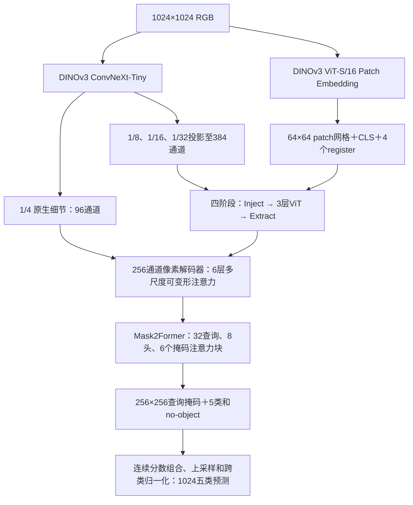

# LuSNAR：DINOv3 ViT-S/16＋ConvNeXt-Tiny＋双向 Adapter＋Mask2Former

这是独立于 `../fenge` 双 CNN 实验的新项目。两个 DINOv3 骨干都接收完整 **1024×1024** RGB；提供 A／B／C 三组可训练配置、断点续训、固定验证集选模、Moon_2/4/9 评估、TTA 和图片导出。训练入口不会启动或修改旧 CNN 实验。

```text
fenge_vit/
├── model/   # 两个 DINOv3 原始预训练权重、配置、许可证和 SHA256
├── code/    # 网络、损失、遮挡、数据、训练、评估、推理、运行验证
├── config/  # A/B/C 可运行配置
├── result/  # 检查点、训练日志、验证指标、运行检查
└── README.md
```

仓库发布位置为 `buqinch/fenge` 的 `fenge_vit/` 子目录；当前部署仍使用 `/home/lzc/workspace/fenge_vit` 这一独立工作目录。数据清单固定引用 `/home/lzc/workspace/fenge/result/selections/`，GitHub保存的是代码与文字结果快照。最新阶段判断见 [最新效果报告](result/progress_analysis/latest_report_zh.md)；[此前阶段快照](result/progress_analysis/report_zh.md) 保留用于追溯。

## 网络



- ViT 是 **非 plus 的 ViT-S/16**：384 通道、12 个 block；保留预训练模型的 CLS、4 个 register tokens 和 RoPE。只有 patch tokens 参与空间重排和 Adapter，网格始终为 64×64。
- ConvNeXt 只执行一次，产生 `96/192/384/768` 通道、步长 `4/8/16/32` 的四层特征。后三层投影为384通道并经过四轮交互；1/4原生细节独立送入像素解码器。
- 每阶段使用真正的多尺度可变形交叉注意力，先向 ViT 注入空间特征，经过3层原始 ViT block，再反向更新三层空间特征。可学习残差系数 `gamma/eta` 初值为 `1e-4`。
- 像素解码器使用六层256通道、8头、4采样点的多尺度可变形编码；查询解码器有**六个真正的解码块**，按1/32→1/16→1/8循环两次。初始预测和六块之后的预测共七组，最终一组＋六组辅助监督。
- 掩码注意力使用前一组查询掩码生成 `detach` 的空间屏蔽；整行屏蔽时恢复可访问位置，避免全屏蔽导致 NaN。查询是语义区域查询，不是已知物理实例。

骨干直接调用 `timm` 的 DINOv3 实现。Adapter 和 Mask2Former 的核心机制在独立 PyTorch 模块中实现，无需 Detectron2/MMCV 的编译环境。可变形采样使用可微 FP32 `grid_sample`，按查询分块控制峰值，不是密集普通交叉注意力的替代品；与定制 CUDA 算子的吞吐可能不同。

实现对应 [DINOv3](https://github.com/facebookresearch/dinov3/blob/main/dinov3/models/vision_transformer.py)、[ViT-Adapter](https://github.com/czczup/ViT-Adapter/blob/main/segmentation/mmseg_custom/models/backbones/adapter_modules.py)、[Mask2Former](https://github.com/facebookresearch/Mask2Former/blob/main/mask2former/modeling/transformer_decoder/mask2former_transformer_decoder.py) 的机制，ConvNeXt空间先验及当前通道、查询、层数属于本实验配置；没有声称加载官方已训练的 Mask2Former 分割模型。

## 三组对照

|组|配置|网络|随机遮挡|
|---|---|---|---|
|A|[a_fusion.json](config/a_fusion.json)|双DINO最终特征简单多尺度融合＋Mask2Former|关闭|
|B|[b_adapter.json](config/b_adapter.json)|四阶段双向Adapter＋Mask2Former|关闭|
|C|[c_adapter_masking.json](config/c_adapter_masking.json)|与B相同|解冻后启用|

三组从相同原始预训练骨干开始；公共投影和 Mask2Former 用相同 seed 初始化，新 Adapter／融合模块使用独立随机流。B／C 初始网络相同，仅训练监督不同。记录公共参数初始化哈希、数据清单哈希和每轮样本／翻转哈希，避免混入旧训练权重。

语义GT仍按每个出现的类别提供一张合并掩码，保留孔洞与不连通部分。Hungarian 分类＋掩码BCE／Dice的权重为 `2/5/5`，`no-object` 为0.1；每层独立匹配，七组预测均有监督。4096个匹配／损失点直接来自原分辨率GT，保证出现类别的正点覆盖，避免缩小标签后抹掉小岩石。

## 遮挡分支

C 每次更新都保留完整图的完整 Mask2Former 监督；解冻后约25%的**优化器更新**追加遮挡语义监督，该次更新中的所有累积微批都执行遮挡分支。不同图像独立采样，同一遮挡图同时送入两个骨干。

块大小32×32，遮挡约10%，填充归一化后的0。默认 `lambda=0.5`，解冻后的前1000次更新线性升至该权重；隐藏有效像素的监督权重 `rho=0.2`。可复现的遮挡随机数由 seed、优化器更新号和样本标识共同确定，与数据读取及损失采样随机流分开。

对被完全遮住的GT岩石、坑或山体8连通区域，仅在遮挡辅助分支忽略该区域；完整图仍正常监督。连通区域是标签定义，不假定为物理实例。

模型先由查询类别概率和查询掩码概率合成五类证据 `S`，再以 FP32 计算

```text
p = (S + 1e-8) / (sum_class(S) + 5e-8)
L_masked = (sum_visible NLL + 0.2 * sum_eligible_hidden NLL)
           / (visible_valid_pixels + eligible_hidden_pixels)
L = L_Mask2Former(full_image) + lambda * L_masked(masked_image)
```

分母不按rho加权。训练对整个累积窗口的有效像素数做归约；先完成完整图反向，再执行遮挡图前向与反向，不同时保留两幅完整计算图。遮挡思路参考 [MIC 的GT遮挡监督路径](https://github.com/lhoyer/MIC/blob/master/seg/mmseg/models/uda/masking_consistency_module.py)，这里不使用教师网络。

## 环境与预训练权重

当前服务器使用已有环境：

```bash
conda activate lzc_fenge
cd /home/lzc/workspace/fenge_vit
python code/download_weights.py --proxy http://10.134.144.213:9870
```

103 使用用户指定的 `/home/lzc/miniconda3/envs/lusnar/bin/python`。依赖见 [requirements.txt](code/requirements.txt)，已有匹配的 PyTorch／torchvision 无需升级。当前服务器为 PyTorch2.1.1/timm1.0.30，103为PyTorch2.2.2/timm1.0.22；跨软件及GPU型号不承诺逐位相同的训练轨迹。

ViT权重来自 [timm/vit_small_patch16_dinov3.lvd1689m](https://huggingface.co/timm/vit_small_patch16_dinov3.lvd1689m)，固定revision `3bf4720a82ec2066db88137180ff1f83a675cef0`、SHA256 `2a1ec16ae28ffa07bc0ead0241ee7df9fc26451fe6f9f839b7b3afa0a906b040`。ConvNeXt使用原DINOv3权重，SHA256 `a7637753a2e85d709d1a5474e13382d39e7bc581a35868b477585c970f36847f`。详见 [model/manifest.json](model/manifest.json)。模型只严格加载本地校验过的权重，缺失／不匹配即报错；不会静默随机初始化。

## 数据与训练

复用已有**同一份数据**，不依赖旧CNN模型源码：

- 固定训练清单：`/home/lzc/workspace/fenge/result/selections/random80_4000_2000_2000_seed42_20261112.json`，8000张＝4000原图＋2000坑增强＋2000山岩增强。
- 来源池及固定验证：`/home/lzc/workspace/fenge/result/selections/random80_4000_2000_2000_pool_20261112.json`，验证1601张；同一原图来源和其增强不跨集合。
- Moon_2／4／9 保留测试，分别1597／1320／2087张。类别ID固定：0月壤、1岩石、2撞击坑、3山体、4天空。

```bash
python code/train.py --config config/a_fusion.json --device cuda:2
python code/train.py --config config/b_adapter.json --device cuda:2
python code/train.py --config config/c_adapter_masking.json --device cuda:4
```

以上是三个独立运行入口；并行运行时指定不同空闲GPU。本次实际batch8、累积1、有效batch8，BF16与激活重计算开启，最多30轮。前3轮冻结两骨干，暂不遮挡；随后联合微调，骨干学习率起点5e-6，新层1e-4，按更新次数poly衰减。**冻结ViT参数时不对ViT整体使用no_grad**，插入层的梯度仍穿过冻结block。

本次指定部署为：A在103的RTX3090（物理卡2，`lusnar`），B／C在当前服务器的RTX4090（物理卡2／4，`lzc_fenge`）。A的命令需在103内通过下文挂载入口执行。已完成完整训练峰值显存实测，并按用户选择以三组实际batch8、累积1启动正式训练。部署记录见 [experiment_placement.json](result/experiment_placement.json)。

每轮完整无TTA验证，按第一次严格最高 mIoU 保存 `best.pt`。从第4轮起，连续5轮未累计提高0.05个百分点则早停；早停和严格最佳选轮分别记录。

```bash
python code/train.py --config config/c_adapter_masking.json \
  --resume result/c_adapter_masking/last.pt --device cuda:0
```

保存模型、优化器、调度器、AMP scaler、随机状态、DataLoader生成器、数据身份、实现SHA及早停状态，按完整epoch边界续训。改变数据、批次或实现不会被悄悄当作精确续训；部分样本执行检查明确标注 `partial` 并使用 `best_smoke.pt`。

A的训练日志和JSON文字结果每60秒从103同步到本机同名 `result/a_fusion/`；权重保留在训练主机，图片仍输出到共享NAS。同步配置为 [remote103.json](config/remote103.json)，状态与日志位于 `result/remote103/`。同步工具只读取远端文字，不管理训练进程。

103 的数据挂载入口保留原清单的规范路径；运行任何训练／验证命令可使用：

```bash
cd /home/lzc/workspace/fenge_vit
bash code/run_on_103.sh /home/lzc/miniconda3/envs/lusnar/bin/python \
  code/train.py --config config/a_fusion.json --device cuda:2
```

## 评估、TTA与导出

```bash
python code/evaluate.py --checkpoint result/c_adapter_masking/best.pt --split val
python code/evaluate.py --checkpoint result/c_adapter_masking/best.pt --split test
python code/evaluate.py --checkpoint result/c_adapter_masking/best.pt --split test \
  --tta multiscale_hflip --tta-sizes 1024 768 \
  --save-images --device cuda:0
python code/infer.py --checkpoint result/c_adapter_masking/best.pt \
  --input /path/to/images --tta hflip --overlay
```

TTA为完整图／水平翻转或多尺度翻转；先还原翻转坐标、统一空间尺寸，再平均归一化五类概率，最后argmax。支持 `--tta-weights 0.75 0.25`，缺省为等权；无需重训。

`miou`／`pooled_miou` 是所有评估像素混淆矩阵汇总后的 mIoU。**完整测试最终分数使用 `weighted_score=(Moon_2+Moon_4+2×Moon_9)/4`**，不把 pooled mIoU 当作比赛分数，也不平均单图 mIoU。每个场景只平均GT中实际出现的类别。数值计算保留完整精度，展示时才四舍五入。

输出逐场景／逐类别IoU、精确率、召回率、整数混淆矩阵及六个错分方向。评估另提供GT定义的大坑内部召回和小岩石召回：8连通坑区域≥16384像素后向内腐蚀5像素，小岩石区域≤256像素，阈值在1024标签网格上固定。分别记录像素召回和区域平均召回及触边数量；**这些是条件召回，不是IoU，也不等于物理实例检测结果**。

图片默认保存在NAS `/media/nas/lzc/fenge_result/<实验目录>/<评估模式>/`，每张带GT的评估样本仅保存 `comparison.jpg` 和 `metrics.json`。文字指标在本项目 `result` 另存一份；推理无GT时只导出类别ID／彩色图及可选叠加图，不虚构IoU。

## 运行检查与实验范围

```bash
python code/verify.py --device cuda:0 --size 1024
```

该入口使用真实原始预训练和真实训练图，检查A／B／C完整1024前向、冻结阶段Adapter梯度、解冻两骨干反向、优化器更新、遮挡视图共享、1024／768 TTA及严格重载。运行验证报告保存在 `result/verification_*.json`，短程训练检查位于 `result/runtime_check_*`。

本项目已完成实现、执行验证并启动三组正式训练；不把短程检查当作新分割成绩。A／B／C需要在相同划分下完成正式训练后才能判断ViT、双向交互与遮挡的收益。既有随机划分与已被查看的Moon_2/4/9成绩不能单独证明跨场景泛化；额外场景或片段隔离对照需建立独立数据清单并从未见过其验证部分的初始化训练。


已完成的运行验证：当前服务器通过10项模型、7项解码器／损失及9组训练／续训CPU检查；103的RTX3090、`lusnar`环境通过A／B／C的真实1024完整网络检查。单图检查中PyTorch峰值分配显存约为A 1.53 GiB、B 1.68 GiB、C 1.92 GiB（含冻结／解冻更新及C的遮挡分支；这不是完整训练吞吐或任意batch的显存保证）。

- [模型与可变形算子检查](result/verification_model.json)
- [Mask2Former和Hungarian损失检查](result/verification_decoder.json)
- [训练、遮挡、累积与精确续训检查](result/verification_trainer.json)
- [真实数据划分及三配置检查](result/verification_data.json)
- [完整1024 GPU检查](result/verification_runtime.json)
- [真实训练、独立评估与图片导出检查](result/verification_end_to_end.json)

PyTorch2.1的CPU oneDNN多线程BF16存在底层兼容问题；本项目CPU BF16上下文临时关闭oneDNN并在退出时恢复，CUDA BF16路径不受此设置影响。

真实GPU断点恢复检查中，随机状态、样本顺序、遮挡、调度器和验证混淆矩阵完全一致，但续训权重最大绝对差为 `4.4357e-5`；当前不承诺GPU训练逐位复现，具体原因尚未确定。完整记录见 [GPU续训对照](result/verification_resume_gpu.json)。

## 本次批大小显存实测

完整1024、BF16、激活重计算，全部骨干解冻；每个batch独立进程，1次AdamW预热后测2次更新，每次累积2个微批。C每次均实际执行完整图和遮挡图的先后反向。随后按用户选择启动三组正式训练，实际batch8、累积1；本表仍记录测试时的2次微批累积。

下表每格为“峰值实际分配／峰值缓存预留”，单位GiB，取预热及实测的最大值；不包含CUDA上下文及驱动占用。

|实际batch|A：103 RTX3090|B：当前 RTX4090|C：当前 RTX4090|
|---:|---:|---:|---:|
|1|2.13／2.47|2.30／2.61|2.30／2.68|
|2|3.14／3.65|3.46／3.85|3.46／3.95|
|4|5.24／5.93|5.80／6.57|5.80／6.68|
|8|9.45／10.52|10.55／11.94|10.55／11.99|

四档全部完成，没有OOM或非有限损失。batch8在本次实测下有余量，已按用户选择写入三组配置并启动，梯度累积为1。未测batch16及以上。C两次反向先后执行，因此峰值接近B，但执行遮挡的更新更慢。

[汇总与来源](result/memory_summary.json)；[A实测](result/memory_A_103.json)、[B实测](result/memory_B_local4090.json)、[C实测](result/memory_C_local4090.json)。

复测入口（在对应主机及其环境内运行，使用新的输出文件）：

```bash
python code/benchmark_memory.py --variant B --device cuda:2 \
  --batch-sizes 1 2 4 8 --output result/memory_B_recheck.json
```


## 103 上完整 C 模型的四卡训练

附件中的完整网络对应 C 组：DINOv3 ViT-S/16＋ConvNeXt-Tiny、四阶段双向 Adapter、完整 Mask2Former，以及解冻后启用的同步块遮挡。C 表示完整方案，训练是否完成需查看各自 `summary.json`；前三轮的遮挡次数为零属于既定冻结训练阶段。

新增独立实验 [c_adapter_masking_103_4gpu.json](config/c_adapter_masking_103_4gpu.json)，从两份原始 DINOv3 预训练权重开始，不继承本机 C 的训练检查点。使用103物理 **GPU 4／5／6／7**，每卡2张、累积1，**全局有效 batch＝8**。相同8000张训练图每轮在四卡各分配2000张，不补齐、不重复；每轮仍为1000次优化器更新。固定1601张验证按401／400／400／400分配，先合并整数混淆矩阵再计算mIoU。

本实验已于 **2026-11-12 18:49（北京时间）** 启动，首批训练日志已确认损失有限。原始完整C初始化模型SHA为`d63b934eff8e1d0cebbddaf9b6a9735608218521cfcc90a72bd353be552fc1c3`。实时进度见[同步训练日志](result/c_adapter_masking_103_4gpu/train.log)；新实验尚未产生完整验证成绩。

独立入口 `code/train_distributed.py` 复用原网络和损失；原单卡入口保持原版本。它采用同步数据并行，在完整图与可选遮挡图依次反向后，以25MiB梯度桶进行NCCL归约。分类损失按全局目标权重之和、BCE／Dice按全局匹配掩码数归约；遮挡NLL按所有卡和累积微批的有效像素数归约。冻结／解冻切换不丢失Adapter梯度，每次保存检查点前核对所有卡的模型SHA一致。

在103运行（正式任务已启动时不要重复执行）：

```bash
cd /home/lzc/workspace/fenge_vit
CUDA_VISIBLE_DEVICES=4,5,6,7 OMP_NUM_THREADS=2 \
  bash code/run_on_103.sh /home/lzc/miniconda3/envs/lusnar/bin/python \
  -m torch.distributed.run --standalone --nnodes=1 --nproc_per_node=4 \
  code/train_distributed.py --config config/c_adapter_masking_103_4gpu.json
```

断点续训使用同一命令追加 `--resume result/c_adapter_masking_103_4gpu/last.pt`。检查点保存各卡随机数和DataLoader状态，要求相同卡数与训练配置；rank 0统一写出best／last、history和summary。推理仍使用原 `code/evaluate.py`，不需要四张卡，也不需要去掉权重键名中的包装前缀。GPU多卡运行与单卡不承诺逐位相同的优化轨迹。

本机通过 [remote103_c_4gpu.json](config/remote103_c_4gpu.json) 每60秒同步该实验的文字结果到 `result/c_adapter_masking_103_4gpu/`；权重留在103，图片仍写NAS。每三轮自动测试由 [periodic_eval_c_103_4gpu.json](config/periodic_eval_c_103_4gpu.json) 管理，与A组共享103的空闲GPU3及同一显卡锁，评估完整Moon_2／4／9，使用1024／768等权翻转TTA；测试不参与best选择。部署状态及进程见 `result/c_full_103_4gpu_deployment.json`。

四卡版的验证包括不均匀GT类别数量下的全局损失与梯度、空rank、1601张无重复验证、随机状态恢复，以及真实1024冻结→解冻→遮挡训练。运行检查用少量样本，明确标记partial，不属于新的分割成绩。

[真实四卡与续训检查](result/verification_distributed_runtime.json)中，数据顺序、翻转、遮挡、各卡随机状态及调度器恢复一致，原单卡评估入口严格重载后的混淆矩阵也与四卡验证一致。独立GPU重跑的参数不是逐位相同（最大绝对差约`2.79e-4`，差异在中断前已经出现）；因此这里保证保存并恢复采样和随机状态，不承诺GPU计算逐位复现。

103实测同一完整C模型、1024输入、BF16、梯度检查点、总batch8的优化器更新耗时如下。每阶段预热一次、测量两次，包含梯度通信和参数更新；不含读取数据、验证和保存检查点。四卡每卡2张，单卡8张，累积均为1。

|阶段|单张3090|四张3090|加速比|
|---|---:|---:|---:|
|冻结骨干、完整图监督|4.114秒|2.093秒|1.97倍|
|联合训练、完整图监督|4.412秒|2.214秒|1.99倍|
|联合训练、完整图＋遮挡图监督|8.240秒|4.155秒|1.98倍|

正式训练只在25%的联合更新中启用遮挡。按本次短测推算，四卡每轮纯训练计算约35分钟（冻结阶段）或45分钟（联合阶段），完整轮次还需加上数据读取、验证与保存时间。各卡峰值PyTorch缓存预留约3.79GiB，不包含NCCL和CUDA上下文。完整原始记录见[单／四卡测速对照](result/c_full_103_speed_comparison.json)。

## 每三轮的 Moon_2／4／9 测试

A／B／C 每完成第3、6、9…轮完整验证，独立监控就固定该轮结束时由验证集选出的最佳权重，在完整5004张 Moon_2／4／9 上评估。固定使用1024＋768等权水平翻转TTA（4视图），测试batch4，输出逐场景和逐类别指标，以及1:1:2加权分数。测试成绩不参与训练的best选择或早停。

A使用103物理卡3；B／C在当前服务器物理卡3排队测试，训练继续使用各自原卡。GPU被其他计算进程占用时等待。提前停止若落在非3倍数轮次，会补做最终best测试；若同一权重和评估设置已测过，会明确记录复用来源。

每次结果单独保存在 `result/<实验>/periodic_test/epoch_003/test_metrics.json` 等目录。`trigger.json`记录触发轮次、实际best轮次及权重SHA256，`status.json`记录排队／运行／完成状态，`test.log`记录测试进度。测试使用不可变快照，成功核对完整场景覆盖和分数后清理临时权重。A的这些文字结果仍每60秒同步回当前服务器。

本机监控入口（已运行时会通过锁避免重复启动）：

```bash
python code/periodic_evaluate.py --config config/periodic_eval_local.json
```

103的监控入口在103内执行：

```bash
bash code/run_on_103.sh /home/lzc/miniconda3/envs/lusnar/bin/python \
  code/periodic_evaluate.py --config config/periodic_eval_103.json
```

两台主机的监控均已部署并通过实际环境启动检查。监控状态分别位于 `result/periodic_eval_local/state.json`、`result/periodic_eval_103/state.json`；具体测试在完成第3轮后首次触发。触发、不可变快照、重启去重与完整指标守卫的验证见 [执行验证](result/verification_periodic_evaluate.json) 和 [独立复核](result/verification_periodic_review.json)。
