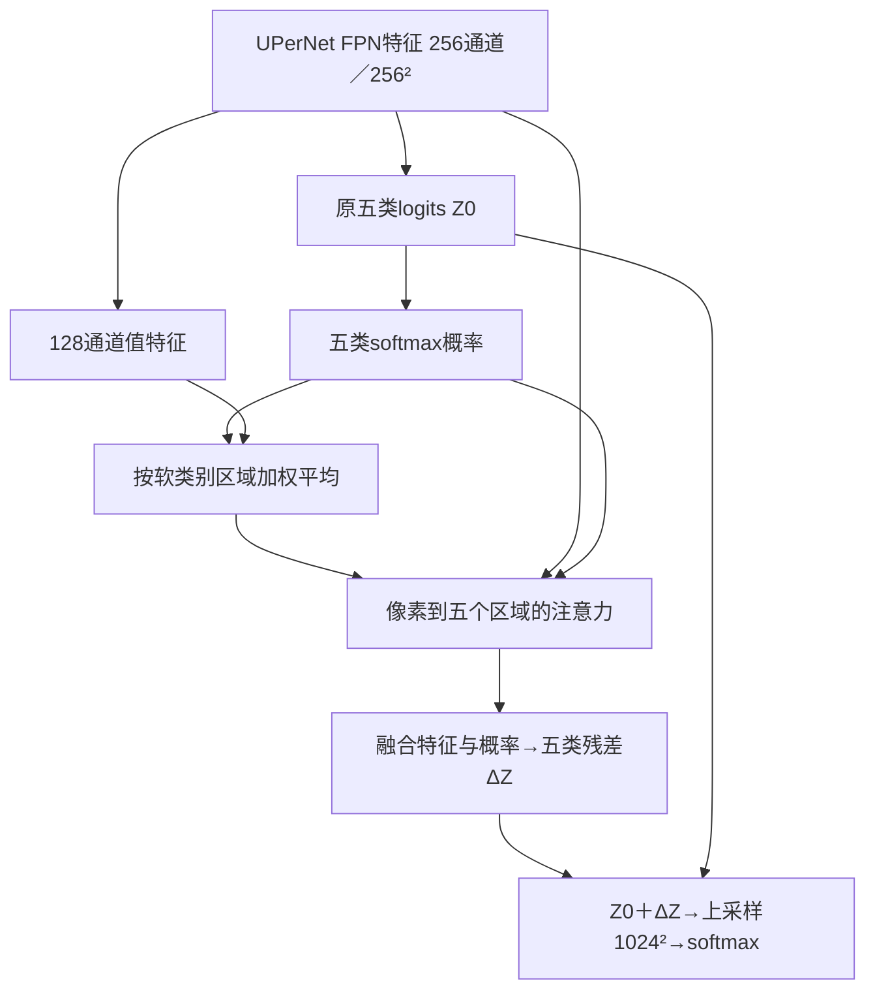
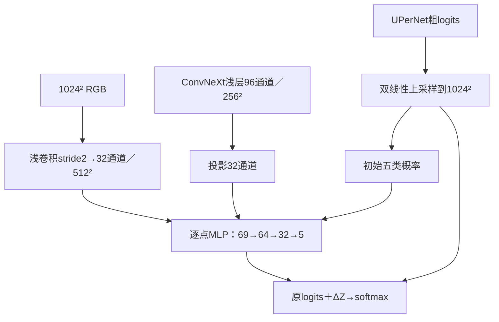

# UPerNet 区域校正与细节修正：两组独立对照

这两组从相同原始 DINOv3 ViT-L/16＋ConvNeXt-Tiny 预训练开始；Adapter、UPerNet 和新增头重新初始化。没有加载已有分割 BEST。区域校正与细节修正分别加入低学习率 UPerNet，不在本轮叠加。

|设置|两组共用|
|---|---|
|训练／验证|固定 6401 张原图／1601 张原图，来源 Moon_1/3/5/6/7/8；不加离线增强|
|输入／批次|1024；每卡 4、双卡、累积 1，总 batch 8|
|骨干学习率|ViT-L 与 ConvNeXt 均为 `2e-6`|
|其余学习率|Adapter、UPerNet、新增头均为 `1e-4`|
|初始化／冻结|原始预训练；前 3 轮冻结骨干|
|损失|原有全分辨率像素 CE＋0.4×stride-16 辅助 CE；不增加额外损失|
|精度|BF16＋激活重计算|
|训练长度|完成第 20 轮并保存后停止，自动早停关闭|
|学习率计划|沿用低学习率对照的 30 轮 poly 计划，第 20 轮由独立控制器停止；避免同时改变调度曲线|
|验证与 BEST|每轮完整 1601 张，沿用对照的 1024/768 等权水平翻转；按验证 mIoU 选 BEST|
|测试|每 5 轮及结束时，评测当时的验证 BEST；完整 Moon_2/4/9 共 5004 张，1024 原图＋水平翻转；GPU 不足时保留快照排队|
|最终评分|`S=(Moon_2 mIoU+Moon_4 mIoU+2×Moon_9 mIoU)/4`，另报逐场景及五类 IoU|

## 区域语义校正（103 GPU 4、5）

`b_adapter_upernet_ocr_vit_large_random80_original6401_lowbackbone_103_2gpu`

每类区域原型为 `r_c=Σ_x p_c(x)V(x)/max(Σ_x p_c(x),ε)`，每张图独立聚合。像素的 query 读取 FPN 特征和粗概率，对五个区域原型计算注意力；再与本地 FPN 特征、粗概率拼接，输出残差。修正末层权重和偏置均为零，初始输出严格保持原模型。

这是 [OCR 论文](https://www.ecva.net/papers/eccv_2020/papers_ECCV/html/5021_ECCV_2020_paper.php) 启发的残差头，并非 OCRNet 原样复现。周围地形信息来自已有 PPM/FPN；没有填洞、连通域强制合并或“不确定像素才可修改”的限制。一个类别原型可聚合多个不连通区域，不代表一个物理目标。

旧双 CNN 的中心—周围模块使用固定近邻、外围环与四个方向窗口的特征差分；本组新增的是由预测类别引导的全图区域聚合和像素到区域关系。两者机制不同，但旧 CNN 与新 UPerNet 的成绩不能直接作为该模块的消融对照。

实现：[upernet.py](code/vitseg/upernet.py)；配置：[区域组配置](config/b_adapter_upernet_ocr_vit_large_random80_original6401_lowbackbone_103_2gpu.json)。

## 细节修正（103 GPU 6、7）

`b_adapter_upernet_detail_vit_large_random80_original6401_lowbackbone_103_2gpu`

借鉴 [PointRend](https://arxiv.org/abs/1912.08193) 将粗预测与细粒度特征结合的思想。本版本采用**全图逐点残差细化**，不复现原论文自适应细分采样。每个原图像素都读取浅层 CNN 特征、1/2 RGB 特征和初始概率，不按不确定性筛掉高置信错误。全图 CE 同时监督岩石／坑内部、边界和非目标区域，不仅监督边缘。

RGB 分支只有两个浅卷积层：3→16（stride 2）→32；不是第三个预训练骨干。点分类器为共享的 1×1 MLP；末层零初始化。采用每块 64 行的计算与重计算控制显存，采样始终来自整幅特征，坐标采用像素中心、双线性、`align_corners=False` 和边界延拓；分块不会改变可见上下文或分块边界处的预测规则。

实现：[detail.py](code/vitseg/detail.py)；配置：[细节组配置](config/b_adapter_upernet_detail_vit_large_random80_original6401_lowbackbone_103_2gpu.json)。

## 验证、保存与判读

- 零初始化时的 FP32／BF16 输出一致性、坐标采样、分块一致性、反向梯度、严格保存重载均单独验证；双卡真实 1024、每卡 batch 4 的冻结及解冻训练步骤另行实测。
- 新增模块在独立 RNG 范围初始化，避免改变原有模块的初值；GPU 短测比较剔除新增参数后的整网权重 SHA256 与低学习率基线。
- 训练使用各自冻结的 `result/<实验>/runtime/code/`。103 保存权重、日志及 JSON；文本持续镜像到本机 `fenge_vit/result/<实验>/`。
- 对照固定低学习率 UPerNet，同时查看坑／岩石 IoU、召回与精度，以及坑→月壤、坑→山和山↔岩混淆。整坑漏检与小目标局部缺失分开抽图；轮廓更清楚不等于分类更准确。
- 验证集用于选轮。Moon_2/4/9 已长期被查看，后续测试仅作同协议开发结果报告，不称为从未查看的独立留出集。

CPU 与 GPU 检查记录分别位于 `result/verification_region_correction_20261117/` 和 `result/verification_detail_correction_20261117/`。新实验成绩须等待正式训练与完整评测产生，短测 loss 不代表模型效果。
