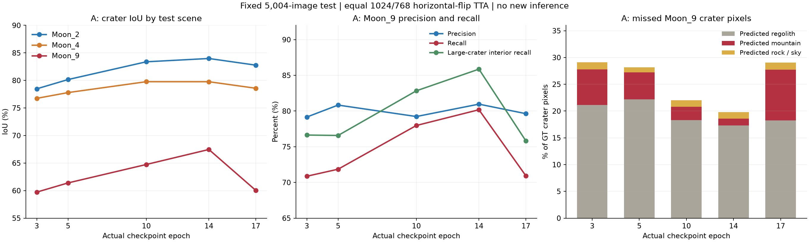

# Crater 变化趋势与提升空间

分析时间：2026-11-13T13:51:58+08:00。读取已有完整测试与验证JSON；未启动新推理或训练。

**主要结论：A组前期持续提高，第17轮出现明显回退。Moon_9的新增漏坑主要集中在坑→山体，大坑内部也明显受影响；不能据此认定结构已经达到上限。**

`epoch_015` 测试目录实际对应第14轮权重，`epoch_020` 对应第17轮；横轴和下表均使用实际权重轮次。全部测试为相同5004张、1024/768等权水平翻转。已独立从整数混淆矩阵重算IoU、mIoU和S，并核对样本身份及GT支持一致。

## A组完整测试趋势

|实际权重轮次|Moon_2坑IoU|Moon_4坑IoU|Moon_9坑IoU|加权S|
|---:|---:|---:|---:|---:|
|3|78.4775%|76.7477%|59.7268%|88.2074%|
|5|80.1612%|77.7952%|61.3958%|89.1769%|
|10|83.3838%|79.7706%|64.7425%|90.1852%|
|14|83.9832%|79.7675%|67.4661%|90.6628%|
|17|82.7728%|78.5782%|60.0365%|89.5187%|

## 第14轮到第17轮：Moon_9发生了什么

|指标|第14轮|第17轮|变化|
|---|---:|---:|---:|
|坑IoU|67.4661%|60.0365%|-7.4296个百分点|
|坑精确率|80.9665%|79.6324%|-1.3341个百分点|
|坑召回率|80.1829%|70.9279%|-9.2550个百分点|
|坑→月壤像素|5,063,804|5,333,614|+269,810|
|坑→山体像素|370,371|2,768,507|+2,398,136|
|月壤→坑像素|5,179,443|5,173,147|-6,296|
|大坑内部条件召回|85.8681%|75.8183%|-10.0498个百分点|

坑漏检净增2,706,327像素，其中坑→山体净增2,398,136，占漏检净增长的88.61%。这是汇总计数的变化，不能据此认定这些是同一批像素的逐点转换。

大坑内部判为山体的像素从127,228增加到2,001,269；内部条件召回从85.8681%降到75.8183%。因此回退涉及区域内部语义判断，单看边缘锐利程度无法解释。内部诊断使用GT八连通区域、面积≥16,384像素、腐蚀5像素；并非物理坑实例标注，也不是IoU。

总S下降1.1441个百分点，其中坑IoU的直接指标贡献为-0.8629个百分点，占总回退的75.43%。Moon_9坑一项直接贡献-0.7430个百分点。这里只做指标分解，不是因果归因。

## 验证集没有同步提示回退

|权重轮次|总体验证mIoU|验证坑IoU|
|---:|---:|---:|
|14|96.5250%|95.7492%|
|17|96.5725%|95.7662%|
|21|96.5867%|95.7421%|

第14→17轮的验证坑IoU基本持平，测试Moon_9却回退7.4296个百分点，提示当前验证指标对这类场景变化不够敏感。验证是单尺度、测试是四视图，不能把两者绝对差值全归因于场景差异；但各自协议内部随轮次变化的分歧真实存在。不能仅凭这组汇总数据证明阴影原因或精确的过拟合机制。

## 其他分支仍有提升迹象

|方案|实际检查点|Moon_9坑IoU|坑精确率|坑召回率|S|
|---|---:|---:|---:|---:|---:|
|B|14|62.8783%|85.1802%|70.6019%|90.0550%|
|C单卡8000|15|62.0381%|82.9547%|71.1018%|90.2547%|
|C四卡6000|15|62.8487%|83.6762%|71.6311%|90.6230%|

C单卡第10→15轮的Moon_9坑IoU从57.4799%提高到62.0381%；C四卡6000从60.3095%提高到62.8487%。因此并非所有方案都停止改善。不同训练量、更新次数、单卡/四卡与权重轮次有混杂，不能把分差直接归因为遮挡或增强比例。

## 建议的下一步

1. **先定位坑→山体的区域竞争。** 在固定验证集保存当前模型的GT/预测对照及五类连续分数，分别检查大坑内部、坑壁，以及错误位置的坑/山体/月壤分数差。后续保留相邻阶段的同一批预测用于配对分析；仅凭本次JSON不能知道错误像素的置信度，也不能保证历史第14轮权重还在。
2. **训练对照优先覆盖坑↔山体。** 从训练池选出这两种方向的困难样本，保留完整1024上下文；各方向分别限额，同时记录坑→月壤、月壤→坑。可以把区域类别与像素归属的辅助监督作为独立候选，先验证是否有净收益。旧困难像素设计主要覆盖坑↔月壤、山↔岩，不能直接视为已检验了当前坑↔山问题。
3. **提高验证诊断的敏感性。** 保留固定1601张主验证集和既定选轮规则，补充按来源场景、坑尺寸、内部/边界的分项曲线。后续需要检验跨场景泛化时，可另设从原预训练开始的场景隔离对照；不能把已参与训练的样本临时当成独立留出集。
4. **统一抬高坑分数暂不列为首选。** Moon_2/4精确率很高、漏检为主，但Moon_9既有漏检也有误检，简单放大分数可能扩大误检。若重试，先在验证集检查排名与分数间隔，再统一选择系数。旧CNN的γ扫描曾增加召回却降低坑IoU，不能直接转用系数到当前ViT。

在其余类别IoU保持不变的算术条件下，Moon_9坑IoU每提高1个百分点，对总S直接贡献0.1个百分点；恢复到已观察到的67.4661%，约对应S增加0.7430个百分点。实际修正也会改变竞争类别IoU，这不是下一实验的收益承诺。

A组已在21轮早停，最终验证best为第21轮；本次分析时最终测试状态为 `running`。第14轮的较高测试表现只用于诊断，不按测试成绩重新选训练best。

来源与完整复核：[逐场景坑指标](crater_metrics.csv)、[验证趋势](validation_crater_metrics.csv)、[源文件SHA及指标分解](summary.json)。历史校准见 [CNN分数扫描报告](../../../fenge/result/crater_calibration_analysis/report_zh.md)。
