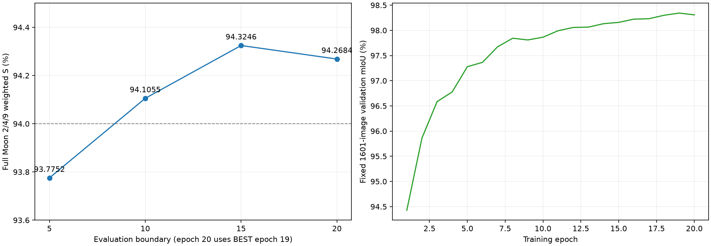

# 最新完整结果与固定训练方案

更新时间：2026-11-19T12:15:16+08:00。所有成绩均完成5004张：Moon_2 1597、Moon_4 1320、Moon_9 2087；单模型1024原图＋水平翻转两视图。

|方案|实际权重轮次|Moon_2|Moon_4|Moon_9|加权S|
|---|---:|---:|---:|---:|---:|
|4000＋1000＋1000，已测最高|15|95.5818%|96.3108%|92.7028%|**94.3246%**|
|同组训练结束的验证BEST|19|95.6456%|96.3119%|92.5581%|**94.2684%**|
|两阶段5e-6，已测最高|15|95.6011%|96.0573%|92.6119%|**94.2205%**|
|两阶段5e-6，训练结束的验证BEST|20|95.4519%|96.0130%|92.4305%|**94.0815%**|

最高成绩的五类指标：

|场景|月壤 IoU|岩石 IoU|撞击坑 IoU|山体 IoU|天空 IoU|
|---|---:|---:|---:|---:|---:|
|Moon_2|99.5306%|91.6901%|89.2410%|97.5167%|99.9308%|
|Moon_4|99.5402%|91.3952%|91.7447%|98.9446%|99.9293%|
|Moon_9|98.8540%|87.9710%|80.4862%|96.4164%|99.7865%|

S=(mIoU_2+mIoU_4+2×mIoU_9)/4。表格均由整数混淆矩阵独立复算；顶层合并像素miou与S不同。第20轮评测目录使用第19轮验证BEST，不能写成第20轮权重成绩；最终第20轮权重已保存，其自身未另行评测。

本地4000＋1000＋1000训练已完成20轮；第19轮验证最佳98.3428%，第20轮98.3077%。训练loss从第15轮0.008711降到第20轮0.007866，完整测试S从94.3246%到94.2684%，变化很小且没有重复种子证据。

原UPerNet基线仍是目前已测最高。103两阶段5e-6在第15轮94.2205%，第20轮94.0815%；数据曝光、学习率及续训策略不同，不能单独归因。新3000＋1500＋1500正在103的4／5双卡从原始预训练开始，骨干2e-6、头1e-4、20轮；本快照尚无完整测试成绩。

第20轮周期测试与最终测试错误地排入了相同第19轮BEST。重复任务已停止，最终记录复用已完成的94.2684%，不算独立测试。已在任务派发前增加检查点SHA、配置、验证身份和推理协议核对；69项CPU回归检查通过。

最高分权重：`/home/lzc/workspace/fenge_vit/result/b_adapter_upernet_vit_large_random80_4000_1000_1000_lowbackbone_local_gpu4/goal94_guard/epoch_015/checkpoint.pt`；SHA256 `069f9309563e5434991dccdafb3988f2eec04d0a394910c975e87c4c2e61ac8e`，本次重新核对实际文件。GitHub保存文字、指标和曲线，不上传权重或数据图像。

[训练建议](training_plan_zh.md) · [最高分JSON](local_epoch015_metrics.json) · [最终验证BEST的JSON](local_epoch020_metrics.json) · [所有逐类指标CSV](metrics.csv) · [训练配置](train_config.json) · [来源清单](sources.json)

完整2／4／9已经反复用于开发和比较，因此这些是已查看测试集成绩，不是新的独立留出结论。94.3246%是历史已测最高，94.2684%是本次固定验证规则选出的结束时模型表现。
