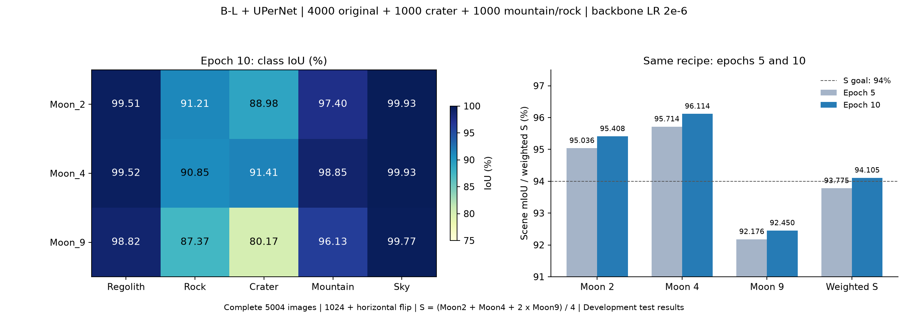

# 94.1055%：当前完整 Moon_2／4／9 最高记录

记录时间：2026-11-19T02:02:58+08:00。本次固定第10轮检查点的完整评测已完成，训练仍继续，计划在第20轮结束。结果于2026年11月18日23:27（北京时间）完成。

**加权S为94.1054695708%，超过项目94.00%的目标0.1055个百分点。** 这是当前本地已测完整场景最高记录；较此前6401原图、骨干5e-6 UPerNet第14轮的93.8405%提高0.2649个百分点。达到既定目标已经是有价值的阶段成果，可以先固定这一版本作为后续基线。

## 完整测试与五类IoU

Moon_2／4／9分别1597／1320／2087张，共5004张；每个场景使用同一份第10轮权重。各场景五类均在真值中存在，先汇总该场景全部图像的整数混淆矩阵，再计算类别IoU及五类等权mIoU。

|场景|月壤 IoU|岩石 IoU|撞击坑 IoU|山体 IoU|天空 IoU|场景mIoU|
|---|---:|---:|---:|---:|---:|---:|
|Moon_2|99.5148%|91.2103%|88.9833%|97.3995%|99.9308%|95.4077%|
|Moon_4|99.5182%|90.8527%|91.4146%|98.8527%|99.9322%|96.1141%|
|Moon_9|98.8164%|87.3705%|80.1718%|96.1262%|99.7653%|92.4500%|

`S=(mIoU_Moon_2 + mIoU_Moon_4 + 2×mIoU_Moon_9)/4 = 0.9410546957082757`。

JSON的`weighted_score`对应S。顶层`miou`／`pooled_miou`为合并5004张像素混淆矩阵后的94.0453%，与场景加权S定义不同。不能把逐图mIoU平均值、合并像素mIoU与S互相替代。



### 精确率与召回率

|场景|类别|精确率|召回率|
|---|---|---:|---:|
|Moon_2|月壤|99.6928%|99.8209%|
|Moon_2|岩石|96.2463%|94.5745%|
|Moon_2|撞击坑|99.3633%|89.4936%|
|Moon_2|山体|97.9927%|99.3823%|
|Moon_2|天空|99.9613%|99.9695%|
|Moon_4|月壤|99.6542%|99.8631%|
|Moon_4|岩石|96.7259%|93.7354%|
|Moon_4|撞击坑|98.3316%|92.8547%|
|Moon_4|山体|99.6661%|99.1812%|
|Moon_4|天空|99.9625%|99.9697%|
|Moon_9|月壤|99.2886%|99.5209%|
|Moon_9|岩石|94.7110%|91.8521%|
|Moon_9|撞击坑|90.6677%|87.3825%|
|Moon_9|山体|98.0420%|98.0077%|
|Moon_9|天空|99.8284%|99.9366%|

## 模型、初始化和训练设置

模型为 **B-L：DINOv3 ViT-L/16＋DINOv3 ConvNeXt-Tiny＋四阶段双向Adapter＋原UPerNet**。没有加入OCR区域语义校正、细节修正或C组RGB遮挡训练；成绩来自单模型。

ViT-L包含24层、1024维patch表示；Adapter四组对应第6／12／18／24层交互，宽1024、16头、每头每尺度4个采样点。CNN浅层stride4特征与Adapter的stride8／16／32特征进入256通道UPerNet。最深层PPM采用1／2／3／6池化尺度，再做FPN融合、五类像素分类，上采样到1024。训练另有stride16辅助分类头；小batch采用GroupNorm。

|项目|本次实际设置|
|---|---|
|初始化|原始DINOv3 ViT-L与ConvNeXt预训练；不加载已训练分割权重，严格加载检查通过|
|输入／精度|1024×1024；BF16；激活重计算|
|训练设备／batch|本机物理GPU4单卡；batch4，累积2，有效batch8|
|骨干／Adapter与解码头基础学习率|2e-6／1e-4|
|优化器|AdamW，weight decay 0.01，梯度裁剪1.0|
|冻结计划|前3轮冻结骨干，第4轮开始解冻|
|损失|全分辨率像素交叉熵＋0.4×辅助交叉熵|
|种子|划分与训练配置seed42；进程训练随机流按原入口派生|
|每轮更新／第10轮累计|750／7500次优化器更新|
|学习率与终点|保留启动时30轮poly计划，power0.9；由独立控制器在第20轮保存后结束，无指标早停|
|验证及选轮|每轮完整1601张，1024／768等权水平翻转；按累计混淆矩阵mIoU选首个严格最高BEST|
|本检查点验证mIoU|第10轮 97.8640%，与完整测试S口径不同|
|完整测试计划|每5轮及训练结束，评测当时的验证BEST|

保存的通用配置中仍有query数、mask BCE／Dice权重等Mask2Former字段；本次`decoder_type=upernet`路径不启用这些查询及匹配损失。学习率数值是基础值，解冻后实际值随poly调度变化。

## 数据构造

Moon_1／3／5／6／7／8共有8002张原图，按来源家族以seed42做4∶1划分：6401张合法训练原图来源、1601张固定验证原图。**本次实际从合法训练池取4000原图＋1000坑增强＋1000山岩增强，共6000张**，并不是6401张原图再加增强。

6000张对应4561个原图父来源。增强父图可以没有被所选4000张原图覆盖，但都属于合法6401训练来源，与1601验证来源零交叉。验证不含增强；Moon_2／4／9图片和标签不进入训练或本次选轮验证。数据读入使用逐文件内容核验的本地只读缓存。

|验证场景|张数|第10轮场景mIoU|
|---|---:|---:|
|Moon_1|217|99.2656%|
|Moon_3|253|97.7905%|
|Moon_5|324|97.6722%|
|Moon_6|216|97.3548%|
|Moon_7|334|97.5405%|
|Moon_8|257|96.9044%|

完整验证的97.8640%来自所有验证图像的合并混淆矩阵，不能直接平均上表六个场景分数得到。`data_identity.json`中的10401是候选池大小；实际训练量以`selection_counts`和`image_count=6000`为准。

数据选择清单：`/home/lzc/workspace/fenge/result/selections/random80_4000_1000_1000_seed42_20261112.json`；SHA256：`cc84cca17b89f88ee514918f65dfd88d8682e7c673275ea7db5a45803716cdfd`。

## 同协议结果与变化

下表均为完整5004张、1024原图＋水平翻转、同一1∶1∶2评分公式。训练组成、预算及训练轨迹不同，因此只作结果记录，不能把差值归因于单一因素。

|方案|训练组成|实际权重轮次|Moon_2|Moon_4|Moon_9|加权S|
|---|---|---:|---:|---:|---:|---:|
|本次6000张，骨干2e-6|4000＋1000＋1000|10|95.4077%|96.1141%|92.4500%|**94.1055%**|
|[同组6000张，骨干2e-6](comparisons/same_recipe_epoch005.json)|4000＋1000＋1000|5|95.0357%|95.7135%|92.1758%|93.7752%|
|[历史原UPerNet，骨干5e-6](comparisons/original6401_lr5e6_epoch014.json)|6401原图|14|95.3825%|96.1529%|91.9133%|93.8405%|
|[两阶段UPerNet，骨干5e-6](comparisons/curriculum_lr5e6_epoch010.json)|前5轮4000，后5轮6000|10|95.2944%|95.8545%|92.2951%|93.9348%|
|[原UPerNet，骨干2e-6，训练结束验证BEST](comparisons/original6401_lr2e6_epoch020.json)|6401原图|20|95.4363%|96.1404%|91.4137%|93.6010%|
|[区域校正，骨干2e-6，训练结束验证BEST](comparisons/ocr6401_lr2e6_epoch020.json)|6401原图|20|95.3311%|96.0684%|91.2217%|93.4608%|
|[细节修正，骨干2e-6，训练结束验证BEST](comparisons/detail6401_lr2e6_epoch019.json)|6401原图|19|95.5557%|96.2546%|91.2489%|93.5770%|

同组第5→10轮S提高0.3303个百分点；但Moon_9坑IoU变化为-0.2120个百分点，岩石变化为+0.7361个百分点。**总分提高没有证明坑漏检已经解决。** 校正头两组在训练结束时也未超过原UPerNet；这里尚无多种子统计，不能据此宣称它们普遍无效。

### 前10轮训练记录

|轮次|平均训练总损失|完整验证mIoU（四视图）|骨干冻结|
|---|---:|---:|---|
|1|0.080795|94.4271%|True|
|2|0.024145|95.8592%|True|
|3|0.019654|96.5843%|True|
|4|0.016291|96.7774%|False|
|5|0.014177|97.2781%|False|
|6|0.012772|97.3644%|False|
|7|0.011866|97.6739%|False|
|8|0.011196|97.8434%|False|
|9|0.010619|97.8092%|False|
|10|0.010282|97.8640%|False|

## 94分的含义和剩余短板

94.1055%已经完成本项目目标，Moon_2／4均超过95%，Moon_9超过92%；作为当前项目阶段结果已经很强。它不能单独证明官方排名、跨数据集能力或统计显著领先。没有必要为了继续追小数点而立即叠加新模块。

主要短板仍为Moon_9坑IoU80.1718%、岩石IoU87.3705%。坑精确率90.6677%、召回87.3825%，同时存在漏检与误检。该场景坑→月壤3,456,652像素，月壤→坑2,546,022像素；岩石→月壤6,946,597像素。应同时观察两个方向，避免单纯扩大坑预测。

按场景权重计算的五类IoU中，坑与岩石合计占距离100%评分差距的86.91%；这是评分差距分解，不是错误像素占比。后续如继续优化，优先从已固定模型的漏检／误检样本检查入手，独立验证改动；目前保留现有训练安排即可。

## 推理与复核

本次测试为**单1024原图＋水平翻转两视图**：每个视图产生五类概率，翻转结果映射回原坐标，以FP32平均概率后再argmax。没有768视图、B/C多模型融合、坑分数系数或额外包络后处理。

103物理GPU4／5各处理2502张，按清单索引交错分片且无重复；合并逐场景整数混淆矩阵后计算指标，完整覆盖已核对。GPU4／5上的本次推理约18.9分钟，不含排队和传输，不作为通用速度基准。

用于核对同一权重的单卡命令（仅记录，不在此次发布中启动）：

```bash
cd /home/lzc/workspace/fenge_vit
CUDA_VISIBLE_DEVICES=4 /home/vrlab/miniconda3/envs/lzc_fenge/bin/python \
  result/b_adapter_upernet_vit_large_random80_4000_1000_1000_lowbackbone_local_gpu4/runtime/code/evaluate.py \
  --checkpoint result/b_adapter_upernet_vit_large_random80_4000_1000_1000_lowbackbone_local_gpu4/goal94_guard/epoch_010/checkpoint.pt \
  --split test --test-manifest /home/nas/lzc/lusnar_test_eval_20261102/data/manifest.json \
  --tta hflip --amp bf16 --batch-size 1 --workers 4 \
  --output /tmp/goal94_epoch010_recheck.json
```

需保留该实验的冻结runtime及预训练目录；当前工作代码可能已变化。训练源文件hash在[配置](train_config.json)的`source_sha256`及[源快照](training_source_snapshot.json)中。复现时不要覆盖仍在运行的训练目录。

## 权重与原始证据

固定保留权重：

```text
/home/lzc/workspace/fenge_vit/result/b_adapter_upernet_vit_large_random80_4000_1000_1000_lowbackbone_local_gpu4/goal94_guard/epoch_010/checkpoint.pt
```

- 检查点SHA256：`de0bafef9de01fe21fb4f316f2eb497c4c9601cdbad34f38cc29bf3047e955fa`，本次发布前重新读取实际文件核对通过。
- 文件4,381,992,452字节，包含训练状态；不是仅模型参数的体积。
- [保留记录](checkpoint_retention.json)；当前滚动`best.pt`可能已更新，不能替代这个固定第10轮文件。
- [完整测试原始JSON](test_epoch010_metrics.json)，SHA256：`a760810911ee6b42506ce234b4cce30a2f04bc974acbbc3f7a5b1e01063761e3`。
- [逐类IoU／精确率／召回率CSV](metrics.csv) · [整数混淆矩阵CSV](confusion_matrices.csv) · [前10轮数据CSV](history_through_epoch010.csv)。
- [第10轮验证原始JSON](validation_epoch010.json) · [训练配置](train_config.json) · [数据身份](data_identity.json) · [来源家族预检查](data_preflight.json)。
- [机器可读汇总](summary.json) · [来源SHA256与复核记录](sources.json) · [测试触发与选轮记录](evaluation_trigger.json)。

权重、预训练文件和图像不上传GitHub，GitHub保存文字指标、配置与证据。**Moon_2／4／9已多次用于开发和方案选择，这个94.1055%是已查看测试集上的本地开发成绩；不是未经查看的留出成绩，也不等同于官方平台成绩。** 本次无多种子重复或显著性检验。
