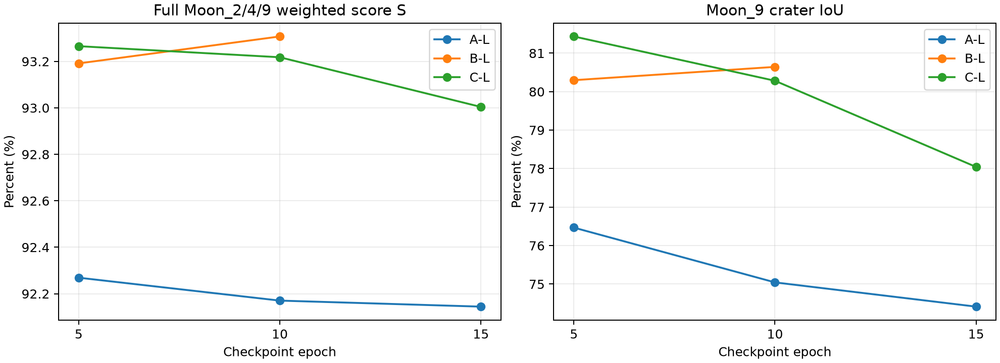

# DINOv3 ViT-L：A／B／C 完整测试与结构分析

快照时间：2026-11-15T10:59:27+08:00。只纳入已完成的 Moon_2／4／9 全部5004张评测；A/B源文件为103服务器的本地文字镜像，C为本机训练的评测结果。训练仍在继续，尚未完成的评测不参与比较。

**当前最高：B-L第10轮，加权S=93.3075%。** C-L第5轮为93.2656%，相差仅0.0419个百分点。三组均已在当前评测协议下超过92%。

## 共同数据、训练及选模口径

训练固定为 **4000张原图＋1000张撞击坑增强＋1000张山岩增强＝6000张**。原图从Moon_1／3／5／6／7／8的8002张池中按固定种子42抽取；增强父图允许来自同一训练来源池中未入选4000原图的样本。训练未混入Moon_2／4／9原图。样本及顺序由[训练清单](../../../result/selections/pool8002_train6000_hardval1500_seed42_20261113.json)固定，SHA256：`68bb4ab8410fb36009d4f6a5818d3943a7f675769a4cd73c9e281a5a82ac7e09`。

最初使用从Moon_2／4／9筛出的困难1500张（188／187／1125）验证选模。之后按要求切换为 **不再运行困难验证、不提前结束、最多30轮、每5轮评测当轮权重的完整5004张**，严格按最高加权S保存 `best_full_test.pt`，并保留最终 `final.pt`。A／B／C分别从已完成第6／3／4轮的检查点续训切换；A第5轮另补测了当轮固定快照，没有拿第4轮旧验证best代替。

**完整Moon_2／4／9已用于模型选择，并包含原困难验证1500张，不能作为独立留出测试集。** 本报告是当前反复评测协议下的结果，不是新的官方平台成绩。不同训练轮次、设备与一次随机种子不能证明Adapter或遮挡的因果收益。

三组从同源原始DINOv3 ViT-L/16和DINOv3 ConvNeXt-Tiny预训练开始，未加载旧任务best；输入1024×1024整图，每卡batch4×2卡、累积1，总batch8；每轮750次更新。前3轮冻结骨干，之后联合微调；开启BF16和激活重计算，头部学习率1e-4、骨干5e-6、权重衰减0.01、poly幂0.9。

全部本次完整评测采用 **1024＋768等权水平翻转TTA，共4视图**：每尺度平均原图及翻转后对齐的概率，再按0.5／0.5融合并argmax。先按场景累计整数混淆矩阵，再对GT存在的类别等权平均。计分 `S=(Moon_2 mIoU+Moon_4 mIoU+2×Moon_9 mIoU)/4`；`pooled_miou`是合并场景像素后的另一统计量，不用于排名。

|模型|训练设备|已完成训练轮|已完成完整测试轮|最佳轮|完整测试加权S|
|---|---|---:|---|---:|---:|
|A-L|103，RTX 3090 4/5|20|5、10、15|5|92.2690%|
|B-L|103，RTX 3090 6/7|13|5、10|10|93.3075%|
|C-L|local，RTX 4090 3/4|16|5、10、15|5|93.2656%|

## A-L／B-L／C-L的实际结构

共同骨干：ViT-L/16为24个Transformer块、1024维、16个注意力头；1024输入形成64×64 patch网格。保留DINOv3自身token与RoPE行为。ConvNeXt-Tiny输出stride4／8／16／32的96／192／384／768通道特征。共同Mask2Former宽度256，像素编码器6层、32个查询、6个查询解码块；输出五类＋no-object分类以及查询掩码。

|结构|A-L：直接融合|B-L：双向Adapter|C-L：Adapter＋RGB遮挡|
|---|---|---|---|
|ViT信息使用|只用第24层最终patch特征|四段各6块：第6／12／18／24层交互|与B-L相同|
|两骨干连接|ViT最终1024通道插值至CNN三个深层尺度；各CNN特征投影384，拼接1408→384|每段之前CNN→patch，之后patch→空间特征；宽1024、16头、4采样点|与B-L相同|
|解码器输入通道（stride4/8/16/32）|96／384／384／384|96／1024／1024／1024|96／1024／1024／1024|
|浅层路径|stride4的96通道CNN特征直达解码端|同左|同左|
|RGB训练遮挡|关闭|关闭|开启额外遮挡视图监督|
|整网参数量|348,105,254|367,832,870|367,832,870|

A-L中的 `adapter_dim=384` 实际用于融合宽度，并不建立四阶段交互Adapter。B/C在训练中分阶段双向交换信息，不是从ViT抽取四张独立特征后拼接。

基础监督均为Mask2Former Hungarian匹配分类CE、mask BCE/Dice及深监督，共7组预测监督；基础路径没有另加全图像素CE。每个出现的语义类别对应一张union mask，允许不连通与孔洞，no-object不等于天空。

C-L额外遮挡：前3轮冻结期关闭；解冻后约25%的optimizer更新追加RGB遮挡视图，两骨干使用同一遮挡。32×32块中随机遮挡102块，即约9.9609%面积；额外监督为语义NLL，隐藏位置权重0.2，辅助系数在解冻后的1000次全部optimizer更新内线性升至0.5。原始无遮挡图的基础监督始终保留。

## 每组最佳完整测试成绩

每组取已完成评测中的严格最高S；下表由原始整数混淆矩阵复算。

|模型／轮次|Moon_2 mIoU|Moon_4 mIoU|Moon_9 mIoU|加权S|pooled mIoU（非计分）|
|---|---:|---:|---:|---:|---:|
|A-L／5|93.7111%|93.6431%|90.8608%|**92.2690%**|92.1712%|
|B-L／10|94.2910%|94.5132%|92.2129%|**93.3075%**|93.2623%|
|C-L／5|94.1251%|94.2988%|92.3193%|**93.2656%**|93.2130%|

### A-L第5轮：逐场景五类IoU、精确率、召回率

[原始完整指标](../a_fusion_vit_large_pool8002_train6000_hardval1500_103_2gpu/periodic_test/epoch_005/test_metrics.json) · [配置](../a_fusion_vit_large_pool8002_train6000_hardval1500_103_2gpu/run_config.json) · [best选择记录](../a_fusion_vit_large_pool8002_train6000_hardval1500_103_2gpu/best_full_test.json)

|场景|类别|IoU|精确率|召回率|
|---|---|---:|---:|---:|
|Moon_2|月壤|99.3249%|99.6256%|99.6971%|
|Moon_2|岩石|88.2808%|93.3037%|94.2525%|
|Moon_2|撞击坑|85.6445%|98.7137%|86.6111%|
|Moon_2|山体|95.5900%|96.7687%|98.7418%|
|Moon_2|天空|99.7150%|99.8664%|99.8483%|
|Moon_4|月壤|99.2052%|99.4800%|99.7224%|
|Moon_4|岩石|88.4381%|93.5893%|94.1411%|
|Moon_4|撞击坑|83.5098%|97.8587%|85.0641%|
|Moon_4|山体|97.3154%|98.6776%|98.6014%|
|Moon_4|天空|99.7471%|99.8740%|99.8728%|
|Moon_9|月壤|98.5309%|99.3586%|99.1617%|
|Moon_9|岩石|85.5141%|92.3366%|92.0468%|
|Moon_9|撞击坑|76.4672%|84.4457%|89.0029%|
|Moon_9|山体|94.2647%|96.3602%|97.7451%|
|Moon_9|天空|99.5273%|99.7077%|99.8185%|

最佳权重SHA256：`be060dec6ebf3929544a6e584bf810ae2467b467fe36b6e0b88d2606ffcc651b`。权重位置：`a_fusion_vit_large_pool8002_train6000_hardval1500_103_2gpu/best_full_test.pt`；A/B权重在103，C权重在本机。

### B-L第10轮：逐场景五类IoU、精确率、召回率

[原始完整指标](../b_adapter_vit_large_pool8002_train6000_hardval1500_103_2gpu/periodic_test/epoch_010/test_metrics.json) · [配置](../b_adapter_vit_large_pool8002_train6000_hardval1500_103_2gpu/run_config.json) · [best选择记录](../b_adapter_vit_large_pool8002_train6000_hardval1500_103_2gpu/best_full_test.json)

|场景|类别|IoU|精确率|召回率|
|---|---|---:|---:|---:|
|Moon_2|月壤|99.3684%|99.6517%|99.7148%|
|Moon_2|岩石|88.9868%|94.2860%|94.0593%|
|Moon_2|撞击坑|87.6425%|98.7631%|88.6152%|
|Moon_2|山体|95.7297%|96.7207%|98.9410%|
|Moon_2|天空|99.7274%|99.8719%|99.8551%|
|Moon_4|月壤|99.2865%|99.5241%|99.7601%|
|Moon_4|岩石|88.8337%|94.3937%|93.7817%|
|Moon_4|撞击坑|87.4377%|98.2592%|88.8135%|
|Moon_4|山体|97.2880%|98.4805%|98.7707%|
|Moon_4|天空|99.7199%|99.8963%|99.8233%|
|Moon_9|月壤|98.7243%|99.2738%|99.4424%|
|Moon_9|岩石|86.3855%|93.4021%|91.9995%|
|Moon_9|撞击坑|80.6437%|92.4018%|86.3712%|
|Moon_9|山体|95.7300%|97.6686%|97.9687%|
|Moon_9|天空|99.5809%|99.7297%|99.8504%|

最佳权重SHA256：`24a663c0ea3388a4a2dc5e9a150f789c0c5402d83ed91039823e2ed65f75b4c2`。权重位置：`b_adapter_vit_large_pool8002_train6000_hardval1500_103_2gpu/best_full_test.pt`；A/B权重在103，C权重在本机。

### C-L第5轮：逐场景五类IoU、精确率、召回率

[原始完整指标](../c_adapter_masking_vit_large_pool8002_train6000_hardval1500_2gpu/periodic_test/epoch_005/test_metrics.json) · [配置](../c_adapter_masking_vit_large_pool8002_train6000_hardval1500_2gpu/run_config.json) · [best选择记录](../c_adapter_masking_vit_large_pool8002_train6000_hardval1500_2gpu/best_full_test.json)

|场景|类别|IoU|精确率|召回率|
|---|---|---:|---:|---:|
|Moon_2|月壤|99.3521%|99.6420%|99.7080%|
|Moon_2|岩石|88.3243%|93.5023%|94.1001%|
|Moon_2|撞击坑|87.4650%|98.7878%|88.4139%|
|Moon_2|山体|95.7557%|96.9202%|98.7608%|
|Moon_2|天空|99.7284%|99.8792%|99.8487%|
|Moon_4|月壤|99.2687%|99.5190%|99.7473%|
|Moon_4|岩石|88.5653%|93.9166%|93.9554%|
|Moon_4|撞击坑|86.5804%|98.2823%|87.9107%|
|Moon_4|山体|97.3385%|98.5937%|98.7090%|
|Moon_4|天空|99.7411%|99.8978%|99.8429%|
|Moon_9|月壤|98.7725%|99.3358%|99.4291%|
|Moon_9|岩石|86.4100%|93.1089%|92.3138%|
|Moon_9|撞击坑|81.4345%|91.9317%|87.7026%|
|Moon_9|山体|95.4003%|97.3599%|97.9338%|
|Moon_9|天空|99.5791%|99.7572%|99.8210%|

最佳权重SHA256：`d4d0eb32f1eaf32f37ef7662f1da54543cd7d9f73367ff0123bfdb17a67488a4`。权重位置：`c_adapter_masking_vit_large_pool8002_train6000_hardval1500_2gpu/best_full_test.pt`；A/B权重在103，C权重在本机。

## 完整测试趋势

|模型|当轮权重|Moon_2 mIoU|Moon_4 mIoU|Moon_9 mIoU|加权S|Moon_9坑IoU|Moon_9坑精确率|Moon_9坑召回率|
|---|---:|---:|---:|---:|---:|---:|---:|---:|
|A-L|[5](../a_fusion_vit_large_pool8002_train6000_hardval1500_103_2gpu/periodic_test/epoch_005/test_metrics.json)|93.7111%|93.6431%|90.8608%|92.2690%|76.4672%|84.4457%|89.0029%|
|A-L|[10](../a_fusion_vit_large_pool8002_train6000_hardval1500_103_2gpu/periodic_test/epoch_010/test_metrics.json)|93.6748%|93.6255%|90.6906%|92.1704%|75.0437%|86.6948%|84.8116%|
|A-L|[15](../a_fusion_vit_large_pool8002_train6000_hardval1500_103_2gpu/periodic_test/epoch_015/test_metrics.json)|93.7396%|93.8794%|90.4794%|92.1444%|74.4138%|84.2156%|86.4747%|
|B-L|[5](../b_adapter_vit_large_pool8002_train6000_hardval1500_103_2gpu/periodic_test/epoch_005/test_metrics.json)|94.1645%|94.3396%|92.1309%|93.1915%|80.2981%|92.7185%|85.7026%|
|B-L|[10](../b_adapter_vit_large_pool8002_train6000_hardval1500_103_2gpu/periodic_test/epoch_010/test_metrics.json)|94.2910%|94.5132%|92.2129%|93.3075%|80.6437%|92.4018%|86.3712%|
|C-L|[5](../c_adapter_masking_vit_large_pool8002_train6000_hardval1500_2gpu/periodic_test/epoch_005/test_metrics.json)|94.1251%|94.2988%|92.3193%|93.2656%|81.4345%|91.9317%|87.7026%|
|C-L|[10](../c_adapter_masking_vit_large_pool8002_train6000_hardval1500_2gpu/periodic_test/epoch_010/test_metrics.json)|94.3378%|94.6979%|91.9180%|93.2179%|80.2828%|92.7481%|85.6599%|
|C-L|[15](../c_adapter_masking_vit_large_pool8002_train6000_hardval1500_2gpu/periodic_test/epoch_015/test_metrics.json)|94.3482%|94.6137%|91.5272%|93.0041%|78.0437%|93.3766%|82.6172%|

训练损失、已完成训练轮与对应完整测试分数见[history.csv](history.csv)。未完成完整测试的轮次保持空白，不以训练损失或困难验证分数代填。

## 瓶颈与下一步候选

1. **优先保留B-L当前最佳与C-L第5轮，继续按既定30轮计划观察。** B-L第5→10轮S上升0.1160个百分点；C-L第5→15轮下降0.2615个百分点；A-L第5→15轮下降0.1245个百分点。训练更久没有自动带来更高S，当前保存最高全测分数的策略有实际价值；此处不改变已设置的无早停训练。

2. **主要突破口仍是Moon_9的坑与岩石。** B-L最佳的Moon_9坑IoU为80.6437%、岩石86.3855%，月壤98.7243%、天空99.5809%。五类等权且Moon_9场景权重为1/2，其它指标不变时，Moon_9单一类别IoU每提高1个百分点，S约提高0.1个百分点。应同时检查漏坑与扩坑，不能只看边界是否更锐利。

3. **C后段的坑判断趋于保守，值得做弱化遮挡的独立对照。** C-L第5→15轮Moon_9坑精确率91.9317%→93.3766%，召回率87.7026%→82.6172%，IoU81.4345%→78.0437%；坑→月壤错分从3,276,277增至4,351,969像素，月壤→坑从2,072,552降至1,628,009像素。可固定其它配置，从同一预训练与相同种子比较较低辅助权重或更迟启用遮挡；每次只改一个因素。该趋势不能单独证明遮挡是退化原因。

4. **先尝试B第10轮与C第5轮的固定概率融合。** 两者网络结构相同，但B在Moon_2／4更好，C在Moon_9的坑更好；可先统计逐像素错误重合，再试全图统一的0.5／0.5概率平均。各模型先完成相同四视图TTA和五类归一化，最后平均、argmax，不按场景挑权重。推理约需两倍前向；聚合指标不能证明像素错误互补，尚不能保证有收益。

5. **下一轮训练把较低解冻学习率与EMA分开对照。** 骨干5e-6→1e-6、头部1e-4→5e-5可作为低学习率候选，用于检验后段泛化下降是否与微调幅度有关，并非已验证最优值。另一个候选是在训练中累计EMA权重；[PyTorch AveragedModel](https://docs.pytorch.org/docs/2.15/generated/torch.optim.swa_utils.AveragedModel.html)提供权重平均实现参考，但不证明本任务会提升。已删除的中间检查点不能事后重建准确EMA。固定相同初始化、数据与预算分别检验，不同时更改遮挡强度。

6. **训练优化先定位漏坑内部与小岩石的样本分布。** 用固定逐图清单检查亮度、物体尺寸及遮挡区域；大坑内部漏检优先补充完整上下文中的语义监督，小岩石边界问题再考虑原图细节分支。新增模块与同硬件、同数据、同更新预算的B-L做对照，避免把模型、训练时长与数据变化一起归因。

## 复算与来源

本次独立复算8份完整评测的24个场景混淆矩阵及120组类别指标。矩阵为非负整数且行列顺序固定；核对场景图像数1597／1320／2087、像素总数、逐类IoU/precision/recall、场景mIoU、pooled mIoU和加权S，与源记录误差不超过1e-12。各组 `best_full_test.json` 的SHA和分数与复算严格最高结果一致。

A第5轮源检查点处于旧训练协议，内部旧 `best_epoch=4` 表示当时验证最佳轮；实际补测为epoch5固定权重。评测记录保留了原先推断的 `reported_checkpoint_choice` 和元数据纠正依据，分数与混淆矩阵未改动。

- [metrics.csv](metrics.csv)：所有完整评测的逐场景逐类IoU、precision、recall及TP/FP/FN，数值为0–1。
- [history.csv](history.csv)：各组逐轮训练与已完成完整测试。
- [summary.json](summary.json)：复算指标、完整混淆矩阵、源文件SHA256、模型配置及最佳权重SHA。

原始ViT-L预训练SHA256：`45172f209c9583c40538afc26b60a07033e6fcc2e8c30228338e6b2e932e7941`；原始ConvNeXt-Tiny预训练SHA256：`a7637753a2e85d709d1a5474e13382d39e7bc581a35868b477585c970f36847f`。两骨干均严格加载。权重SHA引用各次评测及保留best记录，本次未重新读取数GB权重计算哈希。
