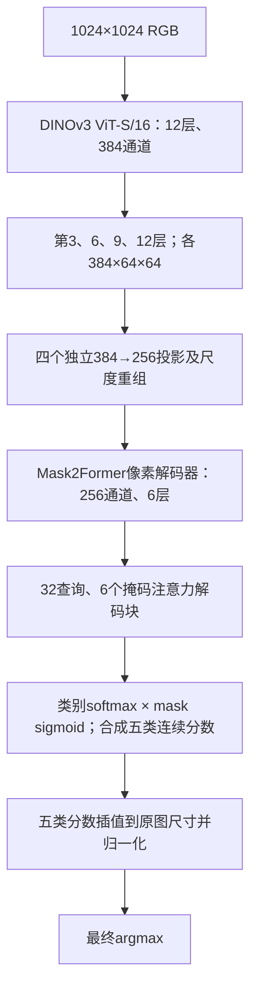

# LuSNAR：纯 DINOv3 ViT-S/16 + Mask2Former

这是与 A 组 `a_fusion` 对照的 **V0-M2F** 实验。图像编码器只有一个 DINOv3 ViT-S/16；没有 ConvNeXt、MobileNet、双向 Adapter 或原图 CNN 旁路。patch embedding、通道投影及像素解码器仍使用卷积。

2026-11-13 10:37（北京时间）已在本机 RTX 4090 GPU 0 启动正式训练，从原始 ViT 预训练开始，实际 batch 8、累积 1。该启动快照尚无完整验证或测试成绩。[训练日志](result/vit_only_m2f_8000_1024/train.log) · [启动记录](result/vit_only_m2f_8000_1024/launch.json) · [周期测试配置](config/periodic_eval.json)。

```text
fenge_vit_only/
├── model/       # 原始 ViT 预训练及来源、SHA256
├── code/        # 网络、训练、评估、推理、运行验证、周期测试
├── result/      # 检查点、逐轮指标、验证报告与测试结果
├── config/      # 正式训练与周期测试配置
└── README.md
```

独立目录用于保留正在运行的 A/B/C 实验源码及其 SHA 校验。解码器、损失、数据读取、评分、TTA 和目标诊断实现直接复用 A 组；逐文件哈希及配置对照见 [protocol_verification.json](result/protocol_verification.json)。

## 网络



| ViT 层（从 1 开始） | 归一化 patch 特征 | 独立投影后操作 | 输出形状（省略 batch） |
|---|---|---|---|
| 3 | 384×64×64 | 双线性上采样 4 倍 | 256×256×256，stride 4 |
| 6 | 384×64×64 | 双线性上采样 2 倍 | 256×128×128，stride 8 |
| 9 | 384×64×64 | 保持尺寸 | 256×64×64，stride 16 |
| 12 | 384×64×64 | 2×2 平均池化 | 256×32×32，stride 32 |

保留原始 token 准备、RoPE、CLS 和 4 个 register。各选中层单独应用预训练模型的最终归一化，去掉 5 个前缀 token 后按原始坐标重排；归一化输出不反馈给后续 ViT 层。插值统一 `align_corners=False`。尺度重组提供解码接口，不声称恢复了 patch 化之前的细节。

**输出顺序按用户确认沿用 A 组**：先对查询类别 softmax、mask sigmoid，合成五类分数，再插值到 1024，最后沿类别归一化。没有改成“先上采样 mask logits 再 sigmoid”。`semantic_logits` 保存归一化概率的对数，合成分数不会被误作 logits 再 softmax。TTA 在每个尺度平均原图和水平翻转后对齐的概率，再按尺度权重融合，最后 argmax。

区域目标与 A 组一致：每个出现的语义类别构成一张 union mask，允许孔洞及不连通部分。保留类别匹配、mask BCE/Dice、6 个辅助输出；本轮不增加额外语义损失、亲和损失或输入遮挡。

全网参数 **36,984,518**。新增投影和解码端使用与 A 相同的模块初始化规则、训练种子 42；不同网络的随机数消费顺序不同，不宣称新解码器随机权重逐元素等于 A，也不加载 A 的训练权重。

## 环境与权重

```bash
conda activate lzc_fenge
cd /home/lzc/workspace/fenge_vit_only
```

本机 Python：`/home/vrlab/miniconda3/envs/lzc_fenge/bin/python`。依赖见 `code/requirements.txt`，使用现有环境。

ViT 预训练与 A 同源：[timm DINOv3 ViT-S/16](https://huggingface.co/timm/vit_small_patch16_dinov3.lvd1689m)，固定 revision `3bf4720a82ec2066db88137180ff1f83a675cef0`。权重 SHA256：`2a1ec16ae28ffa07bc0ead0241ee7df9fc26451fe6f9f839b7b3afa0a906b040`。本机已复用原始文件；来源与许可证见 [model/manifest.json](model/manifest.json)。训练只读本地文件，SHA、架构或严格加载失败会报错。

新机器可下载：

```bash
python code/download_weights.py
```

## 固定训练协议

正式配置：[vit_only_m2f_8000_1024.json](config/vit_only_m2f_8000_1024.json)。

| 项目 | 设置 |
|---|---|
| 训练集 | 4000 原图＋2000 坑增强＋2000 山岩增强，共 8000 |
| 验证集 | 原有固定 1601 张原图，来源与训练隔离 |
| 测试集 | Moon_2/4/9，共 5004 张；不用于选轮 |
| 初始化 | 原始 DINOv3 ViT 预训练；投影、解码端新初始化 |
| 输入与标签 | 完整 1024×1024；类别 ID 0～4 |
| batch | 实际 8，梯度累积 1，有效 8 |
| 训练预算 | 最长 30 轮，每轮 1000 次更新 |
| 冻结计划 | 前 3 轮冻结 ViT，随后全部联合微调 |
| 学习率 | 解码端 `1e-4`，ViT `5e-6`，同 A 的 polynomial 调度 |
| 精度 | BF16＋激活重计算 |
| 验证与选轮 | 单尺度 1024，按固定验证集汇总 mIoU 保存 best |
| 早停 | 第 4 轮起，连续 5 轮无至少 0.05 个百分点明显增长 |
| 周期测试 | 每 5 轮及训练结束后，验证选出的 best；1024/768 等权水平翻转 |

训练清单与 A 完全相同，路径保存在配置和 `run_config.json` 中。每次保存训练/验证数据身份、代码 SHA、随机状态、优化器和调度器状态。原始图像与其增强不会跨训练/验证划分。

```bash
python code/train.py --config config/vit_only_m2f_8000_1024.json
```

续训使用原配置、原目录和原计划：

```bash
python code/train.py --config config/vit_only_m2f_8000_1024.json \
  --resume result/vit_only_m2f_8000_1024/last.pt
```

周期监控独立运行。配置训练用本机 GPU 0；周期测试与现有 ViT 实验共用 GPU 3 和同一个文件锁，按空闲资源串行执行，避免两个项目同时占用测试卡：

```bash
python code/periodic_evaluate.py --config config/periodic_eval.json
```

测试结果写入 `result/vit_only_m2f_8000_1024/periodic_test/epoch_XXX/`。完整测试加权 **S 严格超过 92%** 时，监控保留对应不可变检查点、SHA 和 `score_milestone.json`。原有 A/B/C 继续使用各自监控。

## 评估与可视化

```bash
python code/evaluate.py --checkpoint result/vit_only_m2f_8000_1024/best.pt \
  --split val --device cuda:1 --tta none

python code/evaluate.py --checkpoint result/vit_only_m2f_8000_1024/best.pt \
  --split test --device cuda:1 --tta multiscale_hflip \
  --tta-sizes 1024 768 --tta-weights 0.5 0.5
```

测试按每个场景的整数混淆矩阵累计，计分类别由该场景 GT 中实际存在的类别决定。排名分数为 `weighted_score = (Moon_2 mIoU + Moon_4 mIoU + 2×Moon_9 mIoU)/4`；`miou` 是合并像素后的指标，二者不混用。

默认报告五类 IoU、精确率/召回率、错分去向以及大坑内部、小岩石诊断。对象条件召回不称为 IoU。加 `--save-images` 后，每张样本保存三联图和 IoU；图像默认放在 NAS `/media/nas/lzc/fenge_result/`，文字结果同时留在本机。无标签图片可用：

```bash
python code/infer.py --checkpoint result/vit_only_m2f_8000_1024/best.pt \
  --input /path/to/images --device cuda:1 --tta multiscale_hflip --tta-sizes 1024 768
```

## 实现检查

```bash
python code/verify.py --device cuda:0
python code/benchmark_memory.py --device cuda:0 --batch-size 8 --accumulation 1
python code/verify_training.py --device cuda:0
```

运行检查使用真实 1024 样本，核对原生 timm 中间特征、四尺度坐标、冻结/解冻梯度、完整更新、模型和优化器重载、实际训练入口续训，以及 1024/768 TTA。显存基准包括解冻后的完整 AdamW 更新和优化器状态。运行检查与小样本 `runtime_check_training` 不作为分割成绩。

本机 RTX 4090、`lzc_fenge` 的上述检查已通过：[模型检查](result/verification_model.json)、[训练入口与续训检查](result/verification_training.json)、[数据与协议对照](result/protocol_verification.json)、[周期测试锁检查](result/verification_periodic.json)。batch 8、累积 1、全解冻 BF16 的实测峰值为 **7.91 GiB allocated / 9.12 GiB reserved**，两次完整更新耗时中位数 **2.464 秒**，详见 [显存报告](result/memory_batch8.json)。这是预热后的训练步骤耗时，不含完整轮次的数据等待、验证和测试。

重载时模型参数、Adam 状态和随机状态严格核对；CUDA `grid_sample` 反向包含非确定性运算，因此固定种子和恢复状态不保证后续 BF16 参数更新逐位一致。运行报告单独记录这项限制。

依据：[DINOv3 官方 ViT](https://github.com/facebookresearch/dinov3/blob/main/dinov3/models/vision_transformer.py)、[DPT 多层表示重组](https://arxiv.org/abs/2103.13413)、[Mask2Former 官方配置](https://github.com/facebookresearch/Mask2Former/blob/main/configs/ade20k/semantic-segmentation/maskformer2_R50_bs16_160k.yaml)。本实现的 32 查询、6 查询块沿用本项目 A 组，重组借鉴 DPT，不宣称复现完整 DPT 或官方默认配置。
