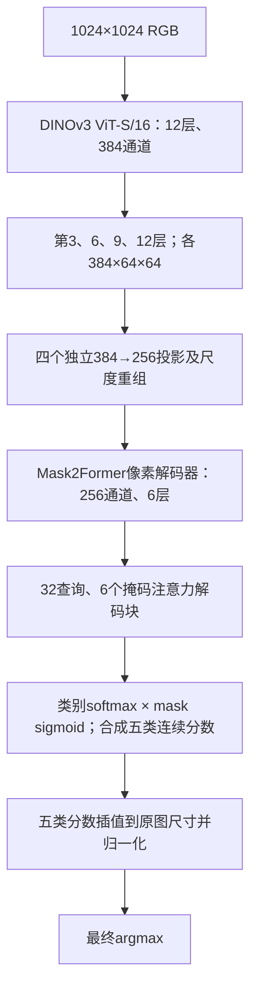

# LuSNAR：纯 DINOv3 ViT-S/16＋Mask2Former

本目录实现与A融合组对照的 **V0-M2F**：图像编码骨干只有DINOv3 ViT-S/16，不含ConvNeXt、MobileNet、交互Adapter或独立原图CNN旁路。patch embedding、通道投影与像素解码器仍可使用卷积。

[三大框架结果总览](https://github.com/buqinch/fenge/blob/main/README.md) · [混合骨干说明](../fenge_vit/README.md) · [完整结果汇总](../fenge_vit/result/progress_analysis/latest_report_zh.md)

## 已完成结果与适用范围

结果整理日期：**2026-11-13**。纯ViT旧8000张实验仍在训练，完整Moon_2／4／9测试目前只完成第5轮权重；不能将该分数标为尚未完整评测的后续best成绩。

|协议／权重|Moon_2 mIoU|Moon_4 mIoU|Moon_9 mIoU|加权分数|来源|
|---|---:|---:|---:|---:|---|
|旧8000训练，第5轮；完整5004测试|89.8902%|90.0389%|82.9585%|**86.4615%**|[完整指标](result/vit_only_m2f_8000_1024/periodic_test/epoch_005/test_metrics.json)|
|新6000训练，第4轮；困难1500验证|79.0369%|68.4445%|77.6842%|**75.7125%**|[验证指标](result/vit_only_pool8002_train6000_hardval1500_103_2gpu/validation_epoch_004.json)|

第5轮完整测试精度为 **86.46152667%**，使用1024／768等权水平翻转4视图。本次快照中，旧1601张验证best为第13轮95.6181%；它是单1024验证的汇总mIoU，不能与上表测试S直接相减。

同一新困难1500验证中，A第4轮为80.4746%，纯ViT为75.7125%；固定来源baseline为C6000第18轮80.7379%。新纯ViT第2轮75.4395%，第4轮提高0.2730个百分点；这些早期成绩不代表纯ViT的最终性能上限。

历史阶段评测的临时权重可能按原“完整S超过92%才额外保留”规则清理。指标与checkpoint SHA仍保留；重测前核对精确权重，不能用新的best代替旧轮次。最新训练状态以各实验`summary.json`和[结果报告](../fenge_vit/result/progress_analysis/latest_report_zh.md)为准。

## 文件与环境

```text
fenge_vit_only/
├── model/   # 原始ViT预训练来源、许可证与SHA256；权重不进Git
├── code/    # 网络、训练、评估、推理、运行验证、评测监控
├── config/  # 旧8000／1601及新6000／1500配置
├── result/  # 检查点、逐轮指标与测试结果
└── README.md
```

GitHub位置为`fenge_vit_only/`，服务器部署位置为`/home/lzc/workspace/fenge_vit_only`。源码独立保存，解码器、损失、评分、TTA和目标诊断与A组采用相同实现；对照见[协议核验](result/protocol_verification.json)。

```bash
conda activate lzc_fenge
cd /home/lzc/workspace/fenge_vit_only
python code/download_weights.py
```

本机Python为`/home/vrlab/miniconda3/envs/lzc_fenge/bin/python`，103使用`/home/lzc/miniconda3/envs/lusnar/bin/python`。依赖见[requirements.txt](code/requirements.txt)，使用已有环境。

ViT与A同源：[timm DINOv3 ViT-S/16](https://huggingface.co/timm/vit_small_patch16_dinov3.lvd1689m)，固定revision `3bf4720a82ec2066db88137180ff1f83a675cef0`。权重SHA256为`2a1ec16ae28ffa07bc0ead0241ee7df9fc26451fe6f9f839b7b3afa0a906b040`，来源与许可证见[权重清单](model/manifest.json)。严格加载本地权重，SHA、结构或参数不匹配即报错。

## 网络与特征接口



|ViT层（从1开始）|归一化patch特征|投影后尺度操作|输出形状（省略batch）|
|---|---|---|---|
|3|384×64×64|双线性上采样4倍|256×256×256，stride4|
|6|384×64×64|双线性上采样2倍|256×128×128，stride8|
|9|384×64×64|保持尺寸|256×64×64，stride16|
|12|384×64×64|2×2平均池化|256×32×32，stride32|

保留原始token准备、RoPE、CLS和4个register。选中层应用预训练模型最终归一化，去掉5个前缀token后按原坐标重排；归一化输出不反馈给后续ViT层。所有双线性插值使用`align_corners=False`。原始patch网格都是64×64，尺度重组提供解码接口，不保证恢复patch化前丢失的细节。

像素解码器有6层256通道多尺度可变形编码器；查询解码器有32查询、6个真正的掩码注意力块。初始预测与每块输出共7组，保留最后输出和6组辅助监督；Mask2Former掩码注意力与训练时遮RGB是两回事。

**输出顺序沿用A**：先查询类别softmax和mask sigmoid、合成五类连续分数，再上采样至1024并沿类别归一化。没有改成先上采样mask logits再sigmoid。`semantic_logits`保存归一化概率的对数，不把合成分数误作原始logits。

每个出现的GT类别是一张union mask，允许孔洞和不连通部分。每层Hungarian匹配、分类／mask BCE／Dice和辅助监督均与A一致；no-object不是天空。本轮不添加亲和损失、额外语义损失或输入遮挡。

全网参数为 **36,984,518**。投影和解码器采用与A相同的初始化规则和seed42；网络差异导致随机数消耗及输入投影形状不同，不宣称两组解码器逐张量初值相同，也不加载A的训练权重。

## 两套数据协议

类别ID：0月壤、1岩石、2撞击坑、3山体、4天空。训练图和标签均为完整1024×1024，不做224中心裁剪。

|项目|旧8000／原1601|新6000／困难1500|
|---|---|---|
|训练原图|旧6401训练来源池抽4000张|Moon_1/3/5/6/7/8全部8002候选重新抽4000张|
|增强|2000坑＋2000山岩|1000坑＋1000山岩|
|验证|固定1601张原图|Moon_2/4/9困难188／187／1125张|
|验证频率|每轮|每2轮及计划末轮|
|验证推理|单1024、无TTA|1024／768等权翻转4视图|
|选轮指标|汇总混淆矩阵mIoU|场景1∶1∶2加权分数|
|完整5004评测|训练结束后，对最终验证best|训练结束后，同时报告1500及剩余3504|

旧协议使用[vit_only_m2f_8000_1024.json](config/vit_only_m2f_8000_1024.json)。与原A/B/C相同8000清单、同1601验证，原图及增强来源不跨集合，Moon_2/4/9不用于选轮。每轮1000更新，最多30轮。

新协议使用[vit_only_pool8002_train6000_hardval1500_103_2gpu.json](config/vit_only_pool8002_train6000_hardval1500_103_2gpu.json)，与新A使用同一清单，SHA256为`68bb4ab8410fb36009d4f6a5818d3943a7f675769a4cd73c9e281a5a82ac7e09`。增强父图只来自8002候选池，不要求父图同时被抽中4000原图。训练每轮750更新。

困难1500固定后不随当前模型重新挑选。`validation_weighted_score`用于新best；`miou`仍为合并混淆矩阵结果。采样1∶1∶6不改变评分1∶1∶2。困难Moon_4无山体GT，按其余4类计算。

新协议使用了原测试中的1500张作验证。期末完整5004张包含选轮数据；剩余3504张也参与过难度筛选，并非未经查看的独立测试。旧1601验证、困难1500和完整5004三个指标不能混排。

## 训练、续训与分布式运行

两套协议都从原始ViT预训练开始，前3轮冻结骨干，随后联合微调；有效batch8、BF16、激活重计算。新层学习率1e-4，ViT为5e-6，沿用A的poly调度。冻结时没有插入ViT内部的训练模块，可对骨干使用no_grad；解冻后恢复梯度。

严格新高保存best；显著提升阈值0.05个百分点，从第4轮起计算。旧协议连续5轮未显著提升早停，新协议连续5次实际验证未显著提升早停，跳过验证的轮次不计耐心。训练预算最长30轮。

本机旧8000实验使用单张RTX4090卡0，batch8、累积1。复现时使用新输出目录：

```bash
python code/train.py --config config/vit_only_m2f_8000_1024.json \
  --device cuda:0 --output result/vit_only_reproduction
```

已有实验续训使用原配置和原计划：

```bash
python code/train.py --config config/vit_only_m2f_8000_1024.json \
  --resume result/vit_only_m2f_8000_1024/last.pt --device cuda:0
```

103新实验使用GPU6／7，每卡batch4、累积1、全局batch8；与新A的数据、损失、调度和更新预算一致。入口为：

```bash
cd /home/lzc/workspace/fenge_vit_only
bash code/run_on_103.sh env CUDA_VISIBLE_DEVICES=6,7 \
  /home/lzc/miniconda3/envs/lusnar/bin/python -m torch.distributed.run \
  --standalone --nproc_per_node=2 code/train_hardval_distributed.py \
  --config config/vit_only_pool8002_train6000_hardval1500_103_2gpu.json
```

正式任务运行时勿重复启动同一输出目录。按完整epoch边界保存和恢复模型、AdamW、调度器、随机状态、每卡数据流及早停状态；同时核对数据清单和实现SHA。改变卡数、数据或代码不能静默作为精确续训。

[双卡完整训练与恢复核验](result/hardval_2gpu_runtime_verification.json)覆盖1024冻结／解冻、梯度同步和续训。训练及验证文字每60秒同步本机，权重保留103，图片写NAS。

## 自动评测计划

旧8000模型仍由1601验证集选轮；固定困难1500每2轮评测，仅用于诊断，`hard_subset_score`不参与best或早停。完整5004仅在训练完成或早停后评测验证best，之前已经完成的阶段测试仍保留。

```bash
python code/periodic_evaluate.py --config config/periodic_eval.json
python code/hard_subset_monitor.py --config config/hard_eval.json
```

推理调度到103，共享评测锁串行执行。完整结果写入`periodic_test/final_epoch_XXX/`，困难诊断写入`hard_periodic_test/epoch_XXX/`。测试检查权重、源码和数据SHA；完整S严格超过92%时额外保留精确权重和`score_milestone.json`，困难子集不触发该里程碑。

新6000直接在训练入口进行困难验证，不再额外重复诊断；期末由以下控制器一次完整5004推理同时报告验证1500和其余3504：

```bash
bash code/run_on_103.sh /home/lzc/miniconda3/envs/lusnar/bin/python \
  code/final_partition_monitor.py --config config/final_eval_vit_only_hardval1500_103.json
```

[期末配置](config/final_eval_vit_only_hardval1500_103.json)及[文字同步配置](config/remote103_vit_only_hardval1500.json)只管理新纯ViT实验，和A共用评测锁。

## 手动评估与图片导出

```bash
python code/evaluate.py --checkpoint result/vit_only_m2f_8000_1024/best.pt \
  --split val --device cuda:0 --tta none
python code/evaluate.py --checkpoint result/vit_only_m2f_8000_1024/best.pt \
  --split test --device cuda:0 --tta multiscale_hflip \
  --tta-sizes 1024 768 --tta-weights 0.5 0.5 \
  --save-images --output result/vit_only_m2f_8000_1024/test_manual_metrics.json
python code/infer.py --checkpoint result/vit_only_m2f_8000_1024/best.pt \
  --input /path/to/images --device cuda:0 --tta hflip --overlay
```

每个尺度内部平均原图和水平翻转预测，翻转结果先恢复坐标；尺度概率对齐到原尺寸后按权重融合，最后argmax。更改TTA不需要重新训练。完整测试分数为`weighted_score=(Moon_2 mIoU+Moon_4 mIoU+2×Moon_9 mIoU)/4`，每个场景只平均GT确实出现的类别。

`miou`是合并像素混淆矩阵的mIoU，与场景加权S不同。逐类别IoU、精确率、召回率及错分去向都保留；大坑内部和小岩石诊断属于条件召回，不称IoU。

加`--save-images`后，每张带GT样本只保存`comparison.jpg`三联图和`metrics.json`，默认位于NAS `/media/nas/lzc/fenge_result/`；文字结果同时保存在本项目result。无GT推理只导出类别图和可选叠加图，不虚构IoU。

## 实现验收与性能记录

```bash
python code/verify.py --device cuda:0
python code/benchmark_memory.py --device cuda:0 --batch-size 8 --accumulation 1
python code/verify_training.py --device cuda:0
```

已核验真实1024样本、原生timm中间特征、token坐标及四尺度、冻结／解冻梯度、优化器更新、保存重载、训练入口续训和1024／768 TTA。见[模型检查](result/verification_model.json)、[训练检查](result/verification_training.json)、[周期测试锁检查](result/verification_periodic.json)。小样本运行验证不代表分割成绩。

RTX4090、batch8、累积1、全解冻BF16的峰值为 **7.91GiB allocated／9.12GiB reserved**；两次预热后完整更新耗时中位数2.464秒，含AdamW状态，不含完整轮次数据等待、验证和测试。记录见[显存报告](result/memory_batch8.json)。

随机状态、数据顺序、优化器和调度器均保存；CUDA `grid_sample`反向存在非确定性，固定种子或恢复状态不保证后续BF16更新逐位一致。软件及GPU型号差异也需在比较中记录。

实现依据：[DINOv3官方ViT](https://github.com/facebookresearch/dinov3/blob/main/dinov3/models/vision_transformer.py)、[DPT多层重组](https://arxiv.org/abs/2103.13413)、[Mask2Former](https://github.com/facebookresearch/Mask2Former/blob/main/configs/ade20k/semantic-segmentation/maskformer2_R50_bs16_160k.yaml)。本项目保留A组32查询、6查询块；重组借鉴DPT，不宣称完整复现DPT或官方默认配置。
