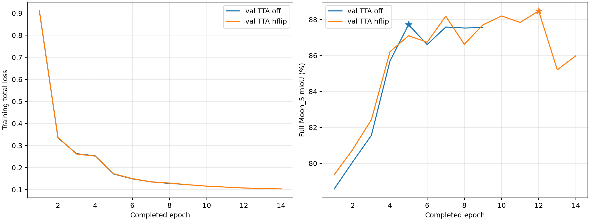

# 双 CNN 区域分割：完整测试分析

本报告只使用已停止训练后的 Moon_5 最佳检查点及完整 Moon_2/4/9 测试结果。所有场景 IoU、精确率、召回率和加权分数均由保存的整数混淆矩阵独立重算并核对。

## 数据与训练设置

两组固定使用同一份 8000 张训练清单：原图 5000、大坑增强 1500、山岩交界增强 1500；共 5492 个来源原图。增强版本与相邻帧存在相关性，8000 张不等于 8000 个独立场景。完整 Moon_5 共 1599 张用于验证和选轮；Moon_2/4/9 共 5004 张只用于最终评估。

训练清单：[固定选择 JSON](../selections/train8000_seed42_20261111.json)；SHA256：`e0f402ff6cc738b8450e0d9877124643d849d3a857f4f21c9b31c04d3d2be815`。

|设置|验证 TTA 关闭组|验证 TTA 开启组|
|---|---|---|
|输入尺寸|1024|1024|
|训练 batch|8|8|
|梯度累积|1|1|
|冻结骨干轮数|3|3|
|骨干学习率|1e-05|1e-05|
|融合/解码器学习率|0.0001|0.0001|
|权重衰减|0.01|0.01|
|AMP|bf16|bf16|
|随机种子|42|42|
|训练随机水平翻转|True|True|

两组架构均为 DINOv3 ConvNeXt-Tiny + MobileNetV3-Large 双 CNN，四尺度融合及 128 通道 FPN，32 个区域查询、4 层注意力区域解码器。TTA 只用于验证和测试推理，不参与训练损失。

## 停止与检查点选择

|组|停止状态|完成轮次|最佳轮次|完整 Moon_5 最佳 mIoU|选轮验证视角|
|---|---|---:|---:|---:|---|
|验证 TTA 关闭组|stopped|9|5|87.7176%|none|
|验证 TTA 开启组|stopped|14|12|88.4815%|hflip|

验证 TTA 关闭组：停止依据为 `User explicitly stopped the no-TTA experiment after prolonged unchanged best Moon_5 score.`；[summary](../dual_region_balanced8000_bs8/summary.json)、[history](../dual_region_balanced8000_bs8/history.jsonl)、[完整配置](../dual_region_balanced8000_bs8/run_config.json)。最佳检查点 SHA256：`10baa725baf8bb8d01cfcfe36624be5969d6fbb333f7e0f1345414f34cc9b043`。

验证 TTA 开启组：停止依据为 `User explicitly stopped the TTA experiment after observing a plateau near 88 percent Moon_5 mIoU.`；[summary](../dual_region_balanced8000_bs8_tta/summary.json)、[history](../dual_region_balanced8000_bs8_tta/history.jsonl)、[完整配置](../dual_region_balanced8000_bs8_tta/run_config.json)。最佳检查点 SHA256：`ff4d8f32a91c1d6dce06b0f06e482c2aa246a18eda2995b452b4f0c878c33eb2`。

## 完整测试成绩

Moon_2/4/9 分别为 1597/1320/2087 张。先汇总每个场景的像素混淆矩阵，再对该场景真值出现的类别 IoU 求均值；不是逐图 mIoU 平均。`S=(Moon_2 mIoU + Moon_4 mIoU + 2×Moon_9 mIoU)/4`，与全场景合并混淆矩阵的 mIoU 口径不同。

|训练组|测试视角|Moon_2 mIoU|Moon_4 mIoU|Moon_9 mIoU|加权 S|
|---|---|---:|---:|---:|---:|
|验证 TTA 关闭组|none|91.6714%|88.6271%|83.9971%|87.0732%|
|验证 TTA 关闭组|hflip|91.9822%|88.9277%|84.0386%|87.2468%|
|验证 TTA 开启组|none|93.0742%|91.9191%|83.9882%|88.2424%|
|验证 TTA 开启组|hflip|93.0228%|92.0529%|84.0710%|88.3044%|

主要比较（关闭组单视角 → 开启组双视角）：加权 S 变化 **+1.2313 个百分点**。两组采用不同的最佳检查点，并分别按各自验证协议选轮。这一比较同时包含训练轨迹、检查点选择和测试视角的差异，不能把全部变化归因于 TTA。

|场景|mIoU 变化/百分点|月壤 IoU 变化|岩石 IoU 变化|撞击坑 IoU 变化|山体 IoU 变化|天空 IoU 变化|
|---|---:|---:|---:|---:|---:|---:|
|Moon_2|+1.3514|+0.1332|+1.9645|+3.5748|+1.0486|+0.0361|
|Moon_4|+3.4258|+0.3005|+2.7245|+5.3820|+8.7180|+0.0039|
|Moon_9|+0.0739|-0.0286|+2.9300|-0.6351|-1.9476|+0.0509|

按评分公式将 S 的差值分解到五类：岩石 +0.5274 个百分点、撞击坑 +0.3843 个百分点、山体 +0.2936 个百分点、月壤 +0.0188 个百分点、天空 +0.0071 个百分点。这是分数的算术贡献分解，不是网络模块的因果贡献。

验证 TTA 关闭组：最低场景 mIoU 为 Moon_9（83.9971%）；最低场景/类别 IoU 为 Moon_9 的撞击坑（61.0559%）。

验证 TTA 开启组：最低场景 mIoU 为 Moon_9（84.0710%）；最低场景/类别 IoU 为 Moon_9 的撞击坑（60.4207%）。

同一 `验证 TTA 关闭组` 检查点的纯推理对照：hflip 相比 none 的 S 变化为 +0.1736 个百分点。这能隔离该检查点上的推理视角变化，仍不代表跨随机种子的一般结论。

同一 `验证 TTA 开启组` 检查点的纯推理对照：hflip 相比 none 的 S 变化为 +0.0620 个百分点。这能隔离该检查点上的推理视角变化，仍不代表跨随机种子的一般结论。

## 五类 IoU、精确率与召回率

精确率 `TP/(TP+FP)`；召回率 `TP/(TP+FN)`。下表与 CSV 保留逐场景、逐类别结果。

|训练组/测试视角|场景|类别|IoU|精确率|召回率|
|---|---|---|---:|---:|---:|
|验证 TTA 关闭组/none|Moon_2|月壤|99.1373%|99.5601%|99.5734%|
|验证 TTA 关闭组/none|Moon_2|岩石|84.6820%|91.7321%|91.6794%|
|验证 TTA 关闭组/none|Moon_2|撞击坑|82.7935%|97.3216%|84.7240%|
|验证 TTA 关闭组/none|Moon_2|山体|92.0398%|93.6673%|98.1472%|
|验证 TTA 关闭组/none|Moon_2|天空|99.7042%|99.8973%|99.8065%|
|验证 TTA 关闭组/none|Moon_4|月壤|98.7737%|99.3116%|99.4546%|
|验证 TTA 关闭组/none|Moon_4|岩石|85.2909%|92.4545%|91.6721%|
|验证 TTA 关闭组/none|Moon_4|撞击坑|76.1993%|94.0659%|80.0472%|
|验证 TTA 关闭组/none|Moon_4|山体|83.1611%|84.2898%|98.4153%|
|验证 TTA 关闭组/none|Moon_4|天空|99.7105%|99.8823%|99.8278%|
|验证 TTA 关闭组/none|Moon_9|月壤|97.5423%|98.9581%|98.5544%|
|验证 TTA 关闭组/none|Moon_9|岩石|79.3341%|90.0595%|86.9478%|
|验证 TTA 关闭组/none|Moon_9|撞击坑|61.0559%|76.3227%|75.3229%|
|验证 TTA 关闭组/none|Moon_9|山体|82.5513%|85.2710%|96.2801%|
|验证 TTA 关闭组/none|Moon_9|天空|99.5021%|99.7781%|99.7227%|
|验证 TTA 关闭组/hflip|Moon_2|月壤|99.1675%|99.5757%|99.5883%|
|验证 TTA 关闭组/hflip|Moon_2|岩石|85.1697%|92.0398%|91.9421%|
|验证 TTA 关闭组/hflip|Moon_2|撞击坑|83.6360%|97.6463%|85.3568%|
|验证 TTA 关闭组/hflip|Moon_2|山体|92.2260%|93.8252%|98.1854%|
|验证 TTA 关闭组/hflip|Moon_2|天空|99.7118%|99.8974%|99.8140%|
|验证 TTA 关闭组/hflip|Moon_4|月壤|98.8115%|99.3346%|99.4699%|
|验证 TTA 关闭组/hflip|Moon_4|岩石|85.8389%|92.6190%|92.1421%|
|验证 TTA 关闭组/hflip|Moon_4|撞击坑|76.7878%|94.4546%|80.4129%|
|验证 TTA 关闭组/hflip|Moon_4|山体|83.4826%|84.5998%|98.4428%|
|验证 TTA 关闭组/hflip|Moon_4|天空|99.7179%|99.8842%|99.8333%|
|验证 TTA 关闭组/hflip|Moon_9|月壤|97.5549%|98.9547%|98.5707%|
|验证 TTA 关闭组/hflip|Moon_9|岩石|79.7945%|90.6596%|86.9420%|
|验证 TTA 关闭组/hflip|Moon_9|撞击坑|60.0990%|75.7576%|74.4091%|
|验证 TTA 关闭组/hflip|Moon_9|山体|83.2141%|85.4239%|96.9850%|
|验证 TTA 关闭组/hflip|Moon_9|天空|99.5303%|99.7942%|99.7350%|
|验证 TTA 开启组/none|Moon_2|月壤|99.2684%|99.6425%|99.6232%|
|验证 TTA 开启组/none|Moon_2|岩石|86.8339%|92.7296%|93.1775%|
|验证 TTA 开启组/none|Moon_2|撞击坑|86.3232%|98.2238%|87.6920%|
|验证 TTA 开启组/none|Moon_2|山体|93.2105%|94.4217%|98.6425%|
|验证 TTA 开启组/none|Moon_2|天空|99.7351%|99.9139%|99.8209%|
|验证 TTA 开启组/none|Moon_4|月壤|99.0591%|99.4283%|99.6265%|
|验证 TTA 开启组/none|Moon_4|岩石|87.7489%|93.8921%|93.0611%|
|验证 TTA 开启组/none|Moon_4|撞击坑|81.4589%|95.1804%|84.9635%|
|验证 TTA 开启组/none|Moon_4|山体|91.6176%|92.7130%|98.7268%|
|验证 TTA 开启组/none|Moon_4|天空|99.7110%|99.9004%|99.8102%|
|验证 TTA 开启组/none|Moon_9|月壤|97.4855%|99.0648%|98.3910%|
|验证 TTA 开启组/none|Moon_9|岩石|81.8110%|90.8793%|89.1291%|
|验证 TTA 开启组/none|Moon_9|撞击坑|60.4308%|76.8746%|73.8572%|
|验证 TTA 开启组/none|Moon_9|山体|80.6811%|82.7346%|97.0155%|
|验证 TTA 开启组/none|Moon_9|天空|99.5327%|99.8004%|99.7312%|
|验证 TTA 开启组/hflip|Moon_2|月壤|99.2705%|99.6412%|99.6266%|
|验证 TTA 开启组/hflip|Moon_2|岩石|86.6465%|92.8655%|92.8257%|
|验证 TTA 开启组/hflip|Moon_2|撞击坑|86.3683%|98.2912%|87.6849%|
|验证 TTA 开启组/hflip|Moon_2|山体|93.0884%|94.2616%|98.6807%|
|验证 TTA 开启组/hflip|Moon_2|天空|99.7403%|99.9160%|99.8241%|
|验证 TTA 开启组/hflip|Moon_4|月壤|99.0741%|99.4295%|99.6406%|
|验证 TTA 开启组/hflip|Moon_4|岩石|88.0154%|94.1741%|93.0838%|
|验证 TTA 开启组/hflip|Moon_4|撞击坑|81.5814%|95.3569%|84.9561%|
|验证 TTA 开启组/hflip|Moon_4|山体|91.8790%|92.9402%|98.7726%|
|验证 TTA 开启组/hflip|Moon_4|天空|99.7144%|99.9003%|99.8138%|
|验证 TTA 开启组/hflip|Moon_9|月壤|97.5137%|99.0945%|98.3904%|
|验证 TTA 开启组/hflip|Moon_9|岩石|82.2641%|91.2451%|89.3138%|
|验证 TTA 开启组/hflip|Moon_9|撞击坑|60.4207%|76.9149%|73.8050%|
|验证 TTA 开启组/hflip|Moon_9|山体|80.6036%|82.3956%|97.3727%|
|验证 TTA 开启组/hflip|Moon_9|天空|99.5529%|99.8150%|99.7369%|

## 撞击坑与主要混淆

### 验证 TTA 关闭组 / none

Moon_2：撞击坑漏检 2,647,389 像素、误检 404,089 像素。漏检中 99.8119% 流向月壤（占全部坑真值 15.2472%），0.0000% 流向山体；坑误检中 97.5409% 来自月壤。

|主要错分：真值 → 预测|像素数|占该真值类别|
|---|---:|---:|
|撞击坑 → 月壤|2,642,409|15.2472%|
|月壤 → 岩石|2,201,721|0.1909%|
|月壤 → 山体|2,141,345|0.1857%|
|岩石 → 月壤|1,840,546|5.9968%|
|岩石 → 山体|680,900|2.2185%|

Moon_4：撞击坑漏检 3,771,658 像素、误检 954,539 像素。漏检中 99.8046% 流向月壤（占全部坑真值 19.9138%），0.0000% 流向山体；坑误检中 89.0427% 来自月壤。

|主要错分：真值 → 预测|像素数|占该真值类别|
|---|---:|---:|
|撞击坑 → 月壤|3,764,290|19.9138%|
|岩石 → 月壤|2,305,693|7.8487%|
|月壤 → 岩石|2,152,120|0.2269%|
|月壤 → 山体|1,831,428|0.1931%|
|月壤 → 撞击坑|849,947|0.0896%|

Moon_9：撞击坑漏检 7,215,985 像素、误检 6,832,951 像素。漏检中 81.9479% 流向月壤（占全部坑真值 20.2224%），12.0832% 流向山体；坑误检中 94.1411% 来自月壤。

|主要错分：真值 → 预测|像素数|占该真值类别|
|---|---:|---:|
|岩石 → 月壤|9,262,594|9.5364%|
|月壤 → 山体|8,082,340|0.5434%|
|月壤 → 岩石|6,638,038|0.4463%|
|月壤 → 撞击坑|6,432,618|0.4325%|
|撞击坑 → 月壤|5,913,346|20.2224%|

### 验证 TTA 开启组 / hflip

Moon_2：撞击坑漏检 2,134,252 像素、误检 264,191 像素。漏检中 99.7678% 流向月壤（占全部坑真值 12.2865%），0.0005% 流向山体；坑误检中 97.7505% 来自月壤。

|主要错分：真值 → 预测|像素数|占该真值类别|
|---|---:|---:|
|撞击坑 → 月壤|2,129,296|12.2865%|
|月壤 → 山体|1,967,479|0.1706%|
|月壤 → 岩石|1,936,344|0.1679%|
|岩石 → 月壤|1,551,495|5.0550%|
|岩石 → 山体|627,585|2.0448%|

Moon_4：撞击坑漏检 2,843,722 像素、误检 781,958 像素。漏检中 99.5994% 流向月壤（占全部坑真值 14.9836%），0.0003% 流向山体；坑误检中 94.9414% 来自月壤。

|主要错分：真值 → 预测|像素数|占该真值类别|
|---|---:|---:|
|撞击坑 → 月壤|2,832,329|14.9836%|
|岩石 → 月壤|1,961,364|6.6766%|
|月壤 → 岩石|1,654,418|0.1744%|
|月壤 → 撞击坑|742,402|0.0783%|
|月壤 → 山体|717,599|0.0756%|

Moon_9：撞击坑漏检 7,659,853 像素、误检 6,477,520 像素。漏检中 74.4704% 流向月壤（占全部坑真值 19.5075%），19.7721% 流向山体；坑误检中 97.2125% 来自月壤。

|主要错分：真值 → 预测|像素数|占该真值类别|
|---|---:|---:|
|月壤 → 山体|10,964,099|0.7371%|
|岩石 → 月壤|7,421,618|7.6410%|
|月壤 → 岩石|6,436,513|0.4327%|
|月壤 → 撞击坑|6,296,958|0.4233%|
|撞击坑 → 月壤|5,704,324|19.5075%|

上述矩阵能说明错分去向和数量，不能单凭这些数值证明标签错误、样本不足或某个模块的因果机制。

## 训练与验证曲线

星号表示各组按 Moon_5 选中的最佳轮次。训练损失与验证 mIoU 是不同量纲，不能直接相减推断过拟合。

|组|轮次|训练总损失|Moon_5 mIoU|骨干冻结|
|---|---:|---:|---:|---|
|验证 TTA 关闭组|1|0.910239|78.5751%|True|
|验证 TTA 关闭组|2|0.334565|80.0883%|True|
|验证 TTA 关闭组|3|0.262972|81.5559%|True|
|验证 TTA 关闭组|4|0.253107|85.6926%|False|
|验证 TTA 关闭组|5|0.170748|87.7176%|False|
|验证 TTA 关闭组|6|0.148913|86.6117%|False|
|验证 TTA 关闭组|7|0.135380|87.5850%|False|
|验证 TTA 关闭组|8|0.128255|87.5308%|False|
|验证 TTA 关闭组|9|0.122613|87.5541%|False|
|验证 TTA 开启组|1|0.910231|79.3645%|True|
|验证 TTA 开启组|2|0.336408|80.7736%|True|
|验证 TTA 开启组|3|0.261320|82.4302%|True|
|验证 TTA 开启组|4|0.252100|86.2120%|False|
|验证 TTA 开启组|5|0.171897|87.1024%|False|
|验证 TTA 开启组|6|0.149837|86.7401%|False|
|验证 TTA 开启组|7|0.135199|88.1892%|False|
|验证 TTA 开启组|8|0.129820|86.6274%|False|
|验证 TTA 开启组|9|0.122149|87.7081%|False|
|验证 TTA 开启组|10|0.115905|88.2035%|False|
|验证 TTA 开启组|11|0.111582|87.8432%|False|
|验证 TTA 开启组|12|0.107504|88.4815%|False|
|验证 TTA 开启组|13|0.104899|85.2040%|False|
|验证 TTA 开启组|14|0.103272|85.9883%|False|

## 复核文件与解释范围

- [逐类别精确指标 CSV](metrics.csv)
- [完整混淆矩阵 CSV](confusion_matrices.csv)
- [逐轮曲线数据 CSV](history.csv)
- [机器可读分析与来源 SHA256](summary.json)

本次为各协议的一次训练结果，没有多随机种子重复，也没有统计显著性检验。本地完整测试标签结果不等同于官方平台成绩。测试诊断用于解释本次表现，后续模块和超参数选择仍须回到训练集与 Moon_5。
