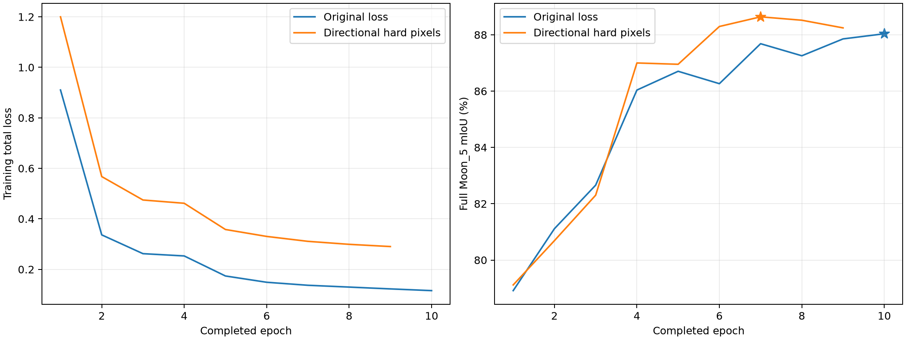

# 双 CNN 区域分割：完整测试分析

本报告只使用已停止训练后的 Moon_5 最佳检查点及完整 Moon_2/4/9 测试结果。所有场景 IoU、精确率、召回率和加权分数均由保存的整数混淆矩阵独立重算并核对。

## 数据与训练设置

两组固定使用同一份 8000 张训练清单：原图 5000、大坑增强 1500、山岩交界增强 1500；共 5492 个来源原图。增强版本与相邻帧存在相关性，8000 张不等于 8000 个独立场景。完整 Moon_5 共 1599 张用于验证和选轮；Moon_2/4/9 共 5004 张只用于最终评估。

训练清单：[固定选择 JSON](../selections/train8000_seed42_20261111.json)；SHA256：`e0f402ff6cc738b8450e0d9877124643d849d3a857f4f21c9b31c04d3d2be815`。

|设置|原损失对照组|困难像素辅助组|
|---|---|---|
|输入尺寸|1024|1024|
|训练 batch|8|8|
|梯度累积|1|1|
|冻结骨干轮数|3|3|
|骨干学习率|1e-05|1e-05|
|融合/解码器学习率|0.0001|0.0001|
|权重衰减|0.01|0.01|
|AMP|bf16|bf16|
|随机种子|42|42|
|训练随机水平翻转|True|True|
|困难像素权重 λ|0.0|0.2|
|每图每方向最多选点|256|256|

两组架构均为 DINOv3 ConvNeXt-Tiny + MobileNetV3-Large 双 CNN，四尺度融合及 128 通道 FPN，32 个区域查询、4 层注意力区域解码器。TTA 只用于验证和测试推理，不参与训练损失。

## 停止与检查点选择

|组|停止状态|完成轮次|最佳轮次|完整 Moon_5 最佳 mIoU|选轮验证视角|
|---|---|---:|---:|---:|---|
|原损失对照组|stopped|10|10|88.0373%|hflip|
|困难像素辅助组|stopped|9|7|88.6385%|hflip|

原损失对照组：停止依据为 `User requested stopping the current comparison and evaluating the best checkpoints before training on a new random split`；[summary](../dual_region_hardpixel_control_8000_bs8/summary.json)、[history](../dual_region_hardpixel_control_8000_bs8/history.jsonl)、[完整配置](../dual_region_hardpixel_control_8000_bs8/run_config.json)。最佳检查点 SHA256：`96c2c7a7df646cd1a21876e7a3a5c651d14298face3d0a3bbd64f9dafbf93356`。

困难像素辅助组：停止依据为 `User requested stopping the current comparison and evaluating the best checkpoints before training on a new random split`；[summary](../dual_region_hardpixel_8000_bs8/summary.json)、[history](../dual_region_hardpixel_8000_bs8/history.jsonl)、[完整配置](../dual_region_hardpixel_8000_bs8/run_config.json)。最佳检查点 SHA256：`7f341f060a0aa316c3013d0e8bad2f268bb8a92ae7eba98529c32b29def15453`。

## 完整测试成绩

Moon_2/4/9 分别为 1597/1320/2087 张。先汇总每个场景的像素混淆矩阵，再对该场景真值出现的类别 IoU 求均值；不是逐图 mIoU 平均。`S=(Moon_2 mIoU + Moon_4 mIoU + 2×Moon_9 mIoU)/4`，与全场景合并混淆矩阵的 mIoU 口径不同。

|训练组|测试视角|Moon_2 mIoU|Moon_4 mIoU|Moon_9 mIoU|加权 S|
|---|---|---:|---:|---:|---:|
|原损失对照组|none|92.6690%|91.3133%|84.2349%|88.1130%|
|原损失对照组|hflip|92.6765%|91.6236%|84.5855%|88.3678%|
|困难像素辅助组|none|92.9042%|91.0353%|83.1863%|87.5780%|
|困难像素辅助组|hflip|92.8810%|91.2484%|83.6172%|87.8410%|

主要比较（原损失对照组/hflip → 困难像素辅助组/hflip）：加权 S 变化 **-0.5268 个百分点**。两组采用不同的最佳检查点，并分别按各自验证协议选轮。两组验证和测试均使用相同水平翻转 TTA，从同一原始预训练初始化重新训练。新增困难像素辅助损失是预设训练变量；这是一次固定种子的对照，不代表跨种子普适提升。

|场景|mIoU 变化/百分点|月壤 IoU 变化|岩石 IoU 变化|撞击坑 IoU 变化|山体 IoU 变化|天空 IoU 变化|
|---|---:|---:|---:|---:|---:|---:|
|Moon_2|+0.2045|+0.0254|-0.4033|+1.0420|+0.4040|-0.0456|
|Moon_4|-0.3752|-0.0353|-1.2932|-0.2407|-0.2673|-0.0396|
|Moon_9|-0.9683|-0.2060|-1.5178|-1.7376|-1.2334|-0.1466|

按评分公式将 S 的差值分解到五类：天空 -0.0189 个百分点、月壤 -0.0211 个百分点、山体 -0.1165 个百分点、撞击坑 -0.1337 个百分点、岩石 -0.2366 个百分点。这是分数的算术贡献分解，不是网络模块的因果贡献。

原损失对照组：最低场景 mIoU 为 Moon_9（84.5855%）；最低场景/类别 IoU 为 Moon_9 的撞击坑（63.5995%）。

困难像素辅助组：最低场景 mIoU 为 Moon_9（83.6172%）；最低场景/类别 IoU 为 Moon_9 的撞击坑（61.8619%）。

同一 `原损失对照组` 检查点的纯推理对照：hflip 相比 none 的 S 变化为 +0.2548 个百分点。这能隔离该检查点上的推理视角变化，仍不代表跨随机种子的一般结论。

同一 `困难像素辅助组` 检查点的纯推理对照：hflip 相比 none 的 S 变化为 +0.2629 个百分点。这能隔离该检查点上的推理视角变化，仍不代表跨随机种子的一般结论。

## 五类 IoU、精确率与召回率

精确率 `TP/(TP+FP)`；召回率 `TP/(TP+FN)`。下表与 CSV 保留逐场景、逐类别结果。

|训练组/测试视角|场景|类别|IoU|精确率|召回率|
|---|---|---|---:|---:|---:|
|原损失对照组/none|Moon_2|月壤|99.2421%|99.6182%|99.6210%|
|原损失对照组/none|Moon_2|岩石|86.4465%|91.9395%|93.5355%|
|原损失对照组/none|Moon_2|撞击坑|84.7191%|98.2976%|85.9807%|
|原损失对照组/none|Moon_2|山体|93.2007%|94.7929%|98.2297%|
|原损失对照组/none|Moon_2|天空|99.7367%|99.9014%|99.8349%|
|原损失对照组/none|Moon_4|月壤|99.0021%|99.3886%|99.6087%|
|原损失对照组/none|Moon_4|岩石|87.3482%|93.3751%|93.1190%|
|原损失对照组/none|Moon_4|撞击坑|79.6928%|95.5686%|82.7506%|
|原损失对照组/none|Moon_4|山体|90.8160%|92.0663%|98.5266%|
|原损失对照组/none|Moon_4|天空|99.7073%|99.8909%|99.8159%|
|原损失对照组/none|Moon_9|月壤|97.6744%|99.0602%|98.5880%|
|原损失对照组/none|Moon_9|岩石|79.7586%|88.0780%|89.4114%|
|原损失对照组/none|Moon_9|撞击坑|63.7138%|79.2033%|76.5143%|
|原损失对照组/none|Moon_9|山体|80.4897%|85.6927%|92.9857%|
|原损失对照组/none|Moon_9|天空|99.5380%|99.7718%|99.7651%|
|原损失对照组/hflip|Moon_2|月壤|99.2474%|99.6171%|99.6275%|
|原损失对照组/hflip|Moon_2|岩石|86.5454%|92.1958%|93.3868%|
|原损失对照组/hflip|Moon_2|撞击坑|84.6480%|98.3432%|85.8726%|
|原损失对照组/hflip|Moon_2|山体|93.2011%|94.7380%|98.2892%|
|原损失对照组/hflip|Moon_2|天空|99.7408%|99.9023%|99.8382%|
|原损失对照组/hflip|Moon_4|月壤|99.0264%|99.3914%|99.6305%|
|原损失对照组/hflip|Moon_4|岩石|87.5479%|93.7186%|93.0052%|
|原损失对照组/hflip|Moon_4|撞击坑|80.4080%|95.9694%|83.2183%|
|原损失对照组/hflip|Moon_4|山体|91.4260%|92.6423%|98.5843%|
|原损失对照组/hflip|Moon_4|天空|99.7099%|99.8914%|99.8181%|
|原损失对照组/hflip|Moon_9|月壤|97.7240%|99.0725%|98.6263%|
|原损失对照组/hflip|Moon_9|岩石|80.6851%|88.8797%|89.7448%|
|原损失对照组/hflip|Moon_9|撞击坑|63.5995%|79.9690%|75.6512%|
|原损失对照组/hflip|Moon_9|山体|81.3581%|85.8402%|93.9692%|
|原损失对照组/hflip|Moon_9|天空|99.5608%|99.7863%|99.7735%|
|困难像素辅助组/none|Moon_2|月壤|99.2749%|99.6029%|99.6693%|
|困难像素辅助组/none|Moon_2|岩石|86.0010%|93.3959%|91.5695%|
|困难像素辅助组/none|Moon_2|撞击坑|85.9490%|98.1612%|87.3555%|
|困难像素辅助组/none|Moon_2|山体|93.6058%|94.3640%|99.1489%|
|困难像素辅助组/none|Moon_2|天空|99.6901%|99.9516%|99.7383%|
|困难像素辅助组/none|Moon_4|月壤|98.9726%|99.2833%|99.6848%|
|困难像素辅助组/none|Moon_4|岩石|86.1582%|94.5029%|90.7040%|
|困难像素辅助组/none|Moon_4|撞击坑|79.9406%|96.5635%|82.2815%|
|困难像素辅助组/none|Moon_4|山体|90.4408%|91.0716%|99.2400%|
|困难像素辅助组/none|Moon_4|天空|99.6645%|99.9491%|99.7151%|
|困难像素辅助组/none|Moon_9|月壤|97.4737%|98.9453%|98.4971%|
|困难像素辅助组/none|Moon_9|岩石|78.1468%|88.9554%|86.5437%|
|困难像素辅助组/none|Moon_9|撞击坑|61.5263%|74.2556%|78.2093%|
|困难像素辅助组/none|Moon_9|山体|79.3775%|84.2797%|93.1724%|
|困难像素辅助组/none|Moon_9|天空|99.4074%|99.7457%|99.6599%|
|困难像素辅助组/hflip|Moon_2|月壤|99.2727%|99.5985%|99.6717%|
|困难像素辅助组/hflip|Moon_2|岩石|86.1421%|93.5505%|91.5809%|
|困难像素辅助组/hflip|Moon_2|撞击坑|85.6901%|98.2753%|86.9984%|
|困难像素辅助组/hflip|Moon_2|山体|93.6051%|94.3329%|99.1825%|
|困难像素辅助组/hflip|Moon_2|天空|99.6952%|99.9528%|99.7421%|
|困难像素辅助组/hflip|Moon_4|月壤|98.9911%|99.2784%|99.7085%|
|困难像素辅助组/hflip|Moon_4|岩石|86.2547%|94.8481%|90.4945%|
|困难像素辅助组/hflip|Moon_4|撞击坑|80.1673%|96.8142%|82.3395%|
|困难像素辅助组/hflip|Moon_4|山体|91.1587%|91.7525%|99.2951%|
|困难像素辅助组/hflip|Moon_4|天空|99.6703%|99.9506%|99.7194%|
|困难像素辅助组/hflip|Moon_9|月壤|97.5180%|98.9611%|98.5267%|
|困难像素辅助组/hflip|Moon_9|岩石|79.1673%|89.9004%|86.8956%|
|困难像素辅助组/hflip|Moon_9|撞击坑|61.8619%|75.0843%|77.8411%|
|困难像素辅助组/hflip|Moon_9|山体|80.1247%|84.2882%|94.1931%|
|困难像素辅助组/hflip|Moon_9|天空|99.4141%|99.7541%|99.6584%|

## 撞击坑与主要混淆

### 原损失对照组 / hflip

Moon_2：撞击坑漏检 2,448,332 像素、误检 250,722 像素。漏检中 99.7999% 流向月壤（占全部坑真值 14.0991%），0.0000% 流向山体；坑误检中 98.3647% 来自月壤。

|主要错分：真值 → 预测|像素数|占该真值类别|
|---|---:|---:|
|撞击坑 → 月壤|2,443,432|14.0991%|
|月壤 → 岩石|1,994,250|0.1729%|
|月壤 → 山体|1,882,691|0.1633%|
|岩石 → 月壤|1,514,088|4.9332%|
|岩石 → 山体|491,835|1.6025%|

Moon_4：撞击坑漏检 3,172,219 像素、误检 660,667 像素。漏检中 99.8505% 流向月壤（占全部坑真值 16.7566%），0.0000% 流向山体；坑误检中 93.6962% 来自月壤。

|主要错分：真值 → 预测|像素数|占该真值类别|
|---|---:|---:|
|撞击坑 → 月壤|3,167,477|16.7566%|
|岩石 → 月壤|1,989,048|6.7708%|
|月壤 → 岩石|1,794,339|0.1892%|
|月壤 → 山体|775,024|0.0817%|
|月壤 → 撞击坑|619,020|0.0653%|

Moon_9：撞击坑漏检 7,119,985 像素、误检 5,541,123 像素。漏检中 83.2025% 流向月壤（占全部坑真值 20.2588%），8.7409% 流向山体；坑误检中 95.9127% 来自月壤。

|主要错分：真值 → 预测|像素数|占该真值类别|
|---|---:|---:|
|月壤 → 山体|8,516,386|0.5726%|
|岩石 → 月壤|7,564,947|7.7886%|
|月壤 → 岩石|6,252,830|0.4204%|
|撞击坑 → 月壤|5,924,002|20.2588%|
|月壤 → 撞击坑|5,314,640|0.3573%|

### 困难像素辅助组 / hflip

Moon_2：撞击坑漏检 2,253,237 像素、误检 264,599 像素。漏检中 99.9365% 流向月壤（占全部坑真值 12.9934%），0.0000% 流向山体；坑误检中 95.9093% 来自月壤。

|主要错分：真值 → 预测|像素数|占该真值类别|
|---|---:|---:|
|撞击坑 → 月壤|2,251,807|12.9934%|
|岩石 → 月壤|1,992,522|6.4920%|
|月壤 → 山体|1,783,416|0.1546%|
|月壤 → 岩石|1,695,960|0.1471%|
|天空 → 山体|749,890|0.1780%|

Moon_4：撞击坑漏检 3,338,352 像素、误检 512,168 像素。漏检中 99.8635% 流向月壤（占全部坑真值 17.6364%），0.0000% 流向山体；坑误检中 97.4387% 来自月壤。

|主要错分：真值 → 预测|像素数|占该真值类别|
|---|---:|---:|
|撞击坑 → 月壤|3,333,794|17.6364%|
|岩石 → 月壤|2,748,303|9.3554%|
|月壤 → 岩石|1,404,534|0.1481%|
|天空 → 月壤|783,468|0.2084%|
|月壤 → 山体|748,610|0.0789%|

Moon_9：撞击坑漏检 6,479,631 像素、误检 7,553,246 像素。漏检中 81.3557% 流向月壤（占全部坑真值 18.0275%），11.6413% 流向山体；坑误检中 96.3646% 来自月壤。

|主要错分：真值 → 预测|像素数|占该真值类别|
|---|---:|---:|
|岩石 → 月壤|9,840,986|10.1319%|
|月壤 → 山体|9,059,275|0.6091%|
|月壤 → 撞击坑|7,278,652|0.4893%|
|撞击坑 → 月壤|5,271,547|18.0275%|
|月壤 → 岩石|5,213,791|0.3505%|

上述矩阵能说明错分去向和数量，不能单凭这些数值证明标签错误、样本不足或某个模块的因果机制。

## 训练与验证曲线

星号表示各组按 Moon_5 选中的最佳轮次。训练损失与验证 mIoU 是不同量纲，不能直接相减推断过拟合。
困难像素组的总损失额外包含辅助项，两组总损失值不能直接据大小比较优劣；主要比较完整 Moon_5 与测试指标。每轮训练点选取、边界比例和高损失点证据保存于该组 hard_pixel_diagnostics_epoch_NNN.json，边界集中或高损失不自动等于错标。

|组|轮次|训练总损失|Moon_5 mIoU|骨干冻结|
|---|---:|---:|---:|---|
|原损失对照组|1|0.910339|78.9137%|True|
|原损失对照组|2|0.336572|81.1138%|True|
|原损失对照组|3|0.262195|82.6607%|True|
|原损失对照组|4|0.253178|86.0374%|False|
|原损失对照组|5|0.173825|86.7046%|False|
|原损失对照组|6|0.148918|86.2645%|False|
|原损失对照组|7|0.137016|87.6840%|False|
|原损失对照组|8|0.129874|87.2558%|False|
|原损失对照组|9|0.122667|87.8550%|False|
|原损失对照组|10|0.115821|88.0373%|False|
|困难像素辅助组|1|1.199965|79.1161%|True|
|困难像素辅助组|2|0.567467|80.6891%|True|
|困难像素辅助组|3|0.474672|82.3037%|True|
|困难像素辅助组|4|0.461730|87.0001%|False|
|困难像素辅助组|5|0.357899|86.9534%|False|
|困难像素辅助组|6|0.330448|88.2955%|False|
|困难像素辅助组|7|0.310978|88.6385%|False|
|困难像素辅助组|8|0.299147|88.5183%|False|
|困难像素辅助组|9|0.290351|88.2457%|False|

## 复核文件与解释范围

- [逐类别精确指标 CSV](metrics.csv)
- [完整混淆矩阵 CSV](confusion_matrices.csv)
- [逐轮曲线数据 CSV](history.csv)
- [机器可读分析与来源 SHA256](summary.json)

本次为各协议的一次训练结果，没有多随机种子重复，也没有统计显著性检验。本地完整测试标签结果不等同于官方平台成绩。测试诊断用于解释本次表现，后续模块和超参数选择仍须回到训练集与 Moon_5。
