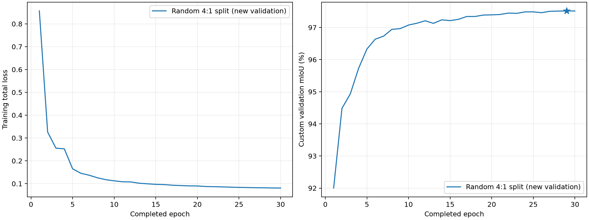

# 双 CNN：随机 4:1 划分后的完整测试对照

新实验从旧训练原图和 Moon_5 原图组成的 8002 张池中按来源随机划分：6401 张训练原图、1601 张验证原图；另加仅来自新训练来源的 1500 张撞击坑增强和 1500 张山岩增强，训练共 9401 张。验证集不含增强，同一原图来源及其增强不会跨训练/验证集。Moon_2/4/9 未进入训练或验证。

**新旧验证口径不同，验证 mIoU 不能直接比较。** 旧参考用完整 Moon_5 的 1599 张选轮；新实验仅按 1601 张多场景验证集汇总混淆矩阵的 `validation.miou` 选第一个严格最高轮次，未按测试成绩选轮。

**测试成绩已经用于选择当前训练方案。** 下述 Moon_2/4/9 对照属于被查看并用于方案选择后的测试集，不能当作从未查看的留出集，也不能据一次结果证明划分或损失的因果收益。

## 实验与来源

新划分：[保存的完整清单](../selections/random80_seed42_20261112.json)；SHA256 `29da57bc3a846e5ae38ba8bd55919e8813f3da954695ffa53552d2e4094e7187`；划分种子 42。

方案选择记录：[JSON](../selections/random80_selected_recipe_20261112.json)；SHA256 `d220a0e0975c665712ec6577303de55b701accee4e9f6a9d6b977a6af6c4d707`。初始化模式为 `original_pretrained`。

|实验|训练图|验证口径|验证视角|完成轮次|最佳轮次|各自验证最佳 mIoU|
|---|---:|---|---|---:|---:|---:|
|旧参考 dual_region_hardpixel_control_8000_bs8|8000|完整 Moon_5，1599 张|hflip|10|10|88.0373%|
|新随机划分 dual_region_random80_1024|9401|多场景原图，1601 张|hflip|30|29|97.5166%|

上表两种验证分数仅分别证明各自的检查点选择，不作差值或排名。新验证集各场景张数：Moon_1 217、Moon_3 253、Moon_5 324、Moon_6 216、Moon_7 334、Moon_8 257。

新实验停止状态 `complete`，停止依据 `见summary`；[summary](../dual_region_random80_1024/summary.json)、[history](../dual_region_random80_1024/history.jsonl)、[配置](../dual_region_random80_1024/run_config.json)。

|设置|旧参考|新随机划分|
|---|---|---|
|输入尺寸|1024|1024|
|batch|8|8|
|梯度累积|1|1|
|冻结骨干轮数|3|3|
|骨干学习率|1e-05|1e-05|
|解码器学习率|0.0001|0.0001|
|困难像素权重|0.0|0.0|
|每图每方向配额|256|256|
|训练种子|42|42|

训练事实：`summary.status=complete`，实际跑满配置的 30 轮；不能将恢复监控后回放历史得到的早停判定写成实际早停。

监控曾中断：`ValueError: Early stopping requires complete 1601-image custom validation: /home/lzc/workspace/fenge/result/dual_region_random80_1024, epoch 1`；失败记录时间 `2026-11-11T17:45:22.266256+00:00`，流程恢复时间 `2026-11-12T01:14:29.127548+00:00`。

监控依据：[状态及恢复归档](../random80_monitor/state.json)；[对应配置](../../config/early_stopping_random80.json)。

恢复后的历史回放显示，当前耐心规则会在已完成第 29 轮时触发；这是回放结论，实际训练仍完成 30 轮，最佳检查点继续按验证历史选出的第 29 轮。[回放状态](../dual_region_random80_1024/early_stopping_monitor.json)。

## 相同 TTA 的完整 Moon_2/4/9 测试

两模型均使用各自已选定的同一个 best 检查点做 none 和 hflip 推理。每种视角均完整评估 Moon_2/4/9 的 1597/1320/2087 张，共 5004 张。指标由逐场景整数混淆矩阵独立重算：`S=(Moon_2 mIoU + Moon_4 mIoU + 2×Moon_9 mIoU)/4`。

|测试视角|模型|Moon_2 mIoU|Moon_4 mIoU|Moon_9 mIoU|加权 S|
|---|---|---:|---:|---:|---:|
|none|旧参考|92.6690%|91.3133%|84.2349%|88.1130%|
|none|新随机划分|93.6594%|93.4588%|84.9600%|89.2595%|
|none|新减旧（百分点）|+0.9904|+2.1456|+0.7251|+1.1465|
|hflip|旧参考|92.6765%|91.6236%|84.5855%|88.3678%|
|hflip|新随机划分|93.6525%|93.5798%|85.2437%|89.4299%|
|hflip|新减旧（百分点）|+0.9760|+1.9561|+0.6582|+1.0621|

旧方案选择时使用的测试视角为 `hflip`；该相同视角下新减旧的加权 S 为 **+1.0621 个百分点**。同时列出另一种相同视角对照，不用新旧不同 TTA 的成绩混算收益。

## 逐场景、五类和混淆变化

下表均为新减旧 IoU 的百分点变化；完整绝对 IoU、精确率、召回率见 metrics.csv。

|TTA|场景|mIoU|月壤|岩石|撞击坑|山体|天空|
|---|---|---:|---:|---:|---:|---:|---:|
|none|Moon_2|+0.9904|+0.0873|+1.5347|+1.5491|+1.7664|+0.0144|
|none|Moon_4|+2.1456|+0.1764|+1.1407|+3.2261|+6.1700|+0.0148|
|none|Moon_9|+0.7251|+0.2401|+3.9129|-7.1548|+6.6159|+0.0112|
|hflip|Moon_2|+0.9760|+0.0867|+1.5359|+1.5197|+1.7226|+0.0151|
|hflip|Moon_4|+1.9561|+0.1651|+1.1756|+2.7935|+5.6322|+0.0142|
|hflip|Moon_9|+0.6582|+0.2141|+3.2715|-6.4085|+6.2071|+0.0070|

主要关注的六个错分方向按真值→预测统计；负变化表示该方向错分像素减少。

|TTA|场景|方向|旧错分像素|新错分像素|新减旧像素|
|---|---|---|---:|---:|---:|
|none|Moon_2|月壤 → 山体|1,894,247|1,317,618|-576,629|
|none|Moon_2|山体 → 月壤|275,784|283,977|+8,193|
|none|Moon_2|撞击坑 → 月壤|2,424,344|2,186,657|-237,687|
|none|Moon_2|月壤 → 撞击坑|253,747|212,664|-41,083|
|none|Moon_2|山体 → 岩石|424,198|176,872|-247,326|
|none|Moon_2|岩石 → 山体|434,961|283,259|-151,702|
|none|Moon_4|月壤 → 山体|842,477|111,591|-730,886|
|none|Moon_4|山体 → 月壤|78,950|68,905|-10,045|
|none|Moon_4|撞击坑 → 月壤|3,254,864|2,800,860|-454,004|
|none|Moon_4|月壤 → 撞击坑|652,365|487,289|-165,076|
|none|Moon_4|山体 → 岩石|9,054|6,218|-2,836|
|none|Moon_4|岩石 → 山体|11,717|9,968|-1,749|
|none|Moon_9|月壤 → 山体|8,599,788|5,027,298|-3,572,490|
|none|Moon_9|山体 → 月壤|114,715|168,900|+54,185|
|none|Moon_9|撞击坑 → 月壤|5,857,266|8,699,150|+2,841,884|
|none|Moon_9|月壤 → 撞击坑|5,622,147|3,839,449|-1,782,698|
|none|Moon_9|山体 → 岩石|4,710,744|1,540,339|-3,170,405|
|none|Moon_9|岩石 → 山体|2,119,566|1,803,841|-315,725|
|hflip|Moon_2|月壤 → 山体|1,882,691|1,325,945|-556,746|
|hflip|Moon_2|山体 → 月壤|281,443|280,452|-991|
|hflip|Moon_2|撞击坑 → 月壤|2,443,432|2,214,709|-228,723|
|hflip|Moon_2|月壤 → 撞击坑|246,622|201,318|-45,304|
|hflip|Moon_2|山体 → 岩石|389,475|173,779|-215,696|
|hflip|Moon_2|岩石 → 山体|491,835|319,847|-171,988|
|hflip|Moon_4|月壤 → 山体|775,024|108,735|-666,289|
|hflip|Moon_4|山体 → 月壤|75,179|67,778|-7,401|
|hflip|Moon_4|撞击坑 → 月壤|3,167,477|2,771,281|-396,196|
|hflip|Moon_4|月壤 → 撞击坑|619,020|466,532|-152,488|
|hflip|Moon_4|山体 → 岩石|8,305|5,829|-2,476|
|hflip|Moon_4|岩石 → 山体|10,150|10,096|-54|
|hflip|Moon_9|月壤 → 山体|8,516,386|4,925,018|-3,591,368|
|hflip|Moon_9|山体 → 月壤|112,422|173,599|+61,177|
|hflip|Moon_9|撞击坑 → 月壤|5,924,002|8,510,967|+2,586,965|
|hflip|Moon_9|月壤 → 撞击坑|5,314,640|3,843,567|-1,471,073|
|hflip|Moon_9|山体 → 岩石|4,020,467|1,386,611|-2,633,856|
|hflip|Moon_9|岩石 → 山体|2,047,112|1,710,665|-336,447|

同一 `dual_region_hardpixel_control_8000_bs8` 检查点中，hflip 相对 none 的 S 变化为 +0.2548 个百分点；这仅是该检查点的推理视角对照。

同一 `dual_region_random80_1024` 检查点中，hflip 相对 none 的 S 变化为 +0.1704 个百分点；这仅是该检查点的推理视角对照。

## 新实验训练与验证曲线

曲线只展示新实验，避免将两种验证口径画成可直接比较的指标。训练损失和验证 mIoU 量纲不同。

|轮次|训练总损失|完整新验证 mIoU|骨干冻结|
|---|---:|---:|---|
|1|0.856731|92.0010%|True|
|2|0.325775|94.4834%|True|
|3|0.255295|94.9315%|True|
|4|0.252695|95.7280%|False|
|5|0.164951|96.3301%|False|
|6|0.145403|96.6360%|False|
|7|0.136782|96.7294%|False|
|8|0.125555|96.9422%|False|
|9|0.117373|96.9645%|False|
|10|0.112340|97.0759%|False|
|11|0.108224|97.1320%|False|
|12|0.107532|97.2087%|False|
|13|0.101883|97.1289%|False|
|14|0.099351|97.2385%|False|
|15|0.096927|97.2141%|False|
|16|0.095871|97.2539%|False|
|17|0.093201|97.3430%|False|
|18|0.091612|97.3426%|False|
|19|0.090187|97.3871%|False|
|20|0.089841|97.3928%|False|
|21|0.087469|97.4046%|False|
|22|0.086674|97.4483%|False|
|23|0.085675|97.4401%|False|
|24|0.084639|97.4857%|False|
|25|0.083564|97.4863%|False|
|26|0.083012|97.4613%|False|
|27|0.082207|97.5048%|False|
|28|0.081840|97.5100%|False|
|29|0.081093|97.5166%|False|
|30|0.080711|97.5137%|False|

## 复核与解释范围

- [逐类别绝对指标](metrics.csv)
- [完整混淆矩阵](confusion_matrices.csv)
- [新实验逐轮数据](history.csv)
- [机器可读分析与来源 SHA256](summary.json)

旧参考和新实验的训练样本数量、验证组成及可能的训练轨迹均不同；本次没有多种子重复或显著性检验。Moon_2/4/9 已用于方案选择，后续对比不再具有从未查看的留出评估含义；本地测试成绩也不等同于官方平台成绩。
